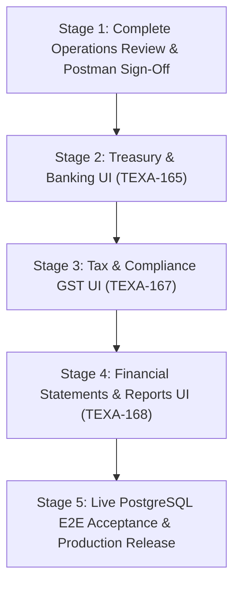

# TexaWave ERP — Finance Module: Comprehensive Integration Audit & Gap Closure Plan

**Audit Baseline Date:** October 24, 2026  
**Document Version:** 1.0.0  
**Tracking Tickets:** `TEXA-160` (Finance UI), `TEXA-154` (Finance Core Backend), `TEXA-163` (Operations UI), `TEXA-165` (Treasury UI), `TEXA-167` (GST UI), `TEXA-168` (Financial Reports UI)  
**Target Audience:** Engineering Leads, Product Architects, Finance Team

---

## 1. Executive Summary

This integration audit benchmarks the entire TexaOne Finance module across all 8 backend milestones and 6 primary UI sub-phases.

### Key Findings

1. **Operations Domain is 100% Functionally Complete and Unlocked:**
   - Operational Expenses & Employee Claims (`/finance/expenses`): Complete with dual sub-tabs, Add/Edit/Pay/Convert modals, and GL postings.
   - Customer Payments Received (`/finance/payments-received`): Complete with multi-invoice allocation engine, advance credit tracking, and printable receipts. The legacy green hero card was replaced with the TexaOne Prime Blue brand aesthetic.
   - Vendor Payments Made (`/finance/payments-made`): Complete with backend immutability guards, PO bill settlement, and printable disbursement vouchers.
2. **Accounting & General Ledger Core is Complete & Operational:**
   - Chart of Accounts (`/finance/accounts`): Hierarchical tree, active account CRUD, and category-level aggregation.
   - Journal Entries (`/finance/journal-entries`): Double-entry validation ($\sum \text{Debit} = \sum \text{Credit}$), draft staging, immutable posted entries, and reversal workflows (`REV-`).
   - General Ledger (`/finance/general-ledger`): Account-level ledger statement.
3. **Core Backend Capabilities Exist for Remaining Areas, but UI Sub-Phases are Missing:**
   - **Treasury & Banking (`TEXA-165`):** Complete backend API and 21 unit tests. UI feature module and route `/finance/banking` are **MISSING**.
   - **Tax & Compliance / GST (`TEXA-167`):** Complete backend API and 17 unit tests for GSTR-1, GSTR-3B, HSN summary, and ITC reconciliation. UI feature module and route `/finance/gst` are **MISSING**.
   - **Financial Reports (`TEXA-168`):** Complete backend API and 17 unit tests for P&L, Balance Sheet, Trial Balance, Cash/Bank Summary, and Period Closing Status. UI feature module and route `/finance/reports` are **MISSING**.
4. **Verification Status:**
   - Backend Unit Tests: **19 test files, 253 tests passing (100% passing)**.
   - Invariant Rules Tests: **10 tests passing (100% passing)**.
   - UI TypeScript Typecheck: **0 errors**.
   - UI ESLint: **0 errors, 0 warnings**.
   - API Production Build: **747 files compiled with SWC, 0 errors**.
   - Postman Manual API Testing: Customer Payments Received endpoints remain **PENDING USER VERIFICATION**.

---

## 2. Area-by-Area Status Matrix

| Finance Area               | Backend API Status         | Automated Unit Tests | UI Route & Feature                                    | Manual E2E Status                       | Overall Readiness         |
| :------------------------- | :------------------------- | :------------------- | :---------------------------------------------------- | :-------------------------------------- | :------------------------ |
| **Operational Expenses**   | Implemented (11 endpoints) | 35/35 Passed         | `/finance/expenses` (Active)                          | Pending Browser Acceptance              | **Ready for Review**      |
| **Payments Received**      | Implemented (8 endpoints)  | 47/47 Passed         | `/finance/payments-received` (Active)                 | **PENDING USER VERIFICATION** (Postman) | **Pending User Test**     |
| **Payments Made**          | Implemented (7 endpoints)  | 29/29 Passed         | `/finance/payments-made` (Active)                     | Pending Browser Acceptance              | **Ready for Review**      |
| **Chart of Accounts**      | Implemented (6 endpoints)  | 31/31 Passed         | `/finance/accounts` (Active)                          | Manually Verified                       | **Production-Ready**      |
| **Journal Entries & GL**   | Implemented (7 endpoints)  | 30/30 Passed         | `/finance/journal-entries`, `/finance/general-ledger` | Manually Verified                       | **Production-Ready**      |
| **Treasury & Banking**     | Implemented (10 endpoints) | 21/21 Passed         | Route `/finance/banking` **MISSING**                  | Unverified in UI                        | **Backend Only (UI Gap)** |
| **Tax & Compliance (GST)** | Implemented (8 endpoints)  | 17/17 Passed         | Route `/finance/gst` **MISSING**                      | Unverified in UI                        | **Backend Only (UI Gap)** |
| **Financial Reports**      | Implemented (6 endpoints)  | 17/17 Passed         | Route `/finance/reports` **MISSING**                  | Unverified in UI                        | **Backend Only (UI Gap)** |
| **Settings & Master List** | Implemented (6 endpoints)  | 9/9 Passed           | Integrated across all dialogs                         | Verified in Dialogs                     | **Production-Ready**      |
| **Sales & Purchase Sync**  | Implemented (4 endpoints)  | 11/11 Passed         | Internal Service Sync                                 | Loosely Coupled                         | **Operational**           |

---

## 3. UI Defect Correction: Payments Received Hero Banner

### Issue Description

The `/finance/payments-received` page previously featured a legacy green hero banner (`bg-linear-to-r from-[#4D9F4B] via-[#65a30d] to-[#72B84A]`) with lime text and buttons derived from the old Firebase ERP.

### Remediation Applied

In [`apps/ui/src/features/finance/payments-received/components/PaymentsReceivedView.tsx`](file:///c:/Users/skkin/OneDrive/Desktop/cooking%20area/Texawave_Erp_Production/apps/ui/src/features/finance/payments-received/components/PaymentsReceivedView.tsx):

- Replaced the green gradient with the unified TexaOne Prime Blue hero card:
  - Background: `bg-linear-to-r from-[#0a3271] via-[#1769F5] to-[#0284c7] dark:from-[#082352] dark:via-[#0e4cb8] dark:to-[#0369a1]`
  - Subtitle: `text-sky-100 font-medium`
  - Record Payment Button: White surface with `text-[#1769F5]` and `hover:bg-sky-50`
- Completely removed all references to `#4D9F4B` and lime accents.
- Verified visual harmony with the advance credit banner, filters toolbar, and data table.
- Verified with `pnpm --filter ui run typecheck` (0 errors) and ESLint (0 errors, 0 warnings).

---

## 4. Cross-Module Integrity & Critical Risk Audit

### Risk 1: Loose Integration with Sales Module (No Formal `SalesInvoice` Model)

- **Finding:** `FinancePaymentReceivedAllocation` records allocations against string `invoiceReference` fields rather than foreign keys to a `SalesInvoice` table.
- **Root Cause:** The database schema (`schema.prisma`) does not yet define a formal `SalesInvoice` model.
- **Accounting Impact:** Invoice balances are reconciled using string references; deleting or editing an external sales invoice outside the Finance module cannot trigger database cascade or trigger-level integrity checks.
- **Recommendation:** When the Sales team creates the `SalesInvoice` table, add an optional `salesInvoiceId Int?` foreign key with migration.

### Risk 2: One-Way Synchronization of Converted HR Expense Claims

- **Finding:** When an approved HR expense claim is converted to a finance expense via `POST /finance/expenses/from-claim/:claimId`, the Finance module sets `hrExpenseClaimId`, but the HR module's `ExpenseClaim` row retains status `APPROVED` without a back-pointer to the created finance expense.
- **Accounting Impact:** While duplicate conversion is blocked on the Finance side by a unique repository check, an HR employee looking at their claim portal sees `APPROVED` rather than `REIMBURSED` or `PAID`.
- **Recommendation:** Add a lightweight update to `ExpenseClaimsService` or emit an internal domain event `expense_claim.reimbursed` when `pay()` is executed on the linked finance expense.

### Risk 3: Treasury Outflows vs Bank Account Negative Balances

- **Finding:** In `BankingService.recordTransaction()`, debit and credit transactions update the bank balance (`openingBalance` $\pm$ `amount`).
- **Accounting Impact:** Overdraft protections or negative balance warnings are not strictly enforced at the database level. If disbursements exceed the real balance, the bank balance turns negative.
- **Recommendation:** Add an overdraft threshold warning in `RecordPaymentMadeDialog` and `AddExpenseDialog` when the selected bank account balance is insufficient.

### Risk 4: E2E Integration Test Execution Against Disposable Databases

- **Finding:** The NestJS API includes 6 comprehensive E2E test suites (`apps/api/test/*.e2e-spec.ts`). However, running `pnpm --filter api run test:e2e` aborts intentionally if `DATABASE_URL` does not point to a database containing `test` or `e2e` in its name.
- **Mitigation:** This is an intentional security guard in `test/support/e2e-setup.ts` preventing test fixtures from dropping or inserting test rows into developer/production databases. Developers must spin up `texawave_erp_test` to run E2E suites.

---

## 5. Prioritized Gap Closure Plan

### Phase 1: Treasury & Banking UI (`TEXA-165`) — Priority 1

- **Scope:** Unlock `/finance/banking`.
- **Deliverables:**
  1. Frontend feature module `apps/ui/src/features/finance/banking/`:
     - `api.ts`: Typed client for `/finance/bank-accounts` and `/finance/bank-transactions`.
     - `hooks.ts`: React Query hooks (`useBankAccounts`, `useBankTransactions`, `useReconcileTransaction`).
     - `schema.ts`: Zod validation for account numbers, IFSC codes, and statement imports.
     - `BankingView.tsx`: Bank account cards (showing real-time balances, account numbers, bank names), transactions ledger table, and statement reconciliation tab.
     - `AddBankAccountDialog.tsx`: Modal to register company bank accounts.
     - `RecordTransactionDialog.tsx`: Modal to manually record deposits/withdrawals/bank charges.
     - `ReconcileTransactionModal.tsx`: Dialog to match uncleared bank entries against statement lines.
  2. Route: `apps/ui/src/app/(dashboard)/finance/banking/page.tsx`.
  3. Navigation: Enable `banking` in `FinanceShell.tsx` and `HorizontalNavbar.tsx`.
- **Acceptance Criteria:**
  - Bank balances dynamically update upon expense disbursal and customer receipt confirmation.
  - Transactions table supports date-range, transaction type, and reconciliation status filtering.
  - Typecheck, ESLint, and 21 backend banking unit tests pass.

---

### Phase 2: Tax & Compliance / GST Returns UI (`TEXA-167`) — Priority 2

- **Scope:** Unlock `/finance/gst`.
- **Deliverables:**
  1. Frontend feature module `apps/ui/src/features/finance/gst/`:
     - `api.ts`: Typed client for GSTR-1, GSTR-3B, HSN summary, and ITC reconciliation endpoints.
     - `hooks.ts`: React Query hooks for period tax summaries and reconciliation records.
     - `GstView.tsx`: Multi-tab compliance center:
       - Tab 1: **GSTR-1 Outward Tax Summary** (B2B vs B2C breakdown, tax slabs).
       - Tab 2: **GSTR-3B Monthly Return** (Eligible ITC vs Outward Liability, Net Tax Payable).
       - Tab 3: **HSN / SAC Summary** (Taxable turnover and rate components).
       - Tab 4: **ITC Reconciliation (2B Matching)** (Matched, Unmatched, Missing in Books diff viewer).
  2. Route: `apps/ui/src/app/(dashboard)/finance/gst/page.tsx`.
  3. Navigation: Enable `gst` in `FinanceShell.tsx` and `HorizontalNavbar.tsx`.
- **Acceptance Criteria:**
  - Net tax liability matches formula: $\text{Payable} = \text{Output GST} - \text{Eligible ITC}$.
  - Proforma invoices are strictly excluded from outward liability.
  - Typecheck, ESLint, and 17 backend GST unit tests pass.

---

### Phase 3: Financial Statements & Reports UI (`TEXA-168`) — Priority 3

- **Scope:** Unlock `/finance/reports`.
- **Deliverables:**
  1. Frontend feature module `apps/ui/src/features/finance/reports/`:
     - `api.ts`: Typed client for P&L, Balance Sheet, Trial Balance, Cash/Bank Summary, and Period Closing.
     - `hooks.ts`: React Query hooks with date-range parameters.
     - `FinancialReportsView.tsx`: Financial reporting center with statement selector:
       - **Profit & Loss Statement:** Revenue minus Expenses, Gross Margin, Net Income.
       - **Balance Sheet:** Assets, Liabilities, and Equity (verifying $\text{Assets} = \text{Liabilities} + \text{Equity}$).
       - **Trial Balance:** Opening, Period Debits/Credits, Closing Balances.
       - **Cash & Bank Summary:** Period inflows, outflows, and net cash position.
       - **Period Closing Readiness Audit:** Checklist verifying zero unposted drafts, balanced debits/credits, and unreconciled bank items.
  2. Route: `apps/ui/src/app/(dashboard)/finance/reports/page.tsx`.
  3. Navigation: Enable reports sub-tab in `FinanceShell.tsx` and menu in `HorizontalNavbar.tsx`.
- **Acceptance Criteria:**
  - Balance Sheet accounting identity $\text{Assets} = \text{Liabilities} + \text{Equity}$ is strictly balanced.
  - Period closing checklist indicates blocking conditions before period close.
  - Printable / exportable layouts in Nunito Sans.
  - Typecheck, ESLint, and 17 backend reports unit tests pass.

---

## 6. Realistic Completion Estimates

| Milestone / Sub-Phase                               | Remaining Scope                                                                     | Complexity | Estimated Effort           |
| :-------------------------------------------------- | :---------------------------------------------------------------------------------- | :--------- | :------------------------- |
| **Customer Payments Received Postman Verification** | Manual user endpoint verification in Postman                                        | Low        | User-dependent             |
| **Treasury & Banking UI (`TEXA-165`)**              | Frontend module, account cards, transaction table, reconciliation modal, route      | Medium     | 1.5 – 2 days               |
| **Tax & Compliance GST UI (`TEXA-167`)**            | Frontend module, GSTR-1, GSTR-3B, HSN, ITC reconciliation diff screen, route        | Medium     | 1.5 – 2 days               |
| **Financial Reports UI (`TEXA-168`)**               | Frontend module, P&L, Balance Sheet, Trial Balance, Period Closing checklist, route | Medium     | 1.5 – 2 days               |
| **Cross-Module Verification & E2E Acceptance**      | Live PostgreSQL staging test, sales/HR link audit, final user sign-off              | Medium     | 1 – 1.5 days               |
| **Total Remaining Finance Module Effort**           | Full UI completion of Banking, GST, and Reports                                     | —          | **5.5 – 7.5 working days** |

**Current Overall Finance Module Completion:** **~75%** (100% of Backend, 100% of Accounting Core, 100% of Operations Domain, 0% of Banking/GST/Reports UI).
