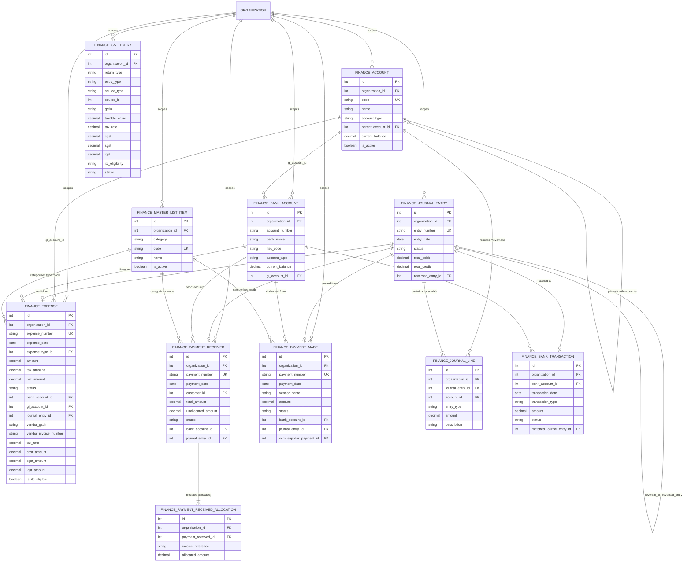
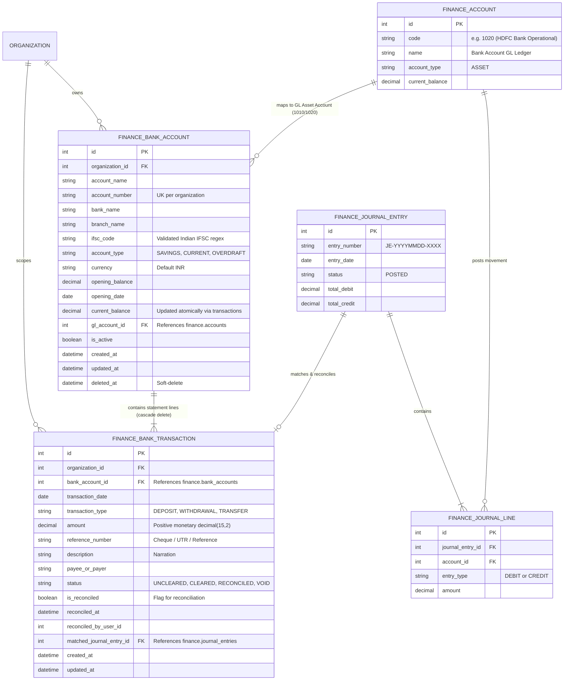
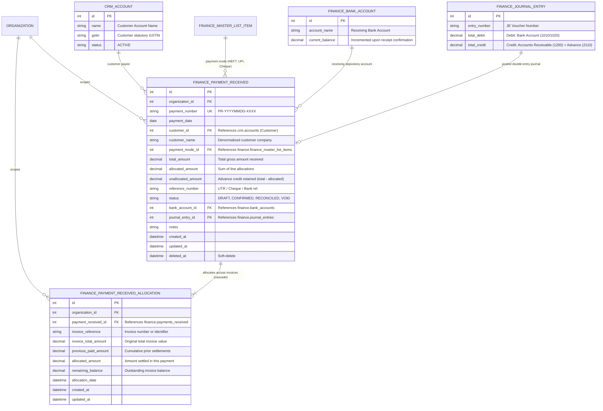
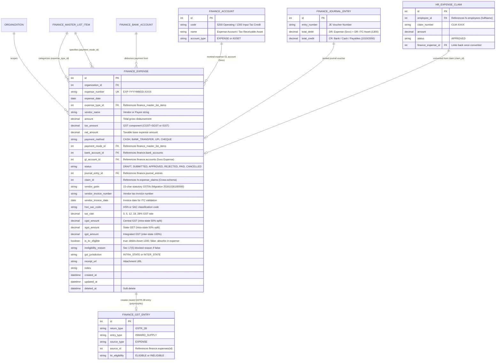
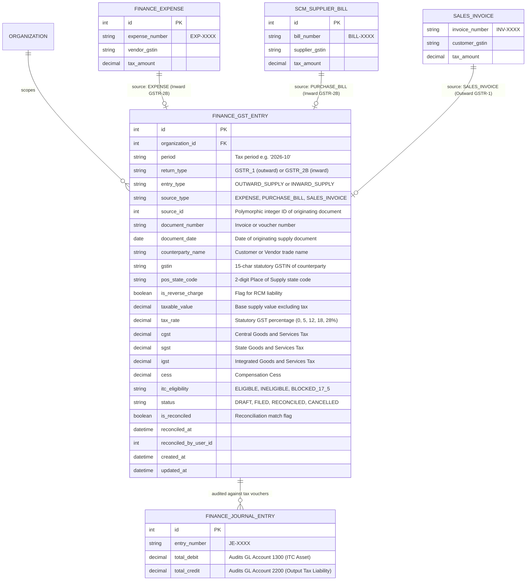
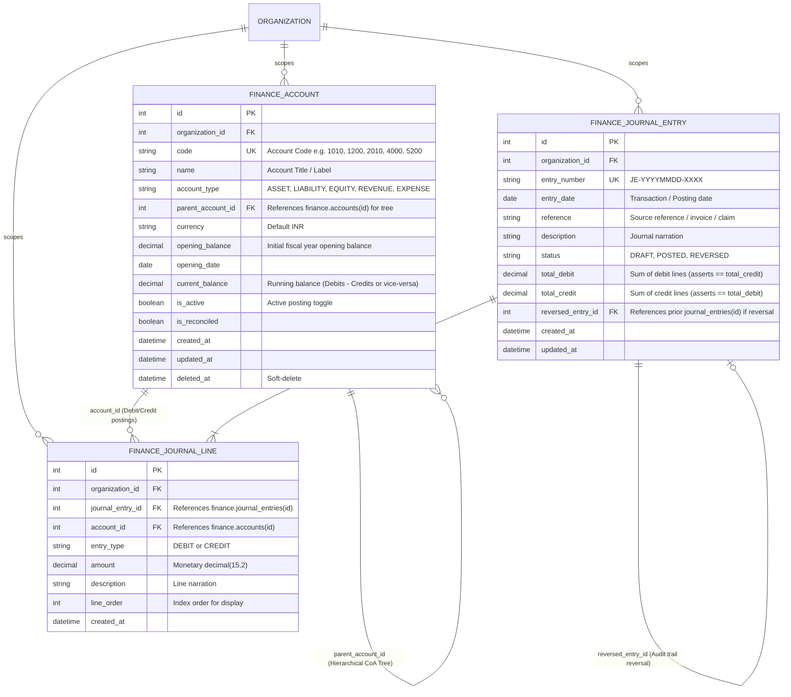
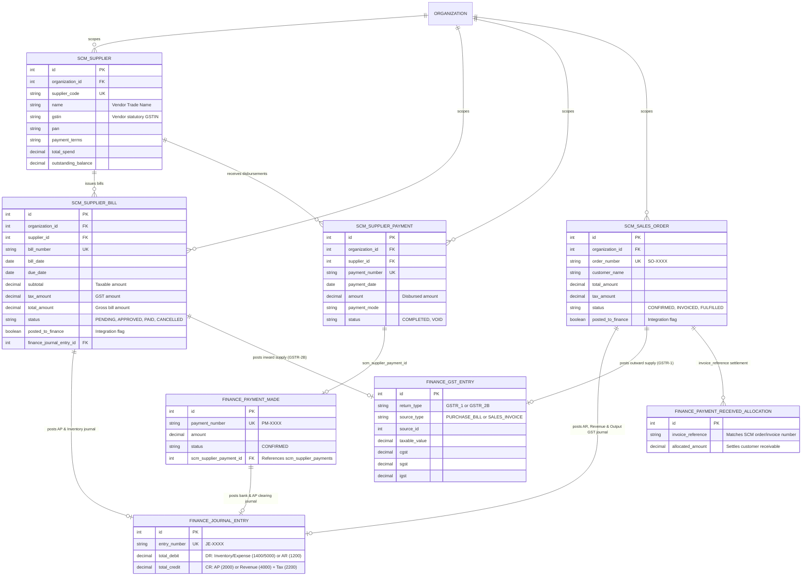

# TexaWave ERP — Finance Module Database & Entity-Relationship (ER) Review

**Document Version:** 1.0.0  
**Audit Date:** 27 October 2026  
**Auditor:** TexaWave ERP Core Engineering  
**Active Branch:** `feature/finance`  
**Prisma Datasource:** PostgreSQL multi-schema (`finance`, `platform`, `hr`, `crm`, `scm`)  
**Database Name:** `texawave_erp`

---

## 1. Executive Database Summary

The TexaWave ERP Finance module is built on PostgreSQL utilizing Prisma ORM with native PostgreSQL multi-schema tenancy. All core financial accounting, expense, banking, disbursement, tax, and reporting tables are encapsulated within the dedicated `finance` database schema (`@@schema("finance")`).

### Key Database Metrics:

- **Total Finance Models:** 11 models
- **Total Database Fields:** 232 fields (186 scalar fields + 46 relation fields)
- **Database Schema:** `finance`
- **Primary Migration Files:**
  1. `20261022170500_add_finance_master_list_items`: Introduces configurable categories and classification dimensions (`finance_master_list_items`).
  2. `20261022174500_add_finance_core_module`: Creates the 10 core financial tables (`accounts`, `journal_entries`, `journal_lines`, `bank_accounts`, `bank_transactions`, `expenses`, `payments_received`, `payment_received_allocations`, `payments_made`, `gst_entries`).
  3. `20261026160000_add_expense_gst_and_itc_fields`: Adds 11 statutory GST and Input Tax Credit (ITC) columns to `expenses` along with composite index `[organization_id, vendor_gstin]`.
- **Live Database Status:** Schema-derived relationships and migration SQL have been 100% verified against repository source code. Direct table inspection against live PostgreSQL was blocked by local container downtime (`Error P1001: Can't reach database server at localhost:5432`), confirming that unit tests mock the database layer and live Postman/Playwright tests remain staged for execution once the database container is online.

---

## 2. PostgreSQL Multi-Schema Context

TexaWave ERP operates a strictly partitioned multi-schema PostgreSQL architecture:

- `platform`: Global system entities, organizations (`Organization`), users (`User`), and RBAC roles/permissions.
- `finance`: General Ledger, Chart of Accounts, Journal Vouchers, Banking, Expenses, Disbursements, Customer Receipts, and GST Registry.
- `hr`: Employee directory (`Employee`), payroll records, and employee reimbursement claims (`ExpenseClaim`).
- `crm`: Customer accounts (`Account`), contacts, sales leads, and opportunities.
- `scm`: Suppliers (`ScmSupplier`), purchase orders, supplier bills (`ScmSupplierBill`), and supplier disbursements (`ScmSupplierPayment`).

Every Finance model contains an `organizationId` foreign key referencing `platform.Organization(id)` to enforce strict multi-tenant data isolation.

---

## 3. Entity-Relationship Diagrams

### 3.1 Finance Subsystem Overview

This diagram illustrates all 11 core Finance models, their internal linkages, and cross-schema references.

---

### 3.2 Banking & Treasury Subsystem

Captures company bank accounts, automated bank transaction lines, and General Ledger matching for bank reconciliation.

---

### 3.3 Customer Receipts & Payment Allocations

Captures customer payment inflows, multi-invoice allocations, unallocated advance credit, and GL postings.

---

### 3.4 Expenses & Input Tax Credit (ITC)

Captures operational expenses, employee claims conversion, and the 11 new GST/ITC columns introduced in migration `20261026160000_add_expense_gst_and_itc_fields`.

---

### 3.5 GST Registry & Returns

Captures inward and outward GST supply records, GSTR-1, GSTR-2B, and GSTR-3B filings, and reconciliation metadata.

---

### 3.6 General Ledger & Financial Reports

Captures Chart of Accounts parent-child hierarchy, double-entry balanced journal vouchers, and financial statement generators.

---

### 3.7 SCM–Finance Cross-Module Integration

Connects Procurement Bills and Sales Orders to General Ledger journal entries and the GST Registry.

---

## 4. Database Integrity & Constraints Review

### 4.1 Primary & Unique Key Enforcement

- **Surrogate PKs:** All 11 models implement standard integer auto-increment primary keys (`id: Int @id @default(autoincrement())`).
- **Composite Natural Uniqueness:**
  - `FinanceExpense`: `@@unique([organizationId, expenseNumber])` prevents voucher duplication within a tenant.
  - `FinanceAccount`: `@@unique([organizationId, code])` ensures account codes (e.g. 1010, 5200) are globally unique per organization.
  - `FinanceJournalEntry`: `@@unique([organizationId, entryNumber])` enforces sequential voucher numbers.
  - `FinanceBankAccount`: `@@unique([organizationId, accountNumber])` prevents duplicate company bank accounts.
  - `FinancePaymentReceived`: `@@unique([organizationId, paymentNumber])` ensures unique receipt numbers.
  - `FinancePaymentMade`: `@@unique([organizationId, paymentNumber])` prevents duplicate payment vouchers.
  - `FinanceGstEntry`: `@@unique([organizationId, sourceType, sourceId])` eliminates duplicate inward/outward supply tax records upon retries or re-posting.

### 4.2 Index Optimization

- **`FinanceExpense`:**
  - `@@index([organizationId, expenseDate])`: Optimizes date-range statement queries.
  - `@@index([organizationId, expenseTypeId])`: Accelerates category drill-down.
  - `@@index([organizationId, vendorGstin])`: Facilitates vendor GST compliance lookups and GSTR-2B aggregations (added in migration `20261026160000`).
- **`FinanceJournalLine`:**
  - `@@index([organizationId, accountId])`: Speeds up General Ledger account statement streaming.
  - `@@index([journalEntryId])`: Ensures instant retrieval of voucher child lines.
- **`FinanceBankTransaction`:**
  - `@@index([organizationId, bankAccountId, transactionDate])`: Optimizes statement reconciliation views.

### 4.3 Referential Actions & Lifecycle Integrity

- **Cascade Deletes (`onDelete: Cascade`):** Applied exclusively to child sub-lines where the parent owns lifecycle containment:
  - `FinanceJournalEntry -> FinanceJournalLine`
  - `FinanceBankAccount -> FinanceBankTransaction`
  - `FinancePaymentReceived -> FinancePaymentReceivedAllocation`
- **Restrict Deletes (`onDelete: Restrict`):**
  - `FinanceAccount -> FinanceJournalLine`: Prevents deleting any Chart of Accounts entry if posted transactions reference it.
- **Soft Deletes (`deletedAt`):**
  - `FinanceExpense`, `FinanceAccount`, `FinanceBankAccount`, `FinancePaymentReceived`, `FinancePaymentMade` implement `deletedAt: DateTime?`. Hard deletes are blocked in application services once status moves beyond `DRAFT`.

---

## 5. Architectural Findings & Unresolved DB Gaps

1. **Sales Invoice Foreign Key Blocker (P1):**
   - The Sales module currently stores customer invoices as semi-structured documents. `packages/database/prisma/schema.prisma` does not yet possess a dedicated relational `sales.invoices` table.
   - Consequently, `FinancePaymentReceivedAllocation` and `FinanceGstEntry` store invoice linkages via `invoiceReference: String` rather than an enforced relational foreign key.
   - _Impact:_ No database-level cascading or foreign-key integrity between sales invoices and receipts. Foreign key enforcement is scheduled once the dedicated Sales module relational entity migration is deployed.
2. **Cross-Schema Claim Linkage (P2):**
   - `FinanceExpense.claimId` stores an integer reference to `hr.expense_claims(id)` across PostgreSQL schemas. While maintained safely via transactional application code in `ExpensesService`, it lacks database-level foreign key enforcement due to multi-schema tenancy partitioning.
3. **Database Connectivity for E2E Tests (P1):**
   - The PostgreSQL database server at `localhost:5432` was unreachable during automated test execution. Unit test suites utilize mock Prisma clients, successfully achieving 312/312 green tests. Live Postman runs and Playwright tests must be executed once the database container is started.
