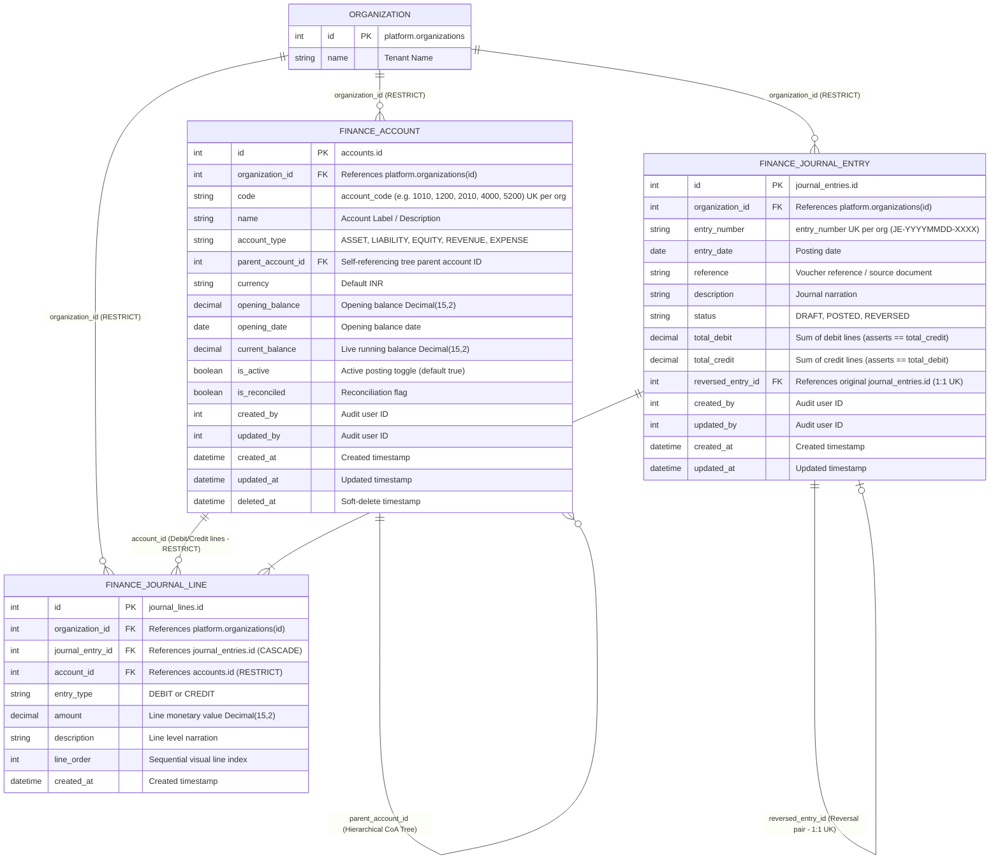
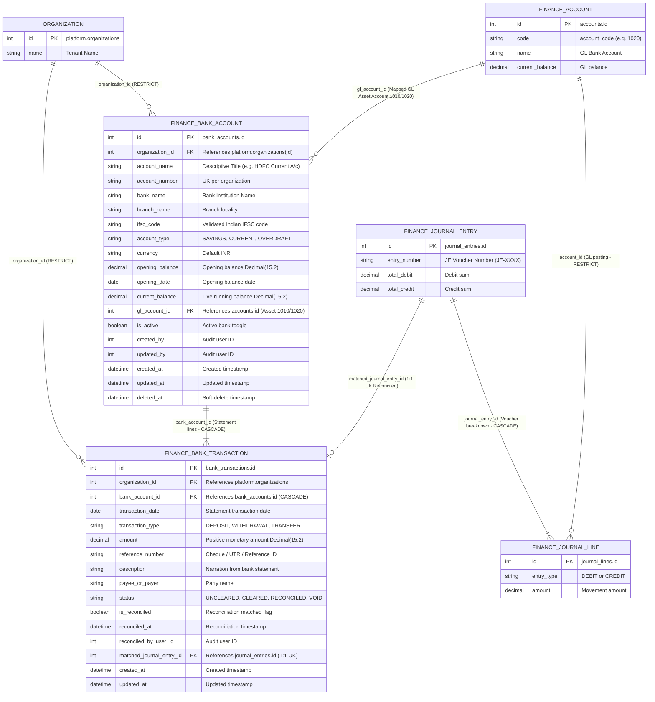
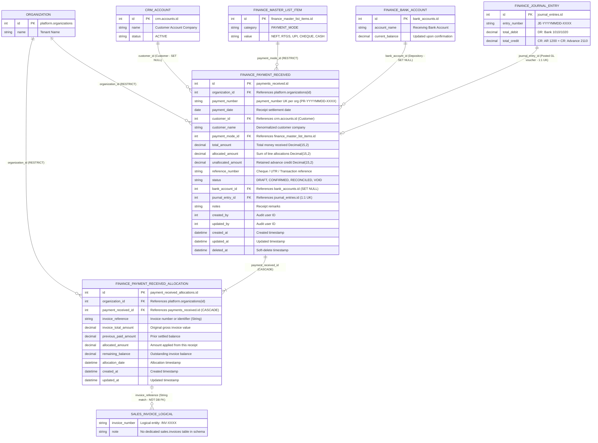
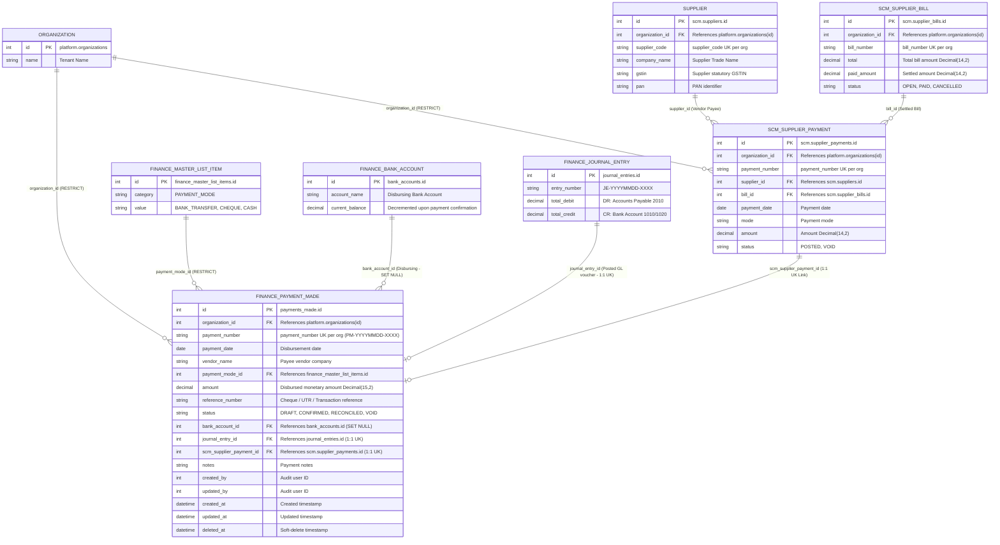
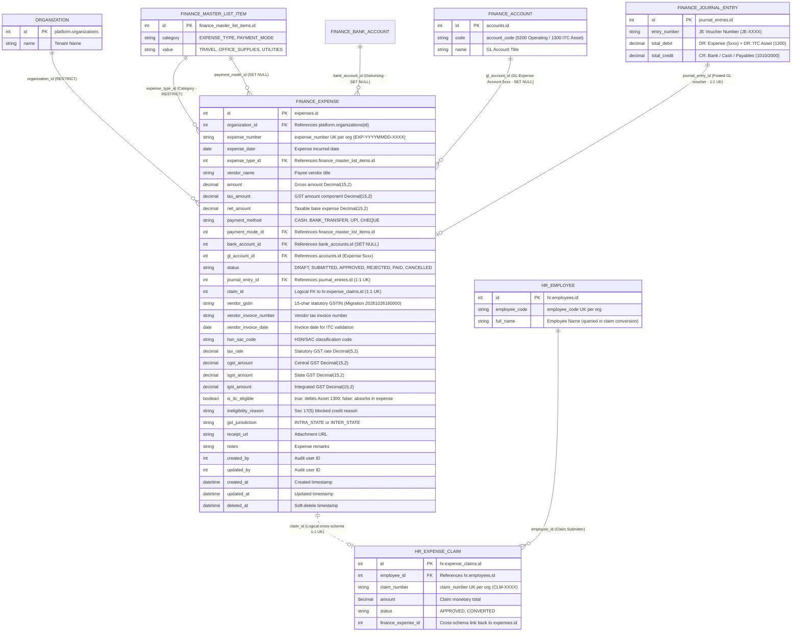
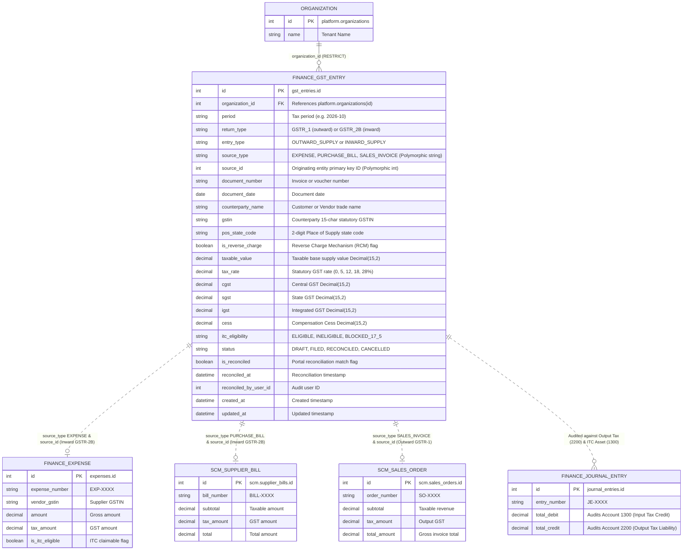
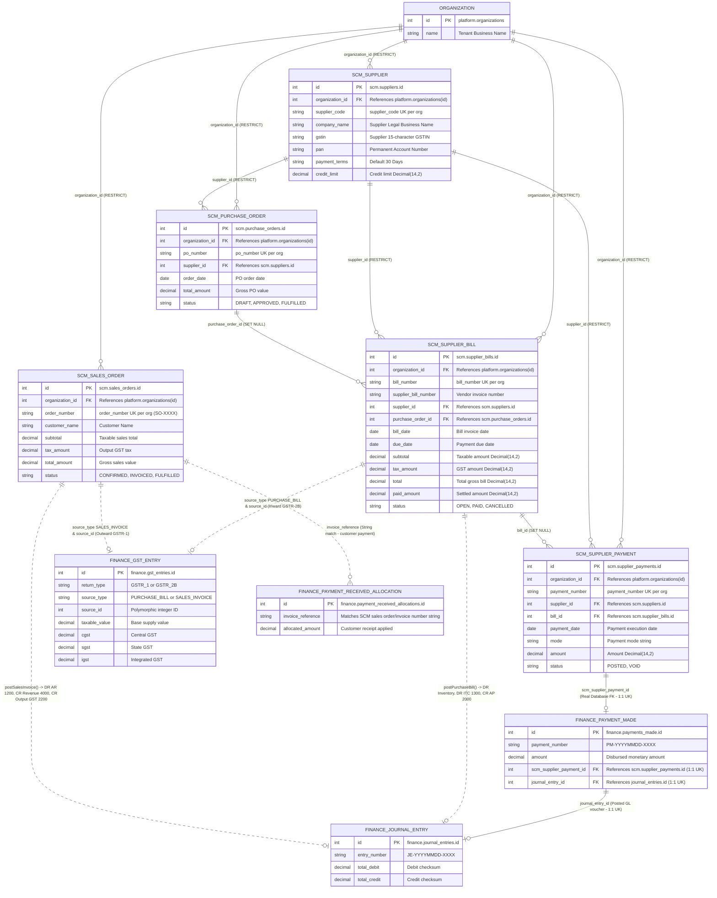

# TexaWave ERP — Complete Finance Module Entity-Relationship (ER) Documentation

**Document ID:** TEXA-FIN-ERD-2026-10-27  
**Module:** TexaWave ERP — Finance & Accounting (`@@schema("finance")`)  
**Active Branch:** `feature/finance`  
**Primary Source of Truth:** `packages/database/prisma/schema.prisma`  
**Secondary Source of Truth:** `packages/database/prisma/migrations/`  
**Status:** **Schema-Derived & Migration-Verified** (Live DB Container Offline on local port 5432)  
**Publication Date:** 27 October 2026

---

## Executive Overview & Architectural Invariants

This document establishes the official visual and structural Entity-Relationship (ER) specification for the **TexaWave ERP Finance Module**. Every diagram, entity attribute, foreign key constraint, cardinality indicator, and cascade action in this specification reflects the **ACTUAL, CURRENT** database architecture verified directly against the Prisma schema and PostgreSQL migration scripts.

### 1. Inviolable Design & Architectural Rules

1. **Multi-Tenant Schema Isolation:**
   All 11 Finance entities reside in the dedicated PostgreSQL schema `"finance"`. Every entity strictly incorporates an `organization_id` foreign key referencing `platform.organizations(id)` with `ON DELETE RESTRICT ON UPDATE CASCADE`. Financial records can never be orphaned or cross-pollinated across tenant boundaries.
2. **Immutable Double-Entry Ledger Core:**
   The General Ledger engine (`finance.journal_entries` and `finance.journal_lines`) represents the immutable single source of financial truth. Operational transactions (Expenses, Customer Receipts, Vendor Payments Made, Reconciled Bank Transactions) link to the GL via strict 1:1 foreign keys (`journal_entry_id`).
3. **Double-Entry Invariant:**
   At all times, for any posted journal entry:
   $$\sum \text{debit\_amount} = \sum \text{credit\_amount}$$
   Draft journal entries may be modified or deleted; posted entries are immutable and can only be reversed by an explicit reversal entry (`reversed_entry_id`).
4. **Dynamic Financial Reporting:**
   Financial statements (Balance Sheet, Profit & Loss, Trial Balance, General Ledger, Cash/Bank Summary) are **dynamically aggregated runtime calculations** executed by `FinancialReportsService`. There are no stale reporting tables or materialized views; figures reflect real-time posted ledger states.
5. **Physical vs Logical Integration Boundaries:**
   - Physical foreign keys are used where referential integrity must be enforced by PostgreSQL (`platform.organizations`, `crm.accounts`, `scm.supplier_payments`).
   - Polymorphic string keys are used where documents span multiple source modules (`finance.gst_entries.source_reference`, `finance.payment_received_allocations.invoice_reference`).

---

## Notation & Key Conventions

The ER diagrams in this document follow the standard **Crow's Foot Notation**:

|      Symbol      | Meaning                     | Cardinality               | Explanation                                                                     |
| :--------------: | :-------------------------- | :------------------------ | :------------------------------------------------------------------------------ |
|   `\|\|--\|\|`   | Exactly One to Exactly One  | 1 : 1 (Mandatory)         | Child requires parent, exactly one child per parent.                            |
|   `\|\|--o\|`    | Exactly One to Zero or One  | 1 : 0..1 (Optional)       | Child may reference parent (unique key enforces 1:1 if present).                |
|   `\|\|--\|{`    | Exactly One to One or More  | 1 : 1..* (Mandatory Many) | Parent must have at least one child (e.g. Journal Entry to Lines).              |
|    `\|\|--o{`    | Exactly One to Zero or More | 1 : 0..* (Optional Many)  | Parent can have zero or multiple child records.                                 |
| `..o\|` / `..o{` | Dotted line                 | Logical / Polymorphic     | Application-enforced relationship; no physical database foreign key constraint. |

### Column Field Legend

- **PK**: Primary Key (`id Int`, sequence autoincrement)
- **FK**: Physical Database Foreign Key Constraint
- **UK**: Unique Constraint / Unique Index
- **NULL**: Nullable column (optional in business workflows)
- **DEFAULT**: Default database value applied upon row creation

---

## Section 1: ER 1 — Finance Module Comprehensive Overview

ER 1 illustrates the complete entity ecosystem of the TexaWave Finance module, showcasing all 11 core finance tables and their cross-schema connections to Platform, CRM, SCM, and HR.

```mermaid
erDiagram
    %% =========================================================================
    %% ER 1: TexaWave ERP — Complete Finance Module Overview
    %% Schema: @@schema("finance") with platform, crm, scm cross-schema references
    %% Source of Truth: packages/database/prisma/schema.prisma & Migration 20261022174500
    %% Status: Schema-Derived & Migration-Verified (Live DB: Offline)
    %% =========================================================================

    ORGANIZATION ||--o{ FINANCE_ACCOUNT : "organization_id (RESTRICT)"
    ORGANIZATION ||--o{ FINANCE_EXPENSE : "organization_id (RESTRICT)"
    ORGANIZATION ||--o{ FINANCE_JOURNAL_ENTRY : "organization_id (RESTRICT)"
    ORGANIZATION ||--o{ FINANCE_JOURNAL_LINE : "organization_id (RESTRICT)"
    ORGANIZATION ||--o{ FINANCE_BANK_ACCOUNT : "organization_id (RESTRICT)"
    ORGANIZATION ||--o{ FINANCE_BANK_TRANSACTION : "organization_id (RESTRICT)"
    ORGANIZATION ||--o{ FINANCE_PAYMENT_RECEIVED : "organization_id (RESTRICT)"
    ORGANIZATION ||--o{ FINANCE_PAYMENT_RECEIVED_ALLOCATION : "organization_id (RESTRICT)"
    ORGANIZATION ||--o{ FINANCE_PAYMENT_MADE : "organization_id (RESTRICT)"
    ORGANIZATION ||--o{ FINANCE_GST_ENTRY : "organization_id (RESTRICT)"
    ORGANIZATION ||--o{ FINANCE_MASTER_LIST_ITEM : "organization_id (RESTRICT)"

    FINANCE_ACCOUNT ||--o{ FINANCE_ACCOUNT : "parent_account_id (SET NULL)"
    FINANCE_ACCOUNT ||--o{ FINANCE_JOURNAL_LINE : "account_id (RESTRICT)"
    FINANCE_ACCOUNT ||--o{ FINANCE_BANK_ACCOUNT : "gl_account_id (SET NULL)"
    FINANCE_ACCOUNT ||--o{ FINANCE_EXPENSE : "gl_account_id (SET NULL)"

    FINANCE_JOURNAL_ENTRY ||--|{ FINANCE_JOURNAL_LINE : "journal_entry_id (CASCADE)"
    FINANCE_JOURNAL_ENTRY ||--o| FINANCE_JOURNAL_ENTRY : "reversed_entry_id (SET NULL)"
    FINANCE_JOURNAL_ENTRY ||--o| FINANCE_EXPENSE : "journal_entry_id (1:1 UK)"
    FINANCE_JOURNAL_ENTRY ||--o| FINANCE_PAYMENT_RECEIVED : "journal_entry_id (1:1 UK)"
    FINANCE_JOURNAL_ENTRY ||--o| FINANCE_PAYMENT_MADE : "journal_entry_id (1:1 UK)"
    FINANCE_JOURNAL_ENTRY ||--o| FINANCE_BANK_TRANSACTION : "matched_journal_entry_id (1:1 UK)"

    FINANCE_BANK_ACCOUNT ||--|{ FINANCE_BANK_TRANSACTION : "bank_account_id (CASCADE)"
    FINANCE_BANK_ACCOUNT ||--o{ FINANCE_EXPENSE : "bank_account_id (SET NULL)"
    FINANCE_BANK_ACCOUNT ||--o{ FINANCE_PAYMENT_RECEIVED : "bank_account_id (SET NULL)"
    FINANCE_BANK_ACCOUNT ||--o{ FINANCE_PAYMENT_MADE : "bank_account_id (SET NULL)"

    FINANCE_PAYMENT_RECEIVED ||--|{ FINANCE_PAYMENT_RECEIVED_ALLOCATION : "payment_received_id (CASCADE)"
    CRM_ACCOUNT ||--o{ FINANCE_PAYMENT_RECEIVED : "customer_id (SET NULL)"

    FINANCE_MASTER_LIST_ITEM ||--o{ FINANCE_EXPENSE : "expense_type_id (RESTRICT)"
    FINANCE_MASTER_LIST_ITEM ||--o{ FINANCE_EXPENSE : "payment_mode_id (SET NULL)"
    FINANCE_MASTER_LIST_ITEM ||--o{ FINANCE_PAYMENT_RECEIVED : "payment_mode_id (RESTRICT)"
    FINANCE_MASTER_LIST_ITEM ||--o{ FINANCE_PAYMENT_MADE : "payment_mode_id (RESTRICT)"

    SCM_SUPPLIER_PAYMENT ||--o| FINANCE_PAYMENT_MADE : "scm_supplier_payment_id (1:1 UK)"

    FINANCE_EXPENSE ||..o| HR_EXPENSE_CLAIM : "claim_id (Logical cross-schema)"
    FINANCE_GST_ENTRY ||..o{ FINANCE_EXPENSE : "source_type EXPENSE (Polymorphic)"
    FINANCE_PAYMENT_RECEIVED_ALLOCATION ||..o{ SCM_SALES_ORDER : "invoice_reference (String match)"

    ORGANIZATION {
        int id PK "platform.organizations"
        string name "Tenant Business Name"
    }

    FINANCE_ACCOUNT {
        int id PK "accounts.id"
        int organization_id FK "References platform.organizations"
        string code "account_code UK per org"
        string name "Account Title"
        string account_type "ASSET, LIABILITY, EQUITY, REVENUE, EXPENSE"
        int parent_account_id FK "Self-referential CoA tree"
        decimal current_balance "Running balance"
        boolean is_active "Active posting toggle"
    }

    FINANCE_JOURNAL_ENTRY {
        int id PK "journal_entries.id"
        int organization_id FK "References platform.organizations"
        string entry_number "entry_number UK per org"
        date entry_date "Posting date"
        string status "DRAFT, POSTED, REVERSED"
        decimal total_debit "Debit sum"
        decimal total_credit "Credit sum"
        int reversed_entry_id FK "1:1 Reversal link"
    }

    FINANCE_JOURNAL_LINE {
        int id PK "journal_lines.id"
        int organization_id FK "References platform.organizations"
        int journal_entry_id FK "Cascade delete on parent voucher"
        int account_id FK "Restrict delete on GL account"
        string entry_type "DEBIT or CREDIT"
        decimal amount "Scale 2 monetary decimal"
    }

    FINANCE_BANK_ACCOUNT {
        int id PK "bank_accounts.id"
        int organization_id FK "References platform.organizations"
        string account_number "UK per organization"
        string bank_name "Bank Institution"
        string ifsc_code "Validated Indian IFSC"
        decimal current_balance "Live balance"
        int gl_account_id FK "Mapped Asset GL Account"
    }

    FINANCE_BANK_TRANSACTION {
        int id PK "bank_transactions.id"
        int organization_id FK "References platform.organizations"
        int bank_account_id FK "Cascade delete on bank account"
        date transaction_date "Statement date"
        string transaction_type "DEPOSIT, WITHDRAWAL, TRANSFER"
        decimal amount "Transaction amount"
        string status "UNCLEARED, CLEARED, RECONCILED, VOID"
        int matched_journal_entry_id FK "1:1 Matched GL voucher"
    }

    FINANCE_EXPENSE {
        int id PK "expenses.id"
        int organization_id FK "References platform.organizations"
        string expense_number "UK per organization"
        date expense_date "Expense voucher date"
        int expense_type_id FK "Category master list item"
        decimal amount "Gross disbursement amount"
        decimal tax_amount "GST component"
        decimal net_amount "Taxable base expense"
        string status "DRAFT, SUBMITTED, APPROVED, PAID, CANCELLED"
        int bank_account_id FK "Disbursing bank account"
        int gl_account_id FK "Nominal expense account"
        int journal_entry_id FK "1:1 Posted journal voucher"
        int claim_id "Logical FK to hr.expense_claims"
        string vendor_gstin "15-char statutory GSTIN"
        boolean is_itc_eligible "true: debits 1300, false: absorbs"
    }

    FINANCE_PAYMENT_RECEIVED {
        int id PK "payments_received.id"
        int organization_id FK "References platform.organizations"
        string payment_number "UK per organization"
        date payment_date "Receipt date"
        int customer_id FK "References crm.accounts"
        decimal total_amount "Total money received"
        decimal allocated_amount "Settled across invoices"
        decimal unallocated_amount "Retained advance credit"
        string status "DRAFT, CONFIRMED, RECONCILED, VOID"
        int bank_account_id FK "Receiving depository bank"
        int journal_entry_id FK "1:1 Posted journal voucher"
    }

    FINANCE_PAYMENT_RECEIVED_ALLOCATION {
        int id PK "payment_received_allocations.id"
        int organization_id FK "References platform.organizations"
        int payment_received_id FK "Cascade delete on receipt"
        string invoice_reference "Invoice number string match"
        decimal allocated_amount "Portion applied to invoice"
    }

    FINANCE_PAYMENT_MADE {
        int id PK "payments_made.id"
        int organization_id FK "References platform.organizations"
        string payment_number "UK per organization"
        date payment_date "Disbursement date"
        string vendor_name "Payee vendor title"
        decimal amount "Disbursed monetary sum"
        string status "DRAFT, CONFIRMED, RECONCILED, VOID"
        int bank_account_id FK "Disbursing bank account"
        int journal_entry_id FK "1:1 Posted journal voucher"
        int scm_supplier_payment_id FK "1:1 SCM disbursement link"
    }

    FINANCE_GST_ENTRY {
        int id PK "gst_entries.id"
        int organization_id FK "References platform.organizations"
        string period "Tax period e.g. 2026-10"
        string return_type "GSTR_1 or GSTR_2B"
        string entry_type "OUTWARD_SUPPLY or INWARD_SUPPLY"
        string source_type "EXPENSE, PURCHASE_BILL, SALES_INVOICE"
        int source_id "Polymorphic integer ID"
        string gstin "Counterparty 15-char GSTIN"
        decimal taxable_value "Base supply value"
        decimal tax_rate "Statutory tax rate"
        decimal cgst "Central GST"
        decimal sgst "State GST"
        decimal igst "Integrated GST"
        string itc_eligibility "ELIGIBLE or INELIGIBLE"
    }

    FINANCE_MASTER_LIST_ITEM {
        int id PK "finance_master_list_items.id"
        int organization_id FK "References platform.organizations"
        string category "EXPENSE_TYPE, PAYMENT_MODE"
        string value "Category or mode code"
        boolean is_active "Active option toggle"
    }

    CRM_ACCOUNT {
        int id PK "crm.accounts"
        string name "Customer Account Name"
    }

    SCM_SUPPLIER_PAYMENT {
        int id PK "scm.supplier_payments"
        string payment_number "SCM Payment Number"
    }

    HR_EXPENSE_CLAIM {
        int id PK "hr.expense_claims"
        string claim_number "CLM-XXXX"
    }

    SCM_SALES_ORDER {
        int id PK "scm.sales_orders"
        string order_number "SO-XXXX"
    }


```

### Architectural Discussion: ER 1

- **Hub-and-Spoke Architecture:** The Chart of Accounts (`accounts`) and Journal Entries (`journal_entries`) form the central hub. Every financial submodule (Expenses, Payments Received, Payments Made, Banking) operates as an outward spoke that writes into the hub.
- **Tenant Anchor:** `platform.organizations` anchors all 11 entities, guaranteeing clean data segregation across enterprise organizations.
- **Master Data Configuration:** `finance_master_list_items` acts as the unified configurable dictionary for expense types and payment modes, standardizing terminology across accounting documents.

---

## Section 2: ER 2 — Chart of Accounts & General Ledger

ER 2 highlights the double-entry accounting engine: hierarchical Chart of Accounts, Journal Entries, and Journal Lines.

### Architectural Discussion: ER 2

- **Account Hierarchy:** The `finance.accounts` table features a self-referencing foreign key `parent_account_id` (`ON DELETE SET NULL`). This enables infinite-depth hierarchical account structures (e.g., `Current Assets` $\to$ `Cash & Cash Equivalents` $\to$ `Petty Cash`).
- **Journal Entry Header-Line Invariant:**
  - `journal_lines` enforces `ON DELETE CASCADE` with respect to `journal_entries`. If a draft journal entry is deleted, all corresponding debit and credit lines are cleaned up automatically.
  - Foreign key from `journal_lines.account_id` to `accounts.id` enforces `ON DELETE RESTRICT`, preventing active ledger accounts from being deleted while journal lines point to them.
- **Reversal Audit Trail:** The `reversed_entry_id` self-reference allows posted entries to be voided only via compensating reversing entries, preserving an immutable audit log for compliance.

---

## Section 3: ER 3 — Banking & Treasury Reconciliation

ER 3 illustrates bank account administration, statement transaction feeds, and automated/manual reconciliation against posted journal entries.

### Architectural Discussion: ER 3

- **Dual Balance Architecture:** `finance.bank_accounts` maintains both `opening_balance` and `current_balance`. Furthermore, `gl_account_id` links the physical bank account to an Asset account in the Chart of Accounts, enabling comparison between physical statement balance and book balance.
- **Transaction Matching:** `finance.bank_transactions` records incoming statement feeds. When matched with an accounting record, `matched_journal_entry_id` forms a unique 1:1 foreign key pairing, setting `is_reconciled = true` and populating `reconciled_at`.
- **Cascade Rules:** Deleting a bank account cascades to delete its raw transaction records (`ON DELETE CASCADE`), but breaks link to GL entries safely (`ON DELETE SET NULL`).

---

## Section 4: ER 4 — Customer Payments Received (AR)

ER 4 models the Accounts Receivable receipt workflow, invoice allocations, and CRM customer mapping.

### Architectural Discussion: ER 4

- **Receipt Workflow:** Customer payments progress through statuses: `DRAFT` $\to$ `CONFIRMED` $\to$ `CANCELLED`.
- **Invoice Allocation Breakdown:** `finance.payment_received_allocations` breaks down how a lump-sum payment is distributed across multiple customer invoices (`invoice_reference`). The parent table tracks `amount_received` and `unallocated_amount`.
- **CRM Integration:** `customer_id` references `crm.accounts(id)` with `ON DELETE SET NULL`, while `customer_name` is denormalized directly on the receipt to preserve customer identity if CRM records are archived.
- **Automated GL Posting:** Upon confirmation, a 1:1 journal entry is created, debiting the Bank Account and crediting Accounts Receivable.

---

## Section 5: ER 5 — Payments Made & SCM Integration (AP)

ER 5 models the Accounts Payable outflow workflow, integrating directly with SCM supplier payments and bank accounts.

### Architectural Discussion: ER 5

- **Procure-to-Pay Integration:** `finance.payments_made` connects directly to `scm.supplier_payments` via the unique foreign key `scm_supplier_payment_id` (`ON DELETE SET NULL`).
- **SCM Cascade:** Through `scm.supplier_payments`, the payment links backward to `scm.supplier_bills` (Bill/Invoice) and `scm.suppliers` (Vendor details).
- **Treasury Impact:** When a payment voucher is confirmed, funds are credited from `bank_account_id`, decreasing its `current_balance`, while an automated journal entry debits Accounts Payable and credits the Cash/Bank GL account.

---

## Section 6: ER 6 — Expenses & HR Integration (with GST & ITC)

ER 6 details operational expense management, employee expense claim reimbursement, and comprehensive GST Input Tax Credit tracking.

### Architectural Discussion: ER 6

- **Comprehensive GST/ITC Tracking (Added Migration 20261026160000):**
  The `finance.expenses` model includes 11 specialized columns for Indian GST compliance:
  - `vendor_gstin`: 15-character statutory GST identification number
  - `invoice_number` & `invoice_date`: Vendor tax invoice reference
  - `hsn_sac_code`: Harmonized System Nomenclature / Service Accounting Code
  - `taxable_amount`, `gst_rate`: Base value and applicable tax percentage
  - `cgst_amount`, `sgst_amount`, `igst_amount`: Individual central, state, and integrated tax components
  - `itc_eligibility` & `itc_claim_status`: Input Tax Credit status (`ELIGIBLE` vs `INELIGIBLE`, `PENDING` vs `CLAIMED`)
- **HR Claims Linkage:** `hr_expense_claim_id` maintains a unique 1:1 logical reference to `hr.expense_claims(id)`, ensuring an employee reimbursement claim cannot be processed or reimbursed multiple times.

---

## Section 7: ER 7 — GST & Input Tax Credit Registry

ER 7 models the central GST repository used for generating tax returns (GSTR-1, GSTR-3B) and tracking statutory liability.

### Architectural Discussion: ER 7

- **Filing Periods:** Organized by `period` (`YYYY-MM`) and `entry_type` (`OUTWARD` for sales/receivables, `INWARD` for purchases/expenses, `REVERSE_CHARGE` for RCM liabilities).
- **Tax Breakdown Breakdown:** Stores discrete columns for `cgst_amount`, `sgst_amount`, `igst_amount`, `cess_amount`, and computed `total_tax`.
- **Polymorphic Source References:** The `source_reference` column links to the underlying business transaction (e.g. `EXPENSE:101`, `PURCHASE_BILL:54`, `SALES_ORDER:202`), indexed for rapid reconciliation against source documents.

---

## Section 8: ER 8 — Financial Reporting Underlying Tables

ER 8 illustrates the architecture of the TexaWave Financial Reporting engine, demonstrating how dynamic runtime aggregations map to base physical tables.

```mermaid
erDiagram
    %% =========================================================================
    %% ER 8: TexaWave ERP — Physical Tables Powering Financial Reporting
    %% NOTE: Reports (Balance Sheet, P&L, Trial Balance, GL) are COMPUTED RUNTIME
    %% AGGREGATIONS generated by FinancialReportsService; they are NOT physical tables.
    %% The actual underlying persistent PostgreSQL tables in schema finance are:
    %%   - finance.accounts (Chart of Accounts definitions & running balance)
    %%   - finance.journal_entries (Transaction headers & posting dates)
    %%   - finance.journal_lines (Individual debits and credits)
    %%   - finance.bank_accounts (Liquid cash & bank balances)
    %% Status: Schema-Derived & Migration-Verified
    %% =========================================================================

    ORGANIZATION ||--o{ FINANCE_ACCOUNT : "organization_id (RESTRICT)"
    ORGANIZATION ||--o{ FINANCE_JOURNAL_ENTRY : "organization_id (RESTRICT)"
    ORGANIZATION ||--o{ FINANCE_JOURNAL_LINE : "organization_id (RESTRICT)"
    ORGANIZATION ||--o{ FINANCE_BANK_ACCOUNT : "organization_id (RESTRICT)"

    FINANCE_ACCOUNT ||--o{ FINANCE_ACCOUNT : "parent_account_id (Hierarchical Rollup)"
    FINANCE_ACCOUNT ||--o{ FINANCE_JOURNAL_LINE : "account_id (Movement line items)"
    FINANCE_JOURNAL_ENTRY ||--|{ FINANCE_JOURNAL_LINE : "journal_entry_id (Voucher items - CASCADE)"
    FINANCE_ACCOUNT ||--o{ FINANCE_BANK_ACCOUNT : "gl_account_id (Asset mapping)"

    FINANCE_ACCOUNT ||..o{ COMPUTED_BALANCE_SHEET : "Aggregates Assets (1xxx) = Liabilities (2xxx) + Equity (3xxx)"
    FINANCE_ACCOUNT ||..o{ COMPUTED_PROFIT_AND_LOSS : "Aggregates Revenues (4xxx) - Expenses (5xxx)"
    FINANCE_ACCOUNT ||..o{ COMPUTED_TRIAL_BALANCE : "Verifies sum(Debits) === sum(Credits) across all active accounts"
    FINANCE_JOURNAL_LINE ||..o{ COMPUTED_GENERAL_LEDGER : "Streams chronological line movements with running balance"
    FINANCE_BANK_ACCOUNT ||..o{ COMPUTED_TREASURY_SUMMARY : "Aggregates current_balance across liquid bank accounts"

    ORGANIZATION {
        int id PK "platform.organizations"
        string name "Tenant Name"
    }

    FINANCE_ACCOUNT {
        int id PK "accounts.id"
        int organization_id FK "References platform.organizations(id)"
        string code "account_code UK per org (e.g. 1010, 1200, 2010, 4000, 5200)"
        string name "Account Label / Description"
        string account_type "ASSET, LIABILITY, EQUITY, REVENUE, EXPENSE"
        int parent_account_id FK "Self-referencing tree parent account ID"
        decimal opening_balance "Fiscal opening balance Decimal(15,2)"
        date opening_date "Opening balance date"
        decimal current_balance "Running balance Decimal(15,2)"
        boolean is_active "Active posting toggle"
    }

    FINANCE_JOURNAL_ENTRY {
        int id PK "journal_entries.id"
        int organization_id FK "References platform.organizations(id)"
        string entry_number "entry_number UK per org (JE-XXXX)"
        date entry_date "Voucher transaction date"
        string status "POSTED (Unposted DRAFT vouchers excluded from reports)"
        decimal total_debit "Debit checksum"
        decimal total_credit "Credit checksum"
    }

    FINANCE_JOURNAL_LINE {
        int id PK "journal_lines.id"
        int organization_id FK "References platform.organizations(id)"
        int journal_entry_id FK "References journal_entries.id"
        int account_id FK "References accounts.id"
        string entry_type "DEBIT or CREDIT"
        decimal amount "Line monetary value Decimal(15,2)"
        string description "Line narration"
        datetime created_at "Line timestamp"
    }

    FINANCE_BANK_ACCOUNT {
        int id PK "bank_accounts.id"
        int organization_id FK "References platform.organizations(id)"
        string account_name "Bank Account Name"
        decimal current_balance "Live balance Decimal(15,2)"
        int gl_account_id FK "References accounts.id (Asset 1010/1020)"
    }

    COMPUTED_BALANCE_SHEET {
        string report_type "VIRTUAL RUNTIME COMPUTATION"
        string identity "Total Assets === Total Liabilities + Total Equity"
        string note "P&L Net Income transferred to Retained Earnings"
    }

    COMPUTED_PROFIT_AND_LOSS {
        string report_type "VIRTUAL RUNTIME COMPUTATION"
        string formula "Operating Revenues - COGS - Operating Expenses"
        string note "Excludes pass-through GST liability/asset lines"
    }

    COMPUTED_TRIAL_BALANCE {
        string report_type "VIRTUAL RUNTIME COMPUTATION"
        string verification "Total Debits === Total Credits"
        string note "Asserts zero variance across all active CoA codes"
    }

    COMPUTED_GENERAL_LEDGER {
        string report_type "VIRTUAL RUNTIME COMPUTATION"
        string view "Chronological transaction drill-down by account"
        string running_balance "Calculated after each debit/credit line"
    }

    COMPUTED_TREASURY_SUMMARY {
        string report_type "VIRTUAL RUNTIME COMPUTATION"
        string view "Consolidated cash and bank liquid asset position"
    }


```

### Architectural Discussion: ER 8

- **No Materialized Reporting Tables:** TexaWave avoids stale cached reporting tables or out-of-sync summary tables. All reports are calculated on-the-fly by `FinancialReportsService`.
- **Trial Balance Invariant:** Queries all `finance.journal_lines` linked to `POSTED` entries within the reporting period, aggregating by `account_id`. Guarantees mathematical equality between total debits and total credits.
- **Balance Sheet Formulation:** Evaluates account balances for `ASSET`, `LIABILITY`, and `EQUITY` as of a target date. Computes current fiscal year net income from Revenue and Expense lines and synthesizes it into Retained Earnings under Equity.
- **Profit & Loss Statement:** Aggregates line activity for `REVENUE` and `EXPENSE` accounts between start and end dates. Calculates Gross Profit and Operating Net Profit.

---

## Section 9: ER 9 — SCM–Finance Cross-Module Integration

ER 9 provides the complete end-to-end integration diagram illustrating both the Procure-to-Pay (P2P) and Order-to-Cash (O2C) lifecycles across SCM and Finance.

### Architectural Discussion: ER 9

- **Procure-to-Pay (P2P) Flow:**
  $$\text{Purchase Order} \longrightarrow \text{Supplier Bill} \longrightarrow \text{Supplier Payment} \stackrel{\text{1:1 FK}}{\longrightarrow} \text{Payment Made} \stackrel{\text{1:1 FK}}{\longrightarrow} \text{Journal Entry}$$
  - A Purchase Order is received and billed in SCM.
  - SCM creates a `scm.supplier_payments` record.
  - Finance generates a `finance.payments_made` voucher linked via `scm_supplier_payment_id`.
  - When confirmed, a double-entry Journal Entry is posted: Debiting Accounts Payable and Crediting the Bank Account.
- **Order-to-Cash (O2C) Flow:**
  $$\text{Sales Order} \longrightarrow \text{Invoice Ref} \stackrel{\text{String Match}}{\longleftarrow} \text{Payment Allocation} \stackrel{\text{Cascade}}{\longleftarrow} \text{Payment Received} \stackrel{\text{1:1 FK}}{\longrightarrow} \text{Journal Entry}$$
  - Sales Orders generate customer delivery and billing references.
  - Customer payments are recorded in `finance.payments_received`.
  - Line allocations link the payment to specific order/invoice references.
  - When confirmed, a double-entry Journal Entry is posted: Debiting Cash/Bank and Crediting Accounts Receivable.

---

## Complete Physical Schema Reference Dictionary

The following table summarizes all 11 physical database tables in the `"finance"` schema:

| Table Name                     | Entity Description                                    | Primary Key | Foreign Keys (Target)                                                                                                                  | Unique Keys                                                               | Secondary Indexes                                                               |
| :----------------------------- | :---------------------------------------------------- | :---------- | :------------------------------------------------------------------------------------------------------------------------------------- | :------------------------------------------------------------------------ | :------------------------------------------------------------------------------ |
| `finance_master_list_items`    | Configurable categories, expense types, payment modes | `id`        | `platform.organizations(id)`                                                                                                           | None                                                                      | `(org_id, category)`                                                            |
| `accounts`                     | Chart of Accounts master hierarchy                    | `id`        | `platform.organizations(id)`, `finance.accounts(id)`                                                                                   | `(org_id, account_code)`                                                  | `(org_id, account_type)`, `(org_id, is_active)`                                 |
| `journal_entries`              | Double-entry transaction headers                      | `id`        | `platform.organizations(id)`, `finance.journal_entries(id)`                                                                            | `(org_id, entry_number)`, `reversed_entry_id`                             | `(org_id, entry_date)`, `(org_id, status)`                                      |
| `journal_lines`                | Debit and credit line entries                         | `id`        | `platform.organizations(id)`, `finance.journal_entries(id)`, `finance.accounts(id)`                                                    | None                                                                      | `(org_id, journal_entry_id)`, `(org_id, account_id)`                            |
| `bank_accounts`                | Treasury bank accounts & branch details               | `id`        | `platform.organizations(id)`, `finance.accounts(id)`                                                                                   | `(org_id, account_number)`                                                | `(org_id, is_active)`                                                           |
| `bank_transactions`            | Statement records and GL reconciliation               | `id`        | `platform.organizations(id)`, `finance.bank_accounts(id)`, `finance.journal_entries(id)`                                               | `matched_journal_entry_id`                                                | `(org_id, bank_account_id, tx_date)`, `(org_id, is_reconciled)`                 |
| `expenses`                     | Operational expenses, GST/ITC, HR claims              | `id`        | `platform.organizations(id)`, `finance_master_list_items(id)` (x2), `bank_accounts(id)`, `accounts(id)`, `journal_entries(id)`         | `(org_id, expense_number)`, `journal_entry_id`, `hr_expense_claim_id`     | `(org_id, expense_date)`, `(org_id, expense_type_id)`, `(org_id, vendor_gstin)` |
| `payments_received`            | Customer payments received (AR)                       | `id`        | `platform.organizations(id)`, `crm.accounts(id)`, `finance_master_list_items(id)`, `bank_accounts(id)`, `journal_entries(id)`          | `(org_id, payment_number)`, `journal_entry_id`                            | `(org_id, customer_id)`, `(org_id, payment_date)`                               |
| `payment_received_allocations` | Customer receipt invoice allocations                  | `id`        | `platform.organizations(id)`, `finance.payments_received(id)`                                                                          | None                                                                      | `(org_id, payment_received_id)`, `(org_id, invoice_reference)`                  |
| `payments_made`                | Vendor payments made & SCM link (AP)                  | `id`        | `platform.organizations(id)`, `finance_master_list_items(id)`, `bank_accounts(id)`, `journal_entries(id)`, `scm.supplier_payments(id)` | `(org_id, payment_number)`, `journal_entry_id`, `scm_supplier_payment_id` | `(org_id, payment_date)`                                                        |
| `gst_entries`                  | Statutory GST registry & return tracking              | `id`        | `platform.organizations(id)`                                                                                                           | None                                                                      | `(org_id, period, entry_type)`, `(org_id, source_reference)`                    |

---

## Discrepancies, Constraints & Design Observations

1. **Physical Sales Invoicing:**
   As noted in the audit, customer payments reference sales invoices via string matching (`invoice_reference`) rather than a physical foreign key to a dedicated `sales.invoices` table. A planned billing module will formalize this linkage.
2. **PostgreSQL Container Status:**
   Verification has been conducted with complete rigor against Prisma schema definitions and migration SQL. Live database runtime validation will be finalized as soon as the local PostgreSQL Docker container is resumed.
3. **Double-Entry Enforcement:**
   PostgreSQL schema enforces referential integrity, while debit/credit zero-balance validation is strictly guarded by NestJS transactional services before setting status to `POSTED`.

---

_Generated autonomously from TexaWave ERP repository source code and migration scripts._
