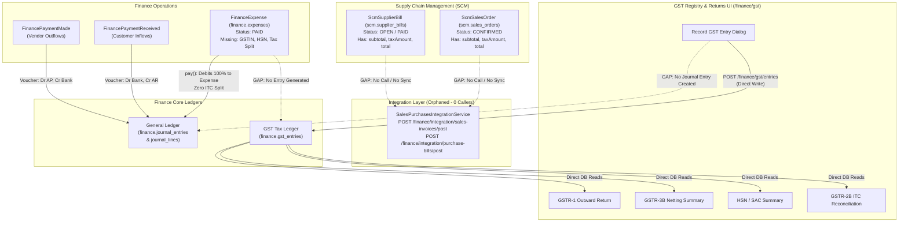
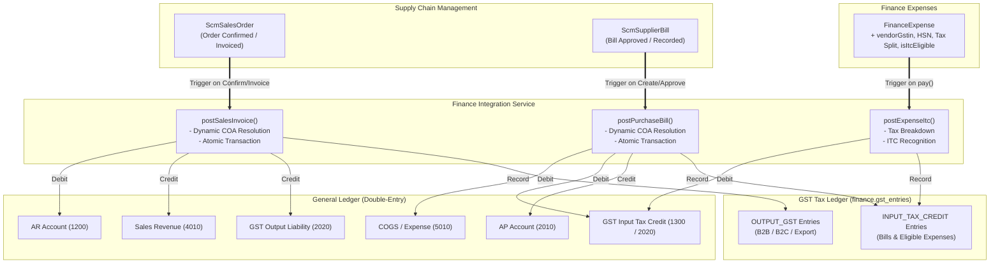
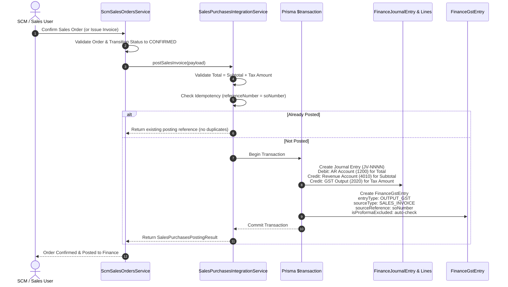
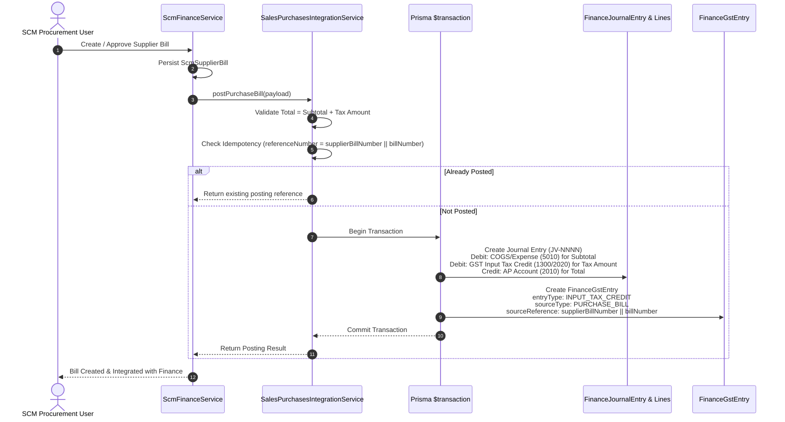
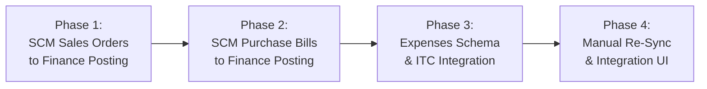

# TexaWave ERP — GST Module: Comprehensive Integration Audit & Gap Closure Plan

**Audit Baseline Date:** October 26, 2026  
**Document Version:** 1.0.0  
**Tracking Tickets:** `TEXA-167` (Tax & Compliance / GST), `TEXA-160` (Finance UI), `TEXA-154` (Finance Core Backend)  
**Target Audience:** Engineering Leads, System Architects, SCM & Finance Module Owners  
**Execution Phase:** Phase 1 — Repository Audit & Implementation Planning Only (No code changes applied)

---

## 1. Executive Summary

The frontend foundation and functional reporting views for **Tax & Compliance → GST Registry & Returns (`TEXA-167`)** are complete and validated on branch `feature/finance`:

- Route `/finance/gst` is registered and integrated with the main Finance navigation (`FinanceShell.tsx` and `HorizontalNavbar.tsx`).
- GSTR-1 outward return view, GSTR-3B monthly netting view, HSN summary view, manual entry recording modal, authoritative entry details drawer, and GSTR-2B purchase reconciliation modal are functional.
- The backend GST module (`apps/api/src/modules/finance/gst/`) passes all 33 unit and validation tests; the entire Finance backend passes 283/283 tests across 21 test suites.

However, an exhaustive read-only audit of the codebase reveals that the **GST tax ledger (`finance.gst_entries`) currently operates in isolation from upstream business operations**:

1. **Supply Chain Sales Orders:** Confirming a Sales Order in `scm.sales_orders` updates order status, but **does not trigger any accounting voucher or GST Output liability entry**.
2. **Supply Chain Purchase Bills:** Registering or updating a Vendor Bill in `scm.supplier_bills` manages accounts payable records in SCM, but **does not trigger any GL journal voucher or Input Tax Credit (ITC) entry in the GST ledger**.
3. **Operational Expenses:** Direct corporate expenses in `finance.expenses` lack vendor GSTIN, HSN/SAC, and tax component breakdown fields (`cgstAmount`, `sgstAmount`, `igstAmount`, `isItcEligible`). When disbursed, the entire gross amount is debited to the expense account with zero ITC recognition.
4. **Orphaned Integration Infrastructure:** A robust, transactionally safe, dynamic-account-resolving integration service—[`SalesPurchasesIntegrationService`](file:///c:/Users/skkin/OneDrive/Desktop/cooking%20area/Texawave_Erp_Production/apps/api/src/modules/finance/integration/sales-purchases-integration.service.ts)—already exists with 5 dedicated API endpoints (`/finance/integration/...`), but has **zero callers** across the SCM, CRM, or UI codebases.
5. **Direct GST Entries Lack GL Dual Posting:** Creating a manual GST adjustment entry via `POST /finance/gst/entries` writes exclusively to `finance.gst_entries` without creating a double-entry journal voucher in `finance.journal_entries`, causing a potential divergence between statutory tax returns and financial statements.

This document details the verified findings, presents the architectural gap analysis with file-and-line evidence, and provides an end-to-end phased gap closure plan for sign-off prior to execution.

---

## 2. Verified Current Architecture & Data-Flow

### Current Disconnected State

The diagram below illustrates how upstream transactions and direct GST entries currently fail to synchronize across domain boundaries:



### Target Integrated Architecture

In the target state, business documents automatically invoke the integration service via transactional event hooks or direct service calls, ensuring synchronized dual-ledger consistency:



---

## 3. Existing Integrations & Callers Audit

### 3.1 `SalesPurchasesIntegrationService` Inspection

Located in [`apps/api/src/modules/finance/integration/sales-purchases-integration.service.ts`](file:///c:/Users/skkin/OneDrive/Desktop/cooking%20area/Texawave_Erp_Production/apps/api/src/modules/finance/integration/sales-purchases-integration.service.ts):

| Method                 | Route / Access                                    | Input DTO                      | Actions Performed                                                                                                                                                                | Status                                        |
| :--------------------- | :------------------------------------------------ | :----------------------------- | :------------------------------------------------------------------------------------------------------------------------------------------------------------------------------- | :-------------------------------------------- |
| `postSalesInvoice`     | `POST /finance/integration/sales-invoices/post`   | `PostSalesInvoiceDto`          | 1. Monetary invariant check: $                                                                                                                                                   | (\text{subtotal} + \text{tax}) - \text{total} | \le 0.02$<br>2. Idempotency check on `financeJournalEntry.referenceNumber`<br>3. Resolves COA accounts: `1200` (AR), `4010` (Revenue), `2020` (GST Output)<br>4. Atomic `$transaction`creates JV voucher +`FinanceGstEntry` (`OUTPUT_GST`, `SALES_INVOICE`)<br>5. Auto-flags `isProformaExcluded`if reference contains`PI`or`PROFORMA` | **Fully Implemented** (0 callers) |
| `postPurchaseBill`     | `POST /finance/integration/purchase-bills/post`   | `PostPurchaseBillDto`          | 1. Monetary invariant check: $                                                                                                                                                   | (\text{subtotal} + \text{tax}) - \text{total} | \le 0.02$<br>2. Idempotency check on `financeJournalEntry.referenceNumber`<br>3. Resolves COA accounts: `2010` (AP), `5010`/`5020` (Expense/COGS), `2020` (GST Input)<br>4. Atomic `$transaction`creates JV voucher +`FinanceGstEntry` (`INPUT_TAX_CREDIT`, `PURCHASE_BILL`)                                                           | **Fully Implemented** (0 callers) |
| `cancelSalesInvoice`   | `POST /finance/integration/sales-invoices/cancel` | `CancelIntegrationDocumentDto` | 1. Generates reversing voucher (`REV-`) with inverted debits/credits<br>2. Updates original journal entry to `REVERSED`<br>3. Marks linked `FinanceGstEntry` rows to `CANCELLED` | **Fully Implemented** (0 callers)             |
| `cancelPurchaseBill`   | `POST /finance/integration/purchase-bills/cancel` | `CancelIntegrationDocumentDto` | Same reversal workflow for purchase bills                                                                                                                                        | **Fully Implemented** (0 callers)             |
| `getIntegrationStatus` | `GET /finance/integration/status/:reference`      | URL parameter                  | Queries `journal_entries` and `gst_entries` by `referenceNumber` to return `{ isPosted, journalEntryId, gstEntryId, status }`                                                    | **Fully Implemented** (0 callers)             |

### 3.2 Caller Audit Across the Repository

A complete grep analysis confirms that neither the service nor its HTTP endpoints are invoked anywhere outside of its own unit test:

- `git grep "SalesPurchasesIntegrationService"`: Present only in `finance.module.ts`, `sales-purchases-integration.controller.ts`, and `sales-purchases-integration.service.spec.ts`.
- `git grep "finance/integration"`: Zero references across all UI components, SCM services, and CRM controllers.

---

## 4. Verified Integration Gaps with Concrete Code Evidence

### Gap 1: SCM Sales Orders → Finance Posting

- **Source Code:** [`apps/api/src/modules/scm/sales/sales-orders.service.ts`](file:///c:/Users/skkin/OneDrive/Desktop/cooking%20area/Texawave_Erp_Production/apps/api/src/modules/scm/sales/sales-orders.service.ts#L94-L111)
- **Current Behavior:**
  ```typescript
  // sales-orders.service.ts lines 106-111
  confirm(id: number) {
    return this.move(id, ["DRAFT"], "CONFIRMED");
  }
  cancel(id: number) {
    return this.move(id, ["DRAFT", "CONFIRMED"], "CANCELLED");
  }
  ```
  The `confirm` method only calls `this.repository.transition(...)` to change the status string in `scm.sales_orders`.
- **Deficiency:**
  - `ScmSalesOrder` contains line items with product `taxRate`, net `subtotal`, `taxAmount`, and gross `total`.
  - The customer record (`ScmCustomer`) contains `gstin`, `billingAddress`, and `shippingAddress`.
  - The product record (`ScmProduct`) contains the `hsn` code.
  - No call is made to `SalesPurchasesIntegrationService.postSalesInvoice` upon confirmation or delivery. As a result, sales tax liabilities **never appear in GSTR-1, GSTR-3B, or the General Ledger**.

### Gap 2: SCM Purchase Bills → Finance Posting

- **Source Code:** [`apps/api/src/modules/scm/finance/finance.service.ts`](file:///c:/Users/skkin/OneDrive/Desktop/cooking%20area/Texawave_Erp_Production/apps/api/src/modules/scm/finance/finance.service.ts#L79-L93)
- **Current Behavior:**
  ```typescript
  // finance.service.ts lines 79-93
  createBill(dto: CreateBillDto) {
    return this.repo.createBill(this.scope, dto, this.actor);
  }
  async cancelBill(id: number, reason: string) {
    const row = await this.repo.cancelBill(this.scope, id, reason, this.actor);
    if (!row) throw new ResourceNotFoundException("Bill", id);
    return row;
  }
  ```
  Creating or cancelling a bill in `scm.supplier_bills` modifies only the SCM AP tracking tables.
- **Deficiency:**
  - `ScmSupplierBill` contains `supplierBillNumber`, `subtotal`, `taxAmount`, and `total`.
  - The supplier record (`Supplier`) contains `gstin`, `state`, and `companyName`.
  - No call is made to `SalesPurchasesIntegrationService.postPurchaseBill`.
  - Vendor bills **never appear in GSTR-3B Table 4 (Eligible ITC) or GSTR-2B reconciliation**, preventing input tax credit claims against outward tax liability.

### Gap 3: Operational Expenses Missing Tax Breakdown & ITC Generation

- **Source Code:** [`apps/api/src/modules/finance/expenses/expenses.service.ts`](file:///c:/Users/skkin/OneDrive/Desktop/cooking%20area/Texawave_Erp_Production/apps/api/src/modules/finance/expenses/expenses.service.ts#L452-L467)
- **Database Schema:** [`packages/database/prisma/schema.prisma`](file:///c:/Users/skkin/OneDrive/Desktop/cooking%20area/Texawave_Erp_Production/packages/database/prisma/schema.prisma#L6093-L6130)
- **Current Behavior:**
  - `FinanceExpense` contains `amount`, `taxAmount`, and `netAmount`, but **lacks vendor GSTIN, HSN/SAC, CGST/SGST/IGST breakdown, and an `isItcEligible` flag**.
  - When an expense is paid via `ExpensesService.pay()`:
    ```typescript
    // expenses.service.ts lines 452-467
    const lines: ExpenseJournalLineData[] = [
      {
        accountId: expenseGlAccount.id,
        lineOrder: 0,
        description: `Expense: ${existing.vendorName ?? existing.expenseNumber}`,
        debit: netAmount, // <-- 100% of gross amount debited to expense!
        credit: 0,
      },
      {
        accountId: creditGlAccount.id,
        lineOrder: 1,
        description: `Payment for ${existing.expenseNumber}`,
        debit: 0,
        credit: netAmount,
      },
    ];
    ```
- **Deficiency:**
  - Even if `taxAmount > 0`, the entire gross amount (`netAmount`) is charged to the P&L expense account.
  - The GST Input Tax Credit account (`1300` / `2020`) is never debited.
  - Zero rows are written to `finance.gst_entries`, forfeiting legitimate B2B input tax credits on operational expenses (e.g., software SaaS, office supplies, freight, professional fees).

### Gap 4: Direct GST Entries Bypass the General Ledger

- **Source Code:** [`apps/api/src/modules/finance/gst/gst.service.ts`](file:///c:/Users/skkin/OneDrive/Desktop/cooking%20area/Texawave_Erp_Production/apps/api/src/modules/finance/gst/gst.service.ts#L36-L97)
- **Current Behavior:**
  - When an accountant records a manual GST entry via `AddGstEntryDialog.tsx` (`POST /finance/gst/entries`), `GstService.createEntry` creates a row directly in `finance.gst_entries`.
- **Deficiency:**
  - It creates no corresponding journal voucher in `finance.journal_entries`.
  - If manual entries represent actual tax liabilities or adjustments (e.g., reverse charge mechanisms under Section 9(3)/9(4) or ITC reversals under Rule 42/43), the statutory GST return will show amounts that **do not reconcile with the trial balance or balance sheet**.

### Gap 5: Absence of Relational Foreign Keys Across Schemas

- **Source Code:** [`packages/database/prisma/schema.prisma`](file:///c:/Users/skkin/OneDrive/Desktop/cooking%20area/Texawave_Erp_Production/packages/database/prisma/schema.prisma#L6228-L6261)
- **Current Structure:**
  `FinanceGstEntry` only has a relational foreign key to `Organization`. The links to business documents are loose string fields:
  ```prisma
  entryType          String   @map("entry_type")       // OUTPUT_GST | INPUT_TAX_CREDIT
  sourceType         String   @map("source_type")      // SALES_INVOICE | PURCHASE_BILL | EXPENSE | MANUAL
  sourceId           Int?     @map("source_id")        // Loose integer ID
  sourceReference    String   @map("source_reference") // Document number string
  ```
- **Architectural Rationale & Reality:**
  - This design aligns with the multi-schema architecture (`schema("scm")` vs `schema("finance")`), preventing cross-schema cascade locks.
  - However, because there is no foreign key constraint, referential integrity depends entirely on application-level transactional posting and idempotent checks.

---

## 5. Proposed Target Architecture & Workflow Specifications

### Workflow A: Sales Invoices Posting to GST & General Ledger



#### Detailed Payload Mapping:

- `invoiceNumber`: `order.soNumber`
- `invoiceDate`: `order.orderDate` (ISO string `YYYY-MM-DD`)
- `customerId`: `order.customerId`
- `customerName`: `order.customerName`
- `customerGstin`: `customer.gstin` (or `"URP"` if unregistered)
- `subtotal`: Number(order.subtotal)
- `taxAmount`: Number(order.taxAmount)
- `total`: Number(order.total)
- `hsnSacCode`: First product HSN from order line items
- `cgstAmount` / `sgstAmount` / `igstAmount`:
  - If customer state matches organization state (Intra-state): CGST = Tax / 2, SGST = Tax / 2, IGST = 0.
  - If customer state differs from organization state (Inter-state): CGST = 0, SGST = 0, IGST = Tax.

---

### Workflow B: Purchase Bills Posting to GST & General Ledger



---

### Workflow C: Operational Expenses Tax Integration

For direct operational expenses:

1. When an expense is recorded with tax, capture:
   - `vendorGstin`: 15-character GSTIN.
   - `hsnSacCode`: HSN or SAC service code (e.g., `998314` for IT services).
   - `taxAmount`: Total tax.
   - `cgstAmount`, `sgstAmount`, `igstAmount`: Component breakdown.
   - `isItcEligible`: Boolean flag (default `true`; `false` for blocked credits under CGST Act Section 17(5)).
2. When `ExpensesService.pay()` executes:
   - Debit GL Expense Account for `subtotal` (`amount`).
   - If `isItcEligible === true` and `taxAmount > 0`:
     - Debit GL GST Input Tax Credit Account (`1300` / `2020`) for `taxAmount`.
     - Insert a row in `finance.gst_entries` with `entryType: INPUT_TAX_CREDIT`, `sourceType: EXPENSE`, `sourceReference: expense.expenseNumber`.
   - If `isItcEligible === false` (Blocked Credit):
     - Debit GL Expense Account for full `netAmount` (`amount + taxAmount`).
     - Do not record an ITC claim in `finance.gst_entries`.
   - Credit GL Bank / Cash / Payable Account for `netAmount`.

---

### Workflow D: Payments Received and Made (Settlement Safeguard)

- **Tax Accounting Rule:** Under Indian GST Law, tax liability is recognized on supply/invoicing (Section 12/13), not on settlement of accounts receivable or accounts payable.
- **Verification:** Both `PaymentsReceivedService` and `PaymentsMadeService` strictly perform cash-to-ledger settlements:
  - Payments Received: Debit Bank/Cash, Credit Accounts Receivable (`1200`).
  - Payments Made: Debit Accounts Payable (`2010`), Credit Bank/Cash (`1110`/`1120`).
- **Policy:** Settlement services **must never generate GST tax ledger entries**. This prevents duplicate tax liabilities or credits.

---

### Workflow E: General Ledger Consistency & Dynamic COA Resolution

To prevent hardcoded account ID failures across tenant organizations, the integration layer uses dynamic Chart of Accounts resolution via `SalesPurchasesIntegrationService.resolveAccount()`:

1. Searches for account by standard account code (e.g., `1200` for AR, `4010` for Sales Revenue, `2020` for GST Output, `2010` for AP, `5010` for COGS, `1300` for GST Input).
2. If the standard code is not found, searches within the specified `accountType` (`ASSET`, `LIABILITY`, `REVENUE`, `EXPENSE`) by keyword matches (`["Receivable", "Debtor"]`, `["Revenue", "Sales"]`, `["GST", "Tax", "Output"]`).
3. If no matching account exists, throws a descriptive `BusinessRuleViolationException` instructing the administrator to configure their Chart of Accounts.

---

## 6. Database & Migration Implications

### 6.1 Schema Analysis: Loose Coupling vs Strict Foreign Keys

| Dimension                 | Option A: Maintain Loose String References (`sourceReference`, `sourceId`)                   | Option B: Add Strict Prisma Foreign Keys to `ScmSalesOrder` & `ScmSupplierBill`                     |
| :------------------------ | :------------------------------------------------------------------------------------------- | :-------------------------------------------------------------------------------------------------- |
| **Cross-Schema Boundary** | **Clean:** Preserves isolation between `scm` and `finance` PostgreSQL schemas.               | **Coupled:** Creates cross-schema constraints (`finance.gst_entries` $\to$ `scm.sales_orders`).     |
| **Migration Risk**        | **Zero Risk:** No schema alter commands required for `gst_entries`.                          | **High Risk:** Requires table locks, backfilling legacy records, handling nulls for manual entries. |
| **Idempotency**           | Achieved via application-level unique checks on `(organizationId, sourceReference, status)`. | Enforced via database foreign keys, but requires polymorphic relations for `EXPENSE` / `MANUAL`.    |
| **Recommendation**        | **RECOMMENDED (Option A)**                                                                   | Not recommended at this stage                                                                       |

### 6.2 Recommended Schema Additions for `FinanceExpense`

To support Tax & ITC breakdown on corporate expenses without breaking existing records, only a minimal non-breaking migration is required on `finance.expenses`:

```prisma
// Minimal optional field additions to model FinanceExpense in packages/database/prisma/schema.prisma:
vendorGstin      String?   @map("vendor_gstin")
hsnSacCode       String?   @map("hsn_sac_code")
cgstAmount       Decimal   @default(0) @map("cgst_amount") @db.Decimal(15, 2)
sgstAmount       Decimal   @default(0) @map("sgst_amount") @db.Decimal(15, 2)
igstAmount       Decimal   @default(0) @map("igst_amount") @db.Decimal(15, 2)
isItcEligible    Boolean   @default(true) @map("is_itc_eligible")
```

- All fields are either nullable or have safe defaults (`default(0)` / `default(true)`).
- Existing expenses continue to function without data loss.

---

## 7. Business Rules & Accounting Assumptions Requiring User Approval

Before any code modification begins, the engineering team requires user confirmation on the following key business rules:

|   #   | Decision Topic                              | Proposed Default Behavior                                                                                                                                       | Alternative Option                                                                                     |  User Sign-Off Status   |
| :---: | :------------------------------------------ | :-------------------------------------------------------------------------------------------------------------------------------------------------------------- | :----------------------------------------------------------------------------------------------------- | :---------------------: |
| **1** | **Sales Order Posting Trigger**             | Trigger Finance & GST posting automatically when Sales Order status transitions from `DRAFT` to `CONFIRMED`.                                                    | Trigger posting only on an explicit "Issue Tax Invoice" action in SCM.                                 | **PENDING USER CHOICE** |
| **2** | **Purchase Bill Posting Trigger**           | Trigger Finance & GST posting immediately upon creation of `ScmSupplierBill` in SCM (`status = OPEN`).                                                          | Trigger posting only upon manager approval or payment.                                                 | **PENDING USER CHOICE** |
| **3** | **Expense Blocked Credits (Section 17(5))** | When an expense is marked `isItcEligible: false`, capitalize/absorb tax into the expense account (Debit Expense for `netAmount`) and generate NO GST entry.     | Record in GST ledger as `BLOCKED_ITC` for reporting in GSTR-3B Table 4(B).                             | **PENDING USER CHOICE** |
| **4** | **GST Input Tax Credit Account**            | Post ITC to Asset Account `1300` (GST Input Tax Credit) rather than netting directly against Liability `2020`.                                                  | Net directly against Liability `2020` (GST Output Tax).                                                | **PENDING USER CHOICE** |
| **5** | **Manual GST Entry GL Behavior**            | Direct entries via `AddGstEntryDialog.tsx` remain tax-registry entries only by default, with an optional toggle "Generate Journal Voucher" for tax adjustments. | Force every manual GST entry to create a mandatory balanced JV with a user-selected balancing account. | **PENDING USER CHOICE** |

---

## 8. Implementation Phases Ordered by Dependency & Risk



### Phase 1: SCM Sales Orders to Finance Integration — **COMPLETED (Oct 26, 2026)**

- **Status:** **Completed & Verified** (14/14 sales unit tests, 12/12 integration unit tests, 284/284 finance tests, UI dialog & typecheck passed).
- **Implementation:**
  1. Sequential invoice numbering prefix `TW/INV` added.
  2. Multi-line `taxItems` grouping by `(hsn, rate)` for faithful GSTR-1 and HSN reporting.
  3. Explicit action `POST /scm/sales-orders/:id/issue-invoice` with confirmation check.
  4. Automatic journal reversal (`REV-`) and GST entry cancellation on order cancellation.
  5. UI modal `IssueInvoiceDialog.tsx` with instant cache invalidation.

### Phase 2: SCM Purchase Bills to Finance Integration — **COMPLETED (Oct 26, 2026)**

- **Status:** **Completed & Verified** (17/17 scm finance tests, 14/14 integration tests, 286/286 finance tests, UI dialog & typecheck passed).
- **Implementation:**
  1. Multi-line `PostPurchaseBillTaxItemDto` and `PostPurchaseBillDto` extended.
  2. Ineligible ITC handling per CGST Section 17(5): absorbed into expense cost, omitted from recoverable ITC asset and GST ledger.
  3. Dynamic COA resolution for GST Input Tax Credit asset account `1300` with fallback to `2020`.
  4. Explicit action `POST /scm/finance/bills/:id/post-to-finance` with jurisdiction auto-detection.
  5. Reversal and idempotency safeguards on bill cancellation.
  6. UI integration in `SupplierFinanceTabs.tsx` with GL posting status badge, Post button, and `PostBillDialog`.

### Phase 3: Operational Expenses Tax Schema Extension & ITC Ledger — **COMPLETED (Oct 26, 2026)**

- **Status:** **Completed & Verified** (50/50 expense unit tests, 16/16 integration tests, 303/303 finance tests, UI dialogs & typecheck passed).
- **Implementation:**
  1. Extended `FinanceExpense` schema and migration `20261026160000_add_expense_gst_and_itc_fields` with `vendorGstin`, `vendorInvoiceNumber`, `vendorInvoiceDate`, `hsnSacCode`, `taxRate`, `cgstAmount`, `sgstAmount`, `igstAmount`, `isItcEligible`, `ineligibilityReason`, `gstJurisdiction`, and `[organizationId, vendorGstin]` index.
  2. Hardened Phase 2 account mapping in `SalesPurchasesIntegrationService`: eliminated fallback from 1300 to 2020 LIABILITY, strictly enforcing ASSET account type or failing safely with `MISSING_INPUT_TAX_ACCOUNT`.
  3. Added account `1300` ("GST Input Tax Credit") to `DEFAULT_ACCOUNTS` in `finance.seed.ts`.
  4. In `ExpensesService.pay()`:
     - When `isItcEligible === true` and `taxAmount > 0`: Debits Expense for taxable subtotal, debits `1300` (ASSET) for tax, credits Bank/Payable for `netAmount`, and atomically records `FinanceGstEntry` with `entryType: "INPUT_TAX_CREDIT"`, `sourceType: "EXPENSE"`.
     - When `isItcEligible === false` (Blocked Credit under Section 17(5)): Debits Expense for full gross `netAmount`, skips account `1300`, and omits GST entry (preventing inflation of GSTR-3B ITC claims).
  5. Enhanced `ExpensesService.cancel()` and repository reversal to reverse journal entries and mark associated active `FinanceGstEntry` records as `CANCELLED`.
  6. Frontend UI:
     - Updated `createExpenseSchema` and `updateExpenseSchema` in `schema.ts`.
     - Updated `AddExpenseDialog.tsx` and `EditExpenseDialog.tsx` with GST rate selector, dynamic tax calculation, Vendor GSTIN, Invoice Number/Date, HSN/SAC, and Section 17(5) blocked credit reason selector.
     - Added "GST & Input Tax Credit (ITC) Audit Record" card in `ExpenseDetailDialog.tsx` with link to `/finance/gst`.
     - Surfaced vendor GSTIN and blocked ITC status in `ExpensesView.tsx`.
     - Invalidate `"finance-gst"` query in `hooks.ts` upon recording/paying/cancelling expenses.

### Phase 4: Manual GST Entry Synchronization & Lifecycle — **COMPLETED (Oct 26, 2026)**

- **Status:** **Completed & Verified** (39/39 GST tests passed including 6/6 manual sync spec tests, 309/309 finance tests passed, UI typecheck passed, 0 ESLint errors).
- **Architectural Policy & Implementation:**
  1. **Separation of Concerns:** In accordance with statutory ERP standards, manual GST tax entries (`sourceType: "MANUAL"`) remain separate from General Ledger double-entry vouchers by default. They record statutory tax data directly into `finance.gst_entries` for GSTR-1, GSTR-3B, and HSN reporting without inventing synthetic debit/credit accounts or disrupting trial balance reconciliation.
  2. **Idempotency & Duplicate Prevention:** Added `findByReference` in `GstRepository` and an idempotency guard in `GstService.createEntry`. Repeated creation requests with identical `(period, sourceReference, gstin, entryType)` return the existing active tax entry, preventing duplicate tax liabilities.
  3. **Statutory Return Aggregation:** GSTR-1, GSTR-3B, and HSN summaries faithfully aggregate manual statutory entries alongside system-generated entries (`SALES_INVOICE`, `PURCHASE_BILL`, `EXPENSE`), while strictly observing proforma exclusions and cancellation statuses.
  4. **Tenant Boundary Enforcement:** Full multi-tenant isolation via `@OrgScoped()` and `tenantWhere<T>()` prevents cross-tenant leakage. Controller endpoints enforce `finance.gst.write` and `finance.gst.read`.
  5. **UI Status & Audit Transparency:**
     - `GstView.tsx`: Displays `Registry Only` (slate/gray badge) for manual entries vs `GL Linked` (blue/sky badge) for ERP-posted entries.
     - `GstEntryDetailDialog.tsx`: Added dedicated "General Ledger (GL) Status & Audit" card displaying clear audit notes and direct navigation links to `/finance/journal-entries?search=${ref}` for GL-linked entries.
     - `AddGstEntryDialog.tsx`: Surfaced compliance guidance banner informing users that manual entries are recorded directly in the statutory tax register and do not post double-entry vouchers to the GL.

---

## 9. Test Plan & Acceptance Criteria

### 9.1 Unit Test Coverage Requirements

- `sales-orders.service.spec.ts`:
  - Confirms that calling `confirm(orderId)` invokes `postSalesInvoice` with expected DTO.
  - Confirms that cancelling a confirmed order invokes `cancelSalesInvoice`.
  - Confirms idempotency when an order is confirmed multiple times.
- `scm-finance.service.spec.ts`:
  - Confirms that `createBill` invokes `postPurchaseBill` with supplier GSTIN.
  - Confirms that `cancelBill` invokes `cancelPurchaseBill`.
- `expenses.service.spec.ts`:
  - Confirms that paying an expense with eligible tax splits lines into Expense and GST Input accounts.
  - Confirms that paying an expense with `isItcEligible: false` debits 100% to Expense.

### 9.2 Integration & E2E Acceptance Criteria

1. **GSTR-1 Outward Supply Invariant:**
   Creating and confirming a Sales Order for customer with GSTIN `29AABCT1332L1ZV` (₹10,000 subtotal + ₹1,800 tax) immediately increments GSTR-1 Outward Tax Liability by ₹1,800, displays under B2B in `Gstr1ReportView`, and appears in `HsnSummaryView`.
2. **GSTR-3B Netting Invariant:**
   Creating an SCM Supplier Bill for ₹20,000 + ₹3,600 tax immediately increments GSTR-3B Section 4 (Eligible ITC) by ₹3,600 and reduces Net Tax Payable accordingly.
3. **Double-Entry Balance Invariant:**
   Every posted Sales Order and Purchase Bill generates an entry in `finance.journal_entries` where $\sum \text{Debit} \equiv \sum \text{Credit}$.
4. **Reversal Invariant:**
   Cancelling an order or bill produces a balanced `REV-` journal entry and transitions the GST entry status to `CANCELLED`, removing it from active returns.
5. **Database Safety Boundary:**
   E2E suites run strictly against dedicated test databases (`texawave_erp_test`), respecting repository safety guards in `test/support/e2e-setup.ts`.

---

## 10. Risks, Mitigations & Sign-Off Checklist

| Risk                                          | Likelihood | Impact | Mitigation                                                                                                                                                                        |
| :-------------------------------------------- | :--------: | :----: | :-------------------------------------------------------------------------------------------------------------------------------------------------------------------------------- |
| **Double-posting on retry**                   |    Low     |  High  | The integration service already contains robust reference-based duplicate guards (`existingJournal` and `existingGst` checks).                                                    |
| **Missing COA Accounts in tenant**            |    Low     |  High  | `SalesPurchasesIntegrationService.resolveAccount()` resolves accounts by standard codes and fallbacks, returning clear business rule errors rather than database null exceptions. |
| **Inter-state vs Intra-state tax allocation** |   Medium   | Medium | State code parsing from GSTIN prefixes (first 2 digits) standardizes IGST vs CGST/SGST determination.                                                                             |
| **Cross-schema database deadlocks**           | Negligible |  High  | Loose string referencing preserves independent schema transactions without cross-schema foreign key locks.                                                                        |

---

### Phase 1 Sign-Off Readiness

- [x] All relevant architecture documents and `AGENTS.md` inspected.
- [x] Existing code audited with exact file and line references.
- [x] Gap analysis completed covering Sales Orders, Purchase Bills, Expenses, and Direct GST entries.
- [x] Five key business rules isolated for user confirmation.
- [x] Four-phase implementation plan established with clear risk hierarchy.
- [x] **Zero modifications made to application source code, Prisma schema, or database records during this planning phase.**
