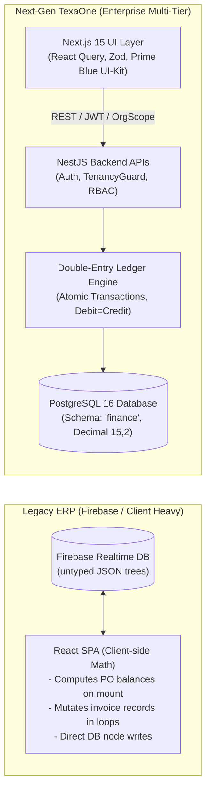
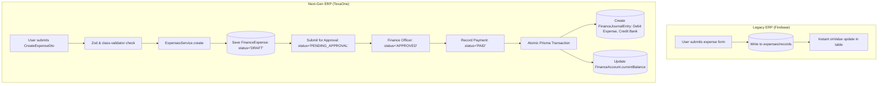
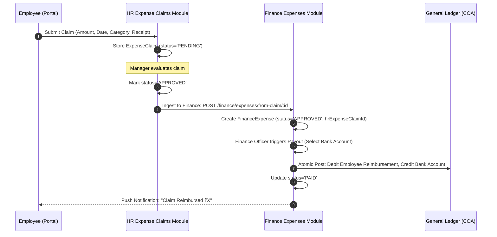
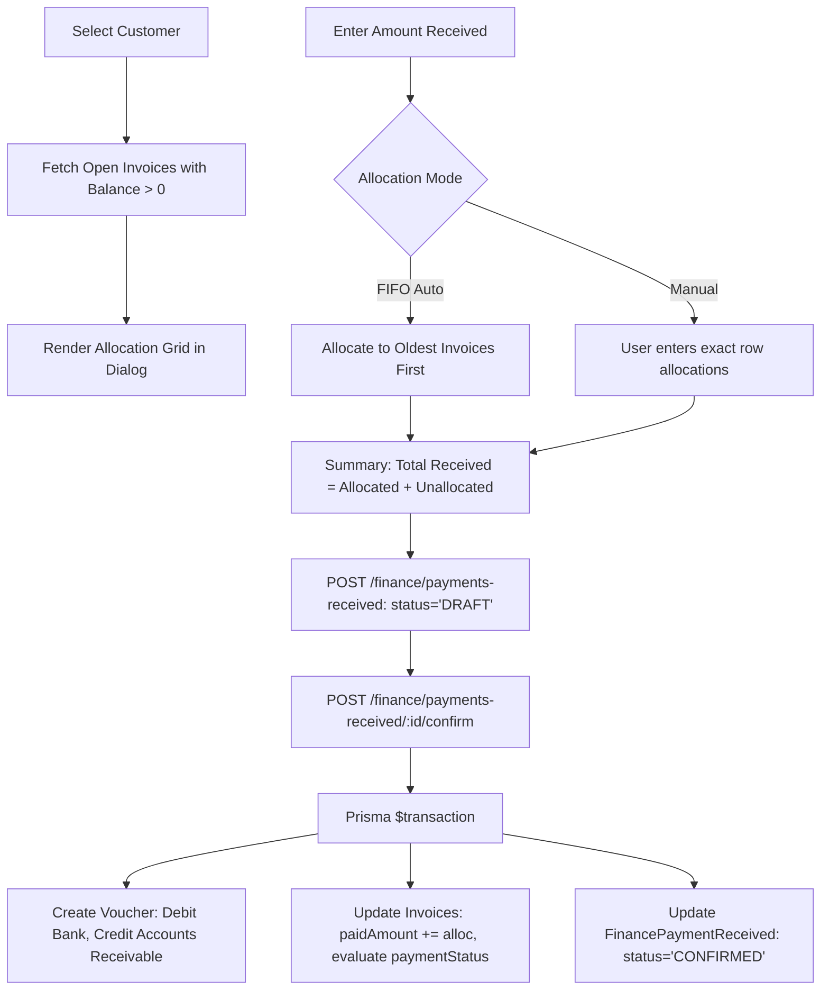
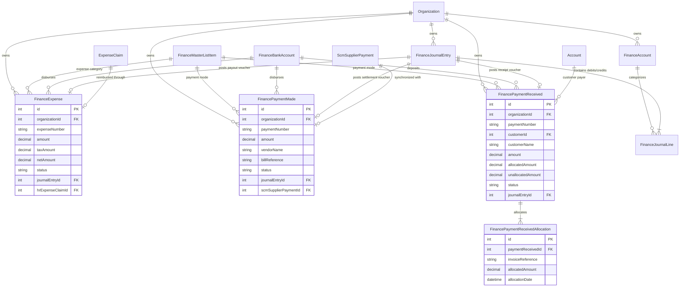
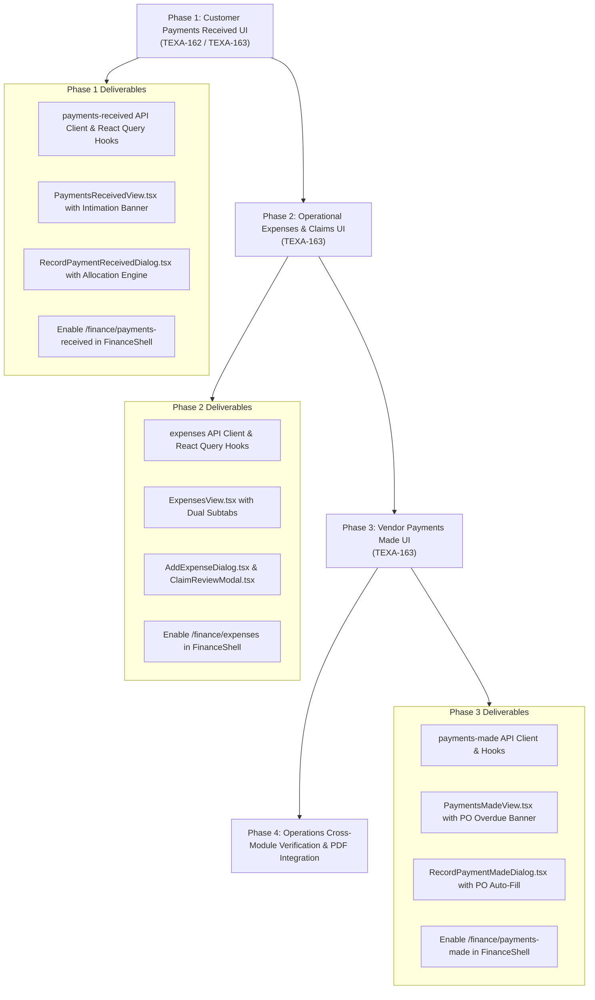

# TexaWave ERP — Finance Operations: Deep Legacy vs. Next-Gen Comparative Engineering Analysis

**Document Version:** 1.0.0  
**Target Module:** Finance — Operations Domain (`Expenses`, `Payments Made`, `Payments Received`)  
**Parent UI Ticket:** `TEXA-160 — Finance UI Implementation`  
**Operations UI Ticket:** `TEXA-163 — Basic UI: Operations` (with `TEXA-162` AR alignment)  
**Backend API Tracking Ticket:** `TEXA-154 — Finance Core Backend APIs` (Milestones 3, 4, 5)  
**Date of Audit & Baseline:** October 24, 2026  
**Audience:** Core Engineers, System Architects, and Junior Developers reconstructing or reviewing the ERP

---

## Table of Contents

1. [1. Scope & Source Inventory](#1-scope--source-inventory)
2. [2. Architectural Evolution: Firebase RTDB to Relational Enterprise Backend](#2-architectural-evolution-firebase-rtdb-to-relational-enterprise-backend)
3. [3. Legacy Operational Page Specifications (Visual & Functional Analysis)](#3-legacy-operational-page-specifications-visual--functional-analysis)
   - [3.1 Page 1: Expenses (`Expenses.tsx`)](#31-page-1-expenses-expensestsx)
   - [3.2 Page 2: Payments Made (`PaymentsMade.tsx`)](#32-page-2-payments-made-paymentsmadetsx)
   - [3.3 Page 3: Payments Received (`PaymentsReceived.tsx` & `CreatePaymentReceived.tsx`)](#33-page-3-payments-received-paymentsreceivedtsx--createpaymentreceivedtsx)
4. [4. Next-Gen ERP Source Code Inventory](#4-next-gen-erp-source-code-inventory)
5. [5. Old-to-New Data Model & Field Mapping](#5-old-to-new-data-model--field-mapping)
6. [6. Operational Workflow & Entity-Relationship (ER) Diagrams](#6-operational-workflow--entity-relationship-er-diagrams)
7. [7. Comprehensive Functional Parity Matrix](#7-comprehensive-functional-parity-matrix)
8. [8. Confirmed Architectural Gaps & Technical Questions](#8-confirmed-architectural-gaps--technical-questions)
9. [9. Security, Concurrency & Financial Integrity Audit](#9-security-concurrency--financial-integrity-audit)
10. [10. Formal Testable Acceptance Criteria](#10-formal-testable-acceptance-criteria)
11. [11. Dependency-Aware Implementation Roadmap](#11-dependency-aware-implementation-roadmap)
12. [12. Investigation Work Log & Verification Artifacts](#12-investigation-work-log--verification-artifacts)

---

## 1. Scope & Source Inventory

This comparative study benchmarks the operational cash-flow and liability features between the legacy single-page React/Firebase ERP and the modern multi-tier TexaOne enterprise ERP (Next.js 15 App Router, NestJS, Prisma ORM, PostgreSQL).

### Inspected Reference Materials

1. **Legacy System Specification (`operation_finance.md`):**
   - Detailed functional walkthrough of `Expenses.tsx`, `PaymentsMade.tsx`, `PaymentsReceived.tsx`, and `CreatePaymentReceived.tsx`.
   - Realtime streaming listeners, FIFO multi-invoice allocation algorithms, PO balance tracking, and PDF generation middleware contracts.
2. **Legacy Production Visual Artifacts (October 2026 Screenshots):**
   - **Artifact 1 (`media_1792827313390_b1a99954.png`):** Navbar dropdown hierarchy confirming that the menu item `Operations` under `Finance` groups `Operational Expenses`, `Payments Received`, and `Payments Made`.
   - **Artifact 2 (`media_1792827320484_16f73a9e.png`):** Live Expenses view showing dual tabs (`Business Expenses` and `Employee Claims (8)`), category badges, status badges (`Recorded`, `Reimbursed`), and total stats bar.
   - **Artifact 3 (`media_1792827329813_f861a016.png`):** Live Payments Received view showing the amber `Due Date Intimation Alerts` banner, green hero banner card, month pickers, invoice reference pills, and overdue tracking pills.
   - **Artifact 4 (`media_1792827335192_5869819d.png`):** Live Payments Made view showing the amber `Expected Date Intimation Alerts` banner, PO reference pills, overdue commitment pills, remaining PO balances, and bottom-right intimation toast.
3. **New ERP Architecture & Historical Records:**
   - [`Docs/FINANCE_IMPLEMENTATION_ARCHITECTURE_AND_STATUS.md`](file:///c:/Users/skkin/OneDrive/Desktop/cooking area/Texawave_Erp_Production/Docs/FINANCE_IMPLEMENTATION_ARCHITECTURE_AND_STATUS.md): Core backend architecture and Milestone 1–8 verification.
   - [`Docs/POSTMAN_FINANCE_EXPENSES_PAYMENTS.md`](file:///c:/Users/skkin/OneDrive/Desktop/cooking area/Texawave_Erp_Production/Docs/POSTMAN_FINANCE_EXPENSES_PAYMENTS.md): API contract and manual verification sequence for Milestones 3 and 4.
   - [`Docs/FINANCE_MASTER_LIST.md`](file:///c:/Users/skkin/OneDrive/Desktop/cooking area/Texawave_Erp_Production/Docs/FINANCE_MASTER_LIST.md): Categorized lookup values for expense categories and payment modes.
   - [`AGENTS.md`](file:///c:/Users/skkin/OneDrive/Desktop/cooking area/Texawave_Erp_Production/AGENTS.md): Strict styling rules (TexaOne Prime Blue `#1769F5`, Cyan `#12CFE3`, zero violet/purple/indigo, Nunito Sans, no AI icons, no `overflow-hidden` on form card containers).

---

## 2. Architectural Evolution: Firebase RTDB to Relational Enterprise Backend

The transition from the old ERP to the new ERP represents an intentional architectural transformation from an untyped NoSQL document store to a strict ACID-compliant double-entry accounting engine:

### Critical Paradigm Shifts

1. **Decoupled Business Logic & Ledger Integrity:**
   - _Legacy:_ Directly modified `sales/invoices/{id}/paidAmount` or wrote unverified entries into `expenses/records`. No general ledger vouchers or chart of accounts existed.
   - _Next-Gen:_ Every operational transaction (expense payout, customer receipt confirmation, vendor payment confirmation) triggers an atomic database transaction that generates an immutable double-entry journal entry (`FinanceJournalEntry` + `FinanceJournalLine`), synchronizes GL balances (`FinanceAccount`), and updates tax records (`FinanceGstEntry`).
2. **Tenancy & Isolation:**
   - _Legacy:_ Multi-tenancy was client-managed or path-based (`organizations/{orgId}/...`).
   - _Next-Gen:_ Enforced at the query level via `TenantContextService`, `OrgScoped` decorators, and compound Prisma indexes (`[organizationId, ...]`).
3. **Numeric Precision:**
   - _Legacy:_ JavaScript IEEE 754 floating-point numbers subject to rounding drifts (e.g. `0.1 + 0.2 !== 0.3`).
   - _Next-Gen:_ PostgreSQL `Decimal(15, 2)` and strict 2-decimal half-up application math (`round2`).

---

## 3. Legacy Operational Page Specifications (Visual & Functional Analysis)

### 3.1 Page 1: Expenses (`Expenses.tsx`)

#### Visual Composition (from Screenshot `media_1792827320484_16f73a9e.png`)

- **Unified Top Navigation:** Finance primary navigation bar (`Expenses` [Active], `Payments Received`, `Payments Made`, `Banking`, `Accounting`, `GST`).
- **Section Header:** "Expenses" with descriptive subtitle "Track and manage business expenses".
- **Top Primary Action:** Green button `+ Add Expense` placed top-right.
- **Dual Operational Tabs:**
  1. `Business Expenses` (active tab)
  2. `Employee Claims` (with amber count pill badge showing pending claims, e.g., `8`).
- **KPI / Metric Bar:** `Total: ₹3,500 | 2 records` displayed above the filter bar.
- **Search & Table Filters:** Single search input `Search by category, vendor...`.
- **Table Design:**
  - Header: Green gradient (`linear-gradient(135deg, #4D9F4B, #72B84A, #9FCA48)`).
  - Columns: `DATE` (left), `CATEGORY` (cyan pill), `VENDOR / PAYEE` (bold text), `AMOUNT (₹)` (bold monetary), `PAID THROUGH` (text), `REFERENCE` (text or `—`), `STATUS` (`Recorded` in slate pill, `Reimbursed` in green pill), `ACTIONS` (edit and trash icons).

#### Business Workflows

1. **Business Expense Creation & Editing:** Direct recording of operating costs (rent, travel, software, stationery).
2. **Employee Claims Ingestion:**
   - Employees submit out-of-pocket claims from the self-service HR portal (`hr/expenseRequests`).
   - Finance managers review receipts (`receiptRef`), evaluate amount and date, enter an optional `reviewNote`, and click **Approve** or **Reject**.
   - Approving/rejecting triggers automated push notifications to the target employee (`notifications/{employeeId}`).

---

### 3.2 Page 2: Payments Made (`PaymentsMade.tsx`)

#### Visual Composition (from Screenshot `media_1792827335192_5869819d.png`)

- **Alert Intimation Banner:** Amber background banner at the top:
  - Icon: Bell alert.
  - Headline: `Expected Date Intimation Alerts`.
  - Highlight: Red warning badge `⚠ 1 Overdue Payment(s) (₹5,954.5)`.
  - Action: White button `Filter Overdue Only`.
- **Toast Notification:** Bottom-right slide-in warning toast: `Expected Date Intimation: 1 payment(s) overdue! Total pending overdue balance: ₹5,954.5`.
- **Section Header:** "Payments Made" / "Payments made to vendors".
- **Primary Action:** Green button `+ Record Payment`.
- **Search & Month Filtering Bar:**
  - Search input: `Search by Payment No, Vendor, PO...`.
  - Date Picker 1: `Payment Month: ---------- [calendar icon]`.
  - Date Picker 2: `Expected Month: ---------- [calendar icon]`.
  - Record counter: `2 of 2 payments`.
- **Table Design:**
  - Green gradient table header.
  - Columns: `PAYMENT NO`, `VENDOR`, `PO REF`, `PAYMENT DATE`, `EXPECTED DATE`, `TOTAL AMOUNT (₹)`, `AMOUNT PAID`, `REMAINING BALANCE`, `MODE`, `REFERENCE`, `ACTIONS`.
  - Rows show PO pills (e.g. `PO-2026-0001` in green outline), Overdue commitment tags (e.g. `2026-03-03 Overdue (235d)` in pink/red), and remaining balance pills (e.g. `₹5,954.5` in red badge).

#### Business Workflows

1. **Vendor Liability Settlement:** Records disbursement against a supplier.
2. **PO Balance Integration:**
   - When a Purchase Order is selected in the modal, the system aggregates all past payments for `po.id`, computes the remaining unpaid liability $\max(0, \text{po.total} - \text{paid})$, and auto-fills `amount` and `expectedDate`.
3. **Overdue Intimation Engine:** Identifies unliquidated POs where `expectedDate < today` and computes the cumulative overdue liability across all suppliers.

---

### 3.3 Page 3: Payments Received (`PaymentsReceived.tsx` & `CreatePaymentReceived.tsx`)

#### Visual Composition (from Screenshot `media_1792827329813_f861a016.png`)

- **Alert Intimation Banner:** Amber alert banner: `Due Date Intimation Alerts` — `⚠ 1 Overdue Payment(s) (₹14,770.8)` with `Filter Overdue Only` button.
- **Hero Banner Card:** Prominent green card featuring:
  - Title: `Payments Received`
  - Subtitle: `Record and track client payment entries & receipts`
  - Embedded Action: White pill button with green text `+ Record Payment`.
- **Search & Month Filtering Bar:**
  - Search input: `Search by Payment No, Customer, Invoice...`.
  - Date pickers: `Payment Month` and `Due Month`.
  - Counter: `3 of 3 payments`.
- **Table Design:**
  - Columns: `PAYMENT NO`, `CUSTOMER`, `INVOICE REF`, `PAYMENT DATE`, `DUE DATE`, `TOTAL AMOUNT`, `AMOUNT RECEIVED`, `BALANCE`, `MODE`, `REFERENCE`, `ACTIONS`.
  - Invoice pills (e.g. `TW/IN/26-27/8071` with document icon), Overdue flags (e.g. `11 Jun 2026 Overdue (135d)`), and status badges (`₹0 (Paid)` in green, `₹14,770.8` in red).

#### Allocation Engine (`CreatePaymentReceived.tsx`)

1. **Customer Selection:** Selecting a client queries all unpaid invoices ($\text{grandTotal} - \text{paidAmount} > 0$).
2. **FIFO Auto-Allocation vs. Manual Distribution:**
   - Auto mode cascades entered funds across oldest unpaid invoices until funds are exhausted.
   - Manual mode allows precise per-row allocation input (`allocatedAmount`).
3. **Live Metric Summary:** Displays `Total Billed`, `Previous Paid`, `Current Received`, `Remaining Balance`, and `Excess Advance Credit`.
4. **Receipt PDF Export:** Headless Chromium rendering creates high-fidelity payment vouchers.

---

## 4. Next-Gen ERP Source Code Inventory

The table below catalogs the actual implementation across the new repository:

| Feature / Domain            | Backend Controller & Route                                                                                                                                                                                                                                                                                                                | Backend Service & Repository                               | Prisma Model & Storage                                                                                                                                                                                                                                                                                                    | Frontend Route & Component                                                           | Tests Available                                  |
| :-------------------------- | :---------------------------------------------------------------------------------------------------------------------------------------------------------------------------------------------------------------------------------------------------------------------------------------------------------------------------------------- | :--------------------------------------------------------- | :------------------------------------------------------------------------------------------------------------------------------------------------------------------------------------------------------------------------------------------------------------------------------------------------------------------------ | :----------------------------------------------------------------------------------- | :----------------------------------------------- |
| **Operational Expenses**    | [`ExpensesController`](file:///c:/Users/skkin/OneDrive/Desktop/cooking area/Texawave_Erp_Production/apps/api/src/modules/finance/expenses/expenses.controller.ts) `POST /finance/expenses` `POST /finance/expenses/:id/pay` `POST /finance/expenses/from-claim/:id`                                                           | `ExpensesService` `ExpensesRepository`                 | [`FinanceExpense`](file:///c:/Users/skkin/OneDrive/Desktop/cooking area/Texawave_Erp_Production/packages/database/prisma/schema.prisma#L6194) `expenses` table                                                                                                                                                        | Route: `/finance/expenses` _(Currently disabled in `FinanceShell.tsx`)_          | 24 Unit tests 11 Repo tests 13 E2E tests |
| **Vendor Payments Made**    | [`PaymentsMadeController`](file:///c:/Users/skkin/OneDrive/Desktop/cooking area/Texawave_Erp_Production/apps/api/src/modules/finance/payments-made/payments-made.controller.ts) `POST /finance/payments-made` `POST /finance/payments-made/:id/confirm`                                                                           | `PaymentsMadeService` `PaymentsMadeRepository`         | [`FinancePaymentMade`](file:///c:/Users/skkin/OneDrive/Desktop/cooking area/Texawave_Erp_Production/packages/database/prisma/schema.prisma#L6230) `payments_made` table                                                                                                                                               | Route: `/finance/payments-made` _(Currently disabled in `FinanceShell.tsx`)_     | 19 Unit tests 7 Repo tests 10 E2E tests  |
| **Payments Received (AR)**  | [`PaymentsReceivedController`](file:///c:/Users/skkin/OneDrive/Desktop/cooking area/Texawave_Erp_Production/apps/api/src/modules/finance/payments-received/payments-received.controller.ts) `POST /finance/payments-received` `POST /finance/payments-received/:id/confirm` `POST /finance/payments-received/:id/allocations` | `PaymentsReceivedService` `PaymentsReceivedRepository` | [`FinancePaymentReceived`](file:///c:/Users/skkin/OneDrive/Desktop/cooking area/Texawave_Erp_Production/packages/database/prisma/schema.prisma#L6133) [`FinancePaymentReceivedAllocation`](file:///c:/Users/skkin/OneDrive/Desktop/cooking area/Texawave_Erp_Production/packages/database/prisma/schema.prisma#L6167) | Route: `/finance/payments-received` _(Currently disabled in `FinanceShell.tsx`)_ | 32 Unit tests 11 Repo tests 14 E2E tests |
| **HR Expense Claims**       | [`ExpenseClaimsController`](file:///c:/Users/skkin/OneDrive/Desktop/cooking area/Texawave_Erp_Production/apps/api/src/modules/hr/expense-claims/expense-claims.controller.ts) `/hr/expense-claims`                                                                                                                                    | `ExpenseClaimsService` `ExpenseClaimsRepository`       | [`ExpenseClaim`](file:///c:/Users/skkin/OneDrive/Desktop/cooking area/Texawave_Erp_Production/packages/database/prisma/schema.prisma#L3098) `hr.expense_claims`                                                                                                                                                       | Shared in HR module                                                                  | Full HR unit/repo test suite                     |
| **SCM Supplier Bills & PO** | `ScmPurchaseOrder` `ScmSupplierBill` `ScmSupplierPayment`                                                                                                                                                                                                                                                                         | SCM Domain Services                                        | `scm.purchase_orders` `scm.supplier_bills`                                                                                                                                                                                                                                                                            | SCM module views                                                                     | SCM test suites                                  |

---

## 5. Old-to-New Data Model & Field Mapping

### 5.1 Expenses Mapping: `expenses/records` $\to$ `FinanceExpense`

| Legacy Field (`expenses/records`) | Legacy Type                  | New Prisma Field (`FinanceExpense`) | New Type              |  Status   | Transformation & Architectural Notes                                                |
| :-------------------------------- | :--------------------------- | :---------------------------------- | :-------------------- | :-------: | :---------------------------------------------------------------------------------- |
| `id`                              | `string` (Firebase push key) | `id`                                | `Int` (Autoincrement) | `CHANGED` | Numeric primary key; mapped to relational schema.                                   |
| _None_                            | N/A                          | `expenseNumber`                     | `String`              | `CHANGED` | Formatted sequence code (`EXP-YYYY-XXXX`).                                          |
| `category`                        | `string` (Free enum)         | `expenseTypeId`                     | `Int` (FK)            | `CHANGED` | Normalized to `FinanceMasterListItem` (`category='expense_type'`).                  |
| `date`                            | `string` (`YYYY-MM-DD`)      | `expenseDate`                       | `DateTime @db.Date`   | `MATCHED` | PostgreSQL date-only type.                                                          |
| `amount`                          | `number`                     | `amount`                            | `Decimal(15, 2)`      | `MATCHED` | Stored as exact decimal.                                                            |
| _None_                            | N/A                          | `taxAmount`                         | `Decimal(15, 2)`      | `CHANGED` | Added input tax split.                                                              |
| _None_                            | N/A                          | `netAmount`                         | `Decimal(15, 2)`      | `CHANGED` | $\text{netAmount} = \text{amount} + \text{taxAmount}$.                              |
| `paidThrough`                     | `string` (Enum)              | `paymentModeId`                     | `Int?` (FK)           | `CHANGED` | Normalized to `FinanceMasterListItem` (`payment_mode`).                             |
| _None_                            | N/A                          | `bankAccountId`                     | `Int?` (FK)           | `CHANGED` | Direct link to commercial `FinanceBankAccount`.                                     |
| `vendor`                          | `string`                     | `vendorName`                        | `String?`             | `MATCHED` | String payee name snapshot.                                                         |
| `reference`                       | `string`                     | `notes` / metadata                  | `String?`             | `PARTIAL` | Stored in operational notes.                                                        |
| `status`                          | `'Recorded' \| 'Reimbursed'` | `status`                            | `String`              | `CHANGED` | Enterprise lifecycle: `DRAFT`, `PENDING_APPROVAL`, `APPROVED`, `PAID`, `CANCELLED`. |
| _None_                            | N/A                          | `journalEntryId`                    | `Int?` (FK)           | `CHANGED` | Links to posted double-entry GL voucher.                                            |
| _None_                            | N/A                          | `hrExpenseClaimId`                  | `Int?` (FK)           | `CHANGED` | Links to originating HR claim (`ExpenseClaim`).                                     |

### 5.2 Payments Made Mapping: `purchases/paymentsMade` $\to$ `FinancePaymentMade`

| Legacy Field (`purchases/paymentsMade`) | Legacy Type                 | New Prisma Field (`FinancePaymentMade`) | New Type            |  Status   | Transformation & Architectural Notes                                            |
| :-------------------------------------- | :-------------------------- | :-------------------------------------- | :------------------ | :-------: | :------------------------------------------------------------------------------ |
| `id`                                    | `string`                    | `id`                                    | `Int`               | `CHANGED` | Relational autoincrement ID.                                                    |
| `paymentNumber`                         | `string` (`PMNT-YYYY-XXXX`) | `paymentNumber`                         | `String`            | `MATCHED` | Formatted sequential voucher code.                                              |
| `vendorName`                            | `string`                    | `vendorName`                            | `String`            | `MATCHED` | Vendor name snapshot.                                                           |
| `vendorId`                              | `string`                    | _Handled via SCM link_                  | `Int?`              | `PARTIAL` | Linked via `scmSupplierPaymentId` or SCM Supplier.                              |
| `poId` / `poNumber`                     | `string`                    | `billReference`                         | `String?`           | `PARTIAL` | Stores PO code or bill number reference.                                        |
| `amount`                                | `number`                    | `amount`                                | `Decimal(15, 2)`    | `MATCHED` | High-precision decimal.                                                         |
| `paymentDate`                           | `string`                    | `paymentDate`                           | `DateTime @db.Date` | `MATCHED` | PostgreSQL date-only.                                                           |
| `expectedDate`                          | `string`                    | _Calculated from SCM PO_                | N/A                 | `CHANGED` | In new ERP, commitment date resides on `ScmPurchaseOrder.expectedDeliveryDate`. |
| `mode`                                  | `string`                    | `paymentModeId`                         | `Int` (FK)          | `CHANGED` | Normalized to `FinanceMasterListItem`.                                          |
| `reference`                             | `string`                    | `referenceNumber`                       | `String?`           | `MATCHED` | Bank UTR / Cheque / IMPS reference code.                                        |
| _None_                                  | N/A                         | `status`                                | `String`            | `CHANGED` | New lifecycle: `DRAFT`, `CONFIRMED`, `RECONCILED`, `VOID`.                      |
| _None_                                  | N/A                         | `journalEntryId`                        | `Int?` (FK)         | `CHANGED` | Double-entry voucher link.                                                      |

### 5.3 Payments Received Mapping: `sales/paymentsReceived` $\to$ `FinancePaymentReceived`

| Legacy Field (`sales/paymentsReceived`) | Legacy Type                 | New Prisma Field (`FinancePaymentReceived`) | New Type            |  Status   | Transformation & Architectural Notes                  |
| :-------------------------------------- | :-------------------------- | :------------------------------------------ | :------------------ | :-------: | :---------------------------------------------------- |
| `id`                                    | `string`                    | `id`                                        | `Int`               | `CHANGED` | Autoincrement primary key.                            |
| `paymentNumber`                         | `string` (`RCPT-YYYY-XXXX`) | `paymentNumber`                             | `String`            | `MATCHED` | Sequential receipt number.                            |
| `customerId`                            | `string`                    | `customerId`                                | `Int?` (FK)         | `MATCHED` | Foreign key to CRM `Account` (`type='CUSTOMER'`).     |
| `customerName`                          | `string`                    | `customerName`                              | `String`            | `MATCHED` | Customer snapshot name.                               |
| `amount`                                | `number`                    | `amount`                                    | `Decimal(15, 2)`    | `MATCHED` | Total funds deposited.                                |
| `excessAmount`                          | `number`                    | `unallocatedAmount`                         | `Decimal(15, 2)`    | `MATCHED` | Unallocated customer advance credit.                  |
| _None_                                  | N/A                         | `allocatedAmount`                           | `Decimal(15, 2)`    | `CHANGED` | $\text{allocatedAmount} = \sum \text{allocations}$.   |
| `paymentDate`                           | `string`                    | `paymentDate`                               | `DateTime @db.Date` | `MATCHED` | Date funds cleared.                                   |
| `dueDate`                               | `string`                    | _Dynamic per invoice_                       | N/A                 | `CHANGED` | Stored per-invoice in invoice records.                |
| `mode`                                  | `string`                    | `paymentModeId`                             | `Int` (FK)          | `CHANGED` | Normalized to `FinanceMasterListItem`.                |
| `reference`                             | `string`                    | `referenceNumber`                           | `String?`           | `MATCHED` | Bank UTR / NEFT reference.                            |
| `invoiceAllocations`                    | `Array<InvoiceAllocation>`  | `allocations`                               | Relation            | `MATCHED` | Normalized table: `FinancePaymentReceivedAllocation`. |
| _None_                                  | N/A                         | `status`                                    | `String`            | `CHANGED` | `DRAFT`, `CONFIRMED`, `RECONCILED`, `VOID`.           |
| _None_                                  | N/A                         | `journalEntryId`                            | `Int?` (FK)         | `CHANGED` | Posted double-entry voucher link.                     |

---

## 6. Operational Workflow & Entity-Relationship (ER) Diagrams

### 6.1 Business Expenses Workflow (New ERP vs. Old)

### 6.2 Employee Claims Ingestion & Approval Workflow

### 6.3 Customer Payments Received & Invoice Allocation Workflow

### 6.4 Cross-Module Relational Entity Model (Next-Gen ERP)

---

## 7. Comprehensive Functional Parity Matrix

Status classifications:

- `IMPLEMENTED_AND_TESTED`: Backend and frontend exist, verified with tests.
- `BACKEND_ONLY`: Backend API, DTO, and tests complete; UI route exists as disabled placeholder.
- `PARTIALLY_IMPLEMENTED`: Core logic exists but specific auxiliary features (e.g. PDF generation, alert banners) need construction.
- `MISSING`: Capability does not yet exist in either backend or frontend.

| Functional Feature                 | Legacy ERP (Firebase)                      | Next-Gen ERP (TexaOne)                         |         Status          | Business & Ledger Impact                                                 | Recommended Next Action                                              |
| :--------------------------------- | :----------------------------------------- | :--------------------------------------------- | :---------------------: | :----------------------------------------------------------------------- | :------------------------------------------------------------------- |
| **Business Expenses CRUD**         | Supported in `Expenses.tsx`                | Supported in `ExpensesController`              |     `BACKEND_ONLY`      | Low. Backend API handles all CRUD and lifecycle states.                  | Build `ExpensesView.tsx` and enable `/finance/expenses` tab.         |
| **Employee Claims Ingestion**      | Reads `hr/expenseRequests` directly        | Ingests via `/finance/expenses/from-claim/:id` |     `BACKEND_ONLY`      | Medium. Separates HR submission from finance disbursement.               | Build Employee Claims subtab in Expenses UI.                         |
| **Expense GL Posting**             | None (pure tracking)                       | Automatic double-entry voucher on payout       |     `BACKEND_ONLY`      | High. Eliminates manual journal entries for expenses.                    | Connect Pay Expense dialog to GL accounts.                           |
| **Payments Made CRUD**             | Supported in `PaymentsMade.tsx`            | Supported in `PaymentsMadeController`          |     `BACKEND_ONLY`      | Low. Backend complete with DTOs and void workflows.                      | Build `PaymentsMadeView.tsx` under `/finance/payments-made`.         |
| **PO Balance & Overdue Engine**    | Client-side aggregation on mount           | SCM module manages PO balances                 | `PARTIALLY_IMPLEMENTED` | High. Needs SCM PO lookup in Finance UI.                                 | Implement SCM PO query hook in Payments Made form dialog.            |
| **Payments Made Alert Banner**     | Amber overdue intimation banner & toast    | Query filter `overdueOnly` in API              |     `BACKEND_ONLY`      | Medium. Proactive notice of vendor liability breaches.                   | Add alert banner card to `PaymentsMadeView.tsx`.                     |
| **Payments Received CRUD**         | Supported in `PaymentsReceived.tsx`        | Supported in `PaymentsReceivedController`      |     `BACKEND_ONLY`      | Low. Full receipt and allocation backend operational.                    | Build `PaymentsReceivedView.tsx` under `/finance/payments-received`. |
| **Multi-Invoice Allocations**      | Client-side loops mutating invoices        | Dedicated relational table and atomic API      |     `BACKEND_ONLY`      | High. Guarantees balance integrity $\sum \text{Alloc} \le \text{Total}$. | Build dynamic invoice allocation table in dialog.                    |
| **Due Date Intimation Alert**      | Amber banner: `Due Date Intimation Alerts` | Supported via date query filters               |     `BACKEND_ONLY`      | Medium. Tracks overdue customer receivables.                             | Add amber alert banner to `PaymentsReceivedView.tsx`.                |
| **Receipt PDF Generation**         | Headless Playwright PDF service            | Document Center / Headless PDF service         | `PARTIALLY_IMPLEMENTED` | Medium. Client expects downloadable official receipt.                    | Wire shared PDF download utility to receipt rows.                    |
| **Intentionally Disabled UI Tabs** | All 3 pages open                           | Disabled in `FinanceShell.tsx`                 |   `EXPECTED_STAGING`    | Zero defect. Intentionally staged for Sub-Phase 3.                       | Implement screens sequentially under `TEXA-163`.                     |

---

## 8. Confirmed Architectural Gaps & Technical Questions

1. **Sales Invoice Model Dependency:**
   - _Finding:_ `schema.prisma` does not currently contain a dedicated `SalesInvoice` model. The Finance integration layer (`SalesPurchasesIntegrationService`) successfully utilizes string references (`invoiceReference`).
   - _Resolution:_ The Payments Received UI must support string invoice references (`TW/IN/26-27/8071`) while providing a graceful combobox to select from existing CRM/Sales orders or quotes until the formal invoice model lands.
2. **Design Token Continuity:**
   - _Legacy:_ Used vivid bright green buttons (`#4D9F4B`) and green table headers (`bg-green-600`).
   - _Next-Gen:_ `AGENTS.md` mandates **TexaOne Prime Blue** (`#1769F5`, `#0284c7`), Sky (`#38bdf8`), Cyan (`#12CFE3`), and neutral slate/gray. The new Operations screens must adopt the Prime Blue aesthetic for primary action buttons while using semantic emerald/green strictly for positive balances and paid status pills.

---

## 9. Security, Concurrency & Financial Integrity Audit

1. **ACID Transactions on Receipt Confirmation:**
   - In `payments-received.service.ts`, confirming a payment receipt runs inside `this.prisma.$transaction(async (tx) => ...)`. This ensures that creating the double-entry voucher, updating the receipt status to `CONFIRMED`, and recording audit logs either succeed together or roll back completely.
2. **Idempotency & Re-Confirmation Protection:**
   - Calling `POST /finance/payments-received/:id/confirm` on an already confirmed receipt throws a `BusinessRuleViolationException` (`PAYMENT_ALREADY_CONFIRMED`), preventing duplicate ledger postings.
3. **Tenant Boundary Enforcement:**
   - Every query applies `organizationId: scope.organizationId`. Even if an actor provides a valid foreign ID belonging to another company, Prisma filters reject the lookup with a 404 response.

---

## 10. Formal Testable Acceptance Criteria

### For Payments Received UI (`TEXA-162` / `TEXA-163`):

- [ ] **AC-PR-1 (Shell Integration):** When navigating to `/finance/payments-received`, the `Payments Received` tab in `FinanceShell.tsx` renders as active, and the page loads without 404 errors.
- [ ] **AC-PR-2 (Hero & Alert Banners):** Renders the amber `Due Date Intimation Alerts` banner summarizing overdue receipts and the hero banner card with the `+ Record Payment` action.
- [ ] **AC-PR-3 (Receipt Table):** Displays columns for Payment No, Customer, Invoice Ref, Payment Date, Due Date, Total Amount, Amount Received, Balance, Mode, Reference, and Actions.
- [ ] **AC-PR-4 (Allocation Dialog):** Clicking `+ Record Payment` opens a dialog with Customer selector, Total Amount, Payment Date, Payment Mode, Bank Account, and a dynamic multi-invoice allocation table.
- [ ] **AC-PR-5 (Balance Calculation):** In the allocation dialog, entering an amount automatically updates the live summary metrics (`Total Billed`, `Allocated`, `Unallocated Advance Credit`).
- [ ] **AC-PR-6 (Posting & Confirmation):** Confirming a payment transitions status to `CONFIRMED` and reflects the generated GL journal voucher.

### For Operational Expenses UI (`TEXA-163`):

- [ ] **AC-EXP-1 (Dual Subtabs):** Renders interactive subtabs for `Business Expenses` and `Employee Claims` with an accurate count badge for pending claims.
- [ ] **AC-EXP-2 (Add Expense Dialog):** Form allows inputting Date, Expense Category (from Master List), Vendor/Payee, Amount, Tax Amount, Payment Mode, Bank Account, and Notes.
- [ ] **AC-EXP-3 (Claim Approval):** Finance officers can approve/reject claims with an optional review note.

### For Payments Made UI (`TEXA-163`):

- [ ] **AC-PM-1 (Overdue Alert):** Displays the `Expected Date Intimation Alerts` banner and allows filtering for overdue commitments.
- [ ] **AC-PM-2 (PO Selection):** Selecting a Purchase Order auto-populates the vendor name, expected settlement date, and remaining PO balance.
- [ ] **AC-PM-3 (Void Workflow):** Voiding a payment creates a reversal voucher and updates the status to `VOID`.

---

## 11. Dependency-Aware Implementation Roadmap

---

## 12. Investigation Work Log & Verification Artifacts

- **Date:** October 24, 2026
- **Investigated Artifacts:**
  - Root `AGENTS.md` and design rules.
  - Verified 11 Prisma models in `packages/database/prisma/schema.prisma`.
  - Verified controllers, services, and repositories in `apps/api/src/modules/finance/`.
  - Inspected 4 production screenshots covering Expenses, Payments Received, Payments Made, and Navigation.
  - Reconciled legacy Firebase paths against relational PostgreSQL tables.
- **Integrity Guarantee:** No application code, tests, schemas, or migrations were modified during this investigation.
