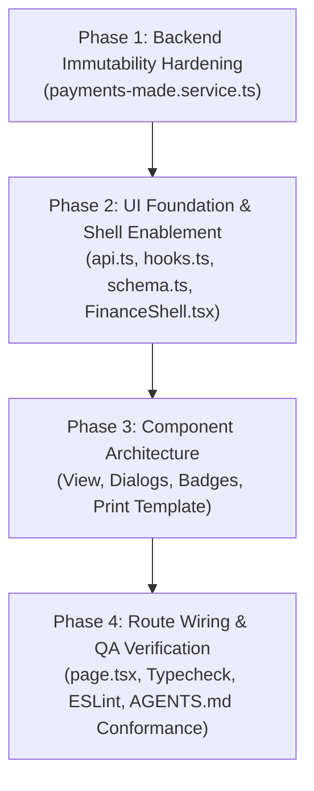

# Vendor Payments Made — Audit Report & Implementation Plan

**Feature:** Vendor Payments Made (`/finance/payments-made`)  
**Parent UI Ticket:** `TEXA-160 — Finance UI Implementation`  
**Operations UI Ticket:** `TEXA-163 — Basic UI: Operations`  
**Backend API Tracking Ticket:** `TEXA-154 — Finance Core Backend APIs (Milestone 5)`  
**Branch:** `feature/finance`  
**Date of Audit:** 24 October 2026  
**Auditor:** Antigravity AI (Pair Programming Assistant)  
**Mode:** Audit & Planning Only (Zero Feature Modifications until Authorized)

---

## 1. Current Implementation Status

| Layer / Component                           |        Status        | Detailed Observation                                                                                                                                                                                                                                                                                                                                                                                     |
| :------------------------------------------ | :------------------: | :------------------------------------------------------------------------------------------------------------------------------------------------------------------------------------------------------------------------------------------------------------------------------------------------------------------------------------------------------------------------------------------------------- |
| **Prisma Database Model**                   |     **Complete**     | `FinancePaymentMade` model exists in `packages/database/prisma/schema.prisma` under the `finance` schema with full relations to `Organization`, `FinanceMasterListItem` (`paymentMode`), `FinanceBankAccount`, `FinanceJournalEntry`, and `ScmSupplierPayment`.                                                                                                                                          |
| **Backend Controller & Routing**            |     **Complete**     | [`PaymentsMadeController`](file:///c:/Users/skkin/OneDrive/Desktop/cooking%20area/Texawave_Erp_Production/apps/api/src/modules/finance/payments-made/payments-made.controller.ts) is registered in `FinanceModule` and handles `GET /`, `GET /:id`, `POST /`, `PATCH /:id`, `POST /:id/confirm`, `POST /:id/void`, and `DELETE /:id`.                                                                    |
| **Backend Business Logic & GL Integration** | **Complete (1 Gap)** | [`PaymentsMadeService`](file:///c:/Users/skkin/OneDrive/Desktop/cooking%20area/Texawave_Erp_Production/apps/api/src/modules/finance/payments-made/payments-made.service.ts) implements double-entry posting (`Debit Accounts Payable 2010`, `Credit Bank/Cash 1020/1010`), bank account deductions, bank transactions, and void reversals. **Gap:** `update()` lacks non-draft immutability enforcement. |
| **Backend Unit Test Suite**                 |     **Complete**     | 26 unit tests passing across `payments-made.repository.spec.ts` (7 tests) and `payments-made.service.spec.ts` (19 tests).                                                                                                                                                                                                                                                                                |
| **Backend E2E Test Suite**                  |     **Complete**     | `apps/api/test/finance-payments-made.e2e-spec.ts` exists covering auth, creation, GL posting, void reversal, and multi-tenant isolation.                                                                                                                                                                                                                                                                 |
| **Shared API Contracts**                    |     **Complete**     | `FinancePaymentMade`, `CreateFinancePaymentMadeInput`, `UpdateFinancePaymentMadeInput`, `QueryFinancePaymentsMadeInput`, and `FinancePaymentMadeStatus` defined in `packages/api-types/src/finance.ts`.                                                                                                                                                                                                  |
| **RBAC & Menu Configuration**               |     **Complete**     | Permissions `finance.payment_made.read` and `finance.payment_made.write` defined in `packages/database/prisma/permissions/catalog.ts`. Menu entry `finance-payments-made` present in `packages/database/prisma/menu/catalog.ts`.                                                                                                                                                                         |
| **Frontend UI Client & Hooks**              |     **Missing**      | No typed API client or React Query hooks exist in `apps/ui/src/features/finance/payments-made/`.                                                                                                                                                                                                                                                                                                         |
| **Frontend UI Views & Dialogs**             |     **Missing**      | No views, components, modals, or printable templates exist under `apps/ui/src/features/finance/payments-made/`.                                                                                                                                                                                                                                                                                          |
| **Frontend Route Page**                     |     **Missing**      | `apps/ui/src/app/(dashboard)/finance/payments-made/page.tsx` does not exist (currently 404).                                                                                                                                                                                                                                                                                                             |
| **Navigation Shell State**                  |     **Disabled**     | `FinanceShell.tsx` and `HorizontalNavbar.tsx` have the Payments Made tab disabled (`upcoming: true`).                                                                                                                                                                                                                                                                                                    |

---

## 2. Existing Files and Endpoints Involved

### 2.1 Backend Source Files

- Controller: [`apps/api/src/modules/finance/payments-made/payments-made.controller.ts`](file:///c:/Users/skkin/OneDrive/Desktop/cooking%20area/Texawave_Erp_Production/apps/api/src/modules/finance/payments-made/payments-made.controller.ts)
- Service: [`apps/api/src/modules/finance/payments-made/payments-made.service.ts`](file:///c:/Users/skkin/OneDrive/Desktop/cooking%20area/Texawave_Erp_Production/apps/api/src/modules/finance/payments-made/payments-made.service.ts)
- Repository: [`apps/api/src/modules/finance/payments-made/payments-made.repository.ts`](file:///c:/Users/skkin/OneDrive/Desktop/cooking%20area/Texawave_Erp_Production/apps/api/src/modules/finance/payments-made/payments-made.repository.ts)
- DTOs:
  - [`apps/api/src/modules/finance/payments-made/dto/create-payment-made.dto.ts`](file:///c:/Users/skkin/OneDrive/Desktop/cooking%20area/Texawave_Erp_Production/apps/api/src/modules/finance/payments-made/dto/create-payment-made.dto.ts)
  - [`apps/api/src/modules/finance/payments-made/dto/update-payment-made.dto.ts`](file:///c:/Users/skkin/OneDrive/Desktop/cooking%20area/Texawave_Erp_Production/apps/api/src/modules/finance/payments-made/dto/update-payment-made.dto.ts)
  - [`apps/api/src/modules/finance/payments-made/dto/query-payments-made.dto.ts`](file:///c:/Users/skkin/OneDrive/Desktop/cooking%20area/Texawave_Erp_Production/apps/api/src/modules/finance/payments-made/dto/query-payments-made.dto.ts)
- Unit Tests:
  - [`apps/api/src/modules/finance/payments-made/payments-made.service.spec.ts`](file:///c:/Users/skkin/OneDrive/Desktop/cooking%20area/Texawave_Erp_Production/apps/api/src/modules/finance/payments-made/payments-made.service.spec.ts)
  - [`apps/api/src/modules/finance/payments-made/payments-made.repository.spec.ts`](file:///c:/Users/skkin/OneDrive/Desktop/cooking%20area/Texawave_Erp_Production/apps/api/src/modules/finance/payments-made/payments-made.repository.spec.ts)
- E2E Test:
  - [`apps/api/test/finance-payments-made.e2e-spec.ts`](file:///c:/Users/skkin/OneDrive/Desktop/cooking%20area/Texawave_Erp_Production/apps/api/test/finance-payments-made.e2e-spec.ts)

### 2.2 Database & Contract Files

- Prisma Schema: [`packages/database/prisma/schema.prisma`](file:///c:/Users/skkin/OneDrive/Desktop/cooking%20area/Texawave_Erp_Production/packages/database/prisma/schema.prisma#L6193-L6225)
- Shared Types: [`packages/api-types/src/finance.ts`](file:///c:/Users/skkin/OneDrive/Desktop/cooking%20area/Texawave_Erp_Production/packages/api-types/src/finance.ts#L520-L590)
- Menu Catalog: [`packages/database/prisma/menu/catalog.ts`](file:///c:/Users/skkin/OneDrive/Desktop/cooking%20area/Texawave_Erp_Production/packages/database/prisma/menu/catalog.ts#L1175-L1181)
- Permissions: [`packages/database/prisma/permissions/catalog.ts`](file:///c:/Users/skkin/OneDrive/Desktop/cooking%20area/Texawave_Erp_Production/packages/database/prisma/permissions/catalog.ts#L1114-L1121)

### 2.3 Navigation Files

- Finance Shell: [`apps/ui/src/features/finance/shared/components/FinanceShell.tsx`](file:///c:/Users/skkin/OneDrive/Desktop/cooking%20area/Texawave_Erp_Production/apps/ui/src/features/finance/shared/components/FinanceShell.tsx#L74-L80)
- Global Navbar: [`apps/ui/src/components/layout/HorizontalNavbar.tsx`](file:///c:/Users/skkin/OneDrive/Desktop/cooking%20area/Texawave_Erp_Production/apps/ui/src/components/layout/HorizontalNavbar.tsx#L1450-L1458)

### 2.4 Endpoints Inventory

| Method   | Endpoint                             | Permission                   | Description                                                                                        |
| :------- | :----------------------------------- | :--------------------------- | :------------------------------------------------------------------------------------------------- |
| `GET`    | `/finance/payments-made`             | `finance.payment_made.read`  | List vendor disbursements with pagination, search, status, and date filters                        |
| `GET`    | `/finance/payments-made/:id`         | `finance.payment_made.read`  | Get disbursement details by ID including bank account, GL journal, and SCM payment                 |
| `POST`   | `/finance/payments-made`             | `finance.payment_made.write` | Record vendor disbursement (defaults to `CONFIRMED` which posts GL journal & deducts bank balance) |
| `PATCH`  | `/finance/payments-made/:id`         | `finance.payment_made.write` | Update disbursement metadata (`vendorName`, `referenceNumber`, `billReference`, `notes`)           |
| `POST`   | `/finance/payments-made/:id/confirm` | `finance.payment_made.write` | Confirm a draft payment, post double-entry GL journal, and deduct bank balance                     |
| `POST`   | `/finance/payments-made/:id/void`    | `finance.payment_made.write` | Void a disbursement, generate GL reversal voucher (`REV-`), and refund bank balance                |
| `DELETE` | `/finance/payments-made/:id`         | `finance.payment_made.write` | Soft-delete a `DRAFT` or `VOID` disbursement                                                       |

---

## 3. Findings Classified by Severity

| ID          |    Severity     |       Category       | Description & Evidence                                                                                                                                                                                                                                                                                                                  | Impact & Recommendation                                                                                                                                                                                                                                         |
| :---------- | :-------------: | :------------------: | :-------------------------------------------------------------------------------------------------------------------------------------------------------------------------------------------------------------------------------------------------------------------------------------------------------------------------------------- | :-------------------------------------------------------------------------------------------------------------------------------------------------------------------------------------------------------------------------------------------------------------- |
| **F-PM-01** |  **P0 (High)**  |   Frontend Missing   | Neither `apps/ui/src/app/(dashboard)/finance/payments-made` nor `apps/ui/src/features/finance/payments-made` exists. Tab in `FinanceShell.tsx` is hardcoded to `disabled: true`.                                                                                                                                                        | Users navigating to `/finance/payments-made` get 404. No interface exists to disburse payments or audit vendor payables. Build full feature layer.                                                                                                              |
| **F-PM-02** |  **P0 (High)**  | Backend Immutability | In `payments-made.service.ts` line 174, `update()` only rejected when `status === "VOID"`. Modifying `paymentDate` or metadata on `CONFIRMED` payments was allowed without updating the posted `FinanceJournalEntry.entryDate`.                                                                                                         | **RESOLVED in Phase 1**: Enforced strict immutability check in `PaymentsMadeService.update()`: `if (existing.status !== "DRAFT") throw new BusinessRuleViolationException(..., "IMMUTABLE_PAYMENT_STATUS")`. Covered by 5 unit tests.                           |
| **F-PM-03** | **P1 (Medium)** | Architecture Parity  | In the legacy ERP screenshot (Image 4), the table shows `EXPECTED DATE (Overdue 235d)`, `TOTAL AMOUNT`, and `REMAINING BALANCE`. In Next-Gen relational ERP, `FinancePaymentMade` is a payment transaction and does not store expected delivery dates or remaining PO balances. Those belong to `ScmPurchaseOrder` / `ScmSupplierBill`. | Replicating `EXPECTED DATE` and `REMAINING BALANCE` as primary columns on payment transactions would require fabricated values or empty cells. Instead, present `BILL / PO REF` and `AMOUNT PAID`, and provide an Accounts Payable cash outflow summary banner. |
| **F-PM-04** | **P1 (Medium)** | UX / Data Integrity  | `CreatePaymentMadeDto` takes `vendorName: string` (free-text string). It does not enforce a foreign key to `Supplier`.                                                                                                                                                                                                                  | Users can enter typos in vendor names. In the UI form, integrate an autocomplete combobox with SCM `useSuppliers` while allowing custom text for ad-hoc payees.                                                                                                 |
| **F-PM-05** |  **P2 (Low)**   |      API Filter      | `QueryPaymentsMadeDto` lacks a dedicated `supplierId` filter; however, `search` matches across `vendorName`, `paymentNumber`, `referenceNumber`, and `billReference`.                                                                                                                                                                   | Sufficient for the UI search bar requirement ("Search by Payment No, Vendor, PO..."), requiring no backend DTO modifications.                                                                                                                                   |
| **F-PM-06** |  **P2 (Low)**   |    Business Rule     | `payments-made.service.ts` line 61 rejects future `paymentDate` (`dto.paymentDate > todayStr`).                                                                                                                                                                                                                                         | Cleared disbursements cannot be dated in the future. Form date picker must enforce `max={today}`.                                                                                                                                                               |

---

## 4. Differences Between Legacy Behavior and Current Implementation

```
+---------------------------------------------------------------------------------------------------------+
|                                        ARCHITECTURAL EVOLUTION                                          |
+------------------------------------+--------------------------------------------------------------------+
| Legacy ERP (Firebase RTDB)          | Next-Gen ERP (TexaOne Relational Engine)                           |
+------------------------------------+--------------------------------------------------------------------+
| Flat node: `purchases/paymentsMade`| Dedicated table: `finance.payments_made` with tenant isolation      |
| Denormalized `poTotalAmount`,      | Normalized: `billReference` on payment; full PO tracking in       |
| `expectedDate` copied onto payment | `scm.purchase_orders` & bills in `scm.supplier_bills`              |
| No double-entry accounting         | Double-entry posting: Debit AP (2010), Credit Bank/Cash (1020/1010)|
| Free-text payment mode string      | Foreign key `paymentModeId` + `bankAccountId` with balance tracking|
| Bank balance unaffected            | Atomic bank balance deduction + DEBIT BankTransaction record       |
| No audit trail upon deletion       | Full lifecycle: DRAFT, CONFIRMED, RECONCILED, VOID + REV- vouchers |
+------------------------------------+--------------------------------------------------------------------+
```

---

## 5. API Contract Gaps and Required Test Cases

### 5.1 Contract Gaps Identified

1. **Service Immutability:** Backend `PaymentsMadeService.update()` must be updated to restrict edits strictly to `existing.status === 'DRAFT'`.
2. **Missing UI API Client:** Need `apps/ui/src/features/finance/payments-made/api.ts` exposing all 7 endpoints (`list`, `get`, `create`, `update`, `confirm`, `void`, `delete`).
3. **Missing React Query Hooks:** Need `apps/ui/src/features/finance/payments-made/hooks.ts` with invalidation of `"finance-payments-made"`, `"finance-bank-accounts"`, and `"finance-accounts"`.

### 5.2 Required Test Cases

1. **Backend Unit Tests (`payments-made.service.spec.ts`):**
   - `throws BusinessRuleViolationException when updating a CONFIRMED disbursement`
   - `throws BusinessRuleViolationException when updating a RECONCILED disbursement`
   - `successfully updates metadata on a DRAFT disbursement`
2. **Frontend Typecheck & Lint:**
   - `pnpm --filter ui run typecheck` (`next typegen && tsc --noEmit`) passes with 0 errors under `exactOptionalPropertyTypes: true`.
   - `pnpm --filter ui exec eslint` passes with 0 errors and 0 warnings.
3. **Manual Postman Verification:**
   - Verified that Payments Received Postman checks are currently **PENDING USER VERIFICATION**.
   - Payments Made Postman tests will be prepared alongside UI development without blocking progress.

---

## 6. Database or Migration Requirements

> [!IMPORTANT]
> **No database schema migration is required.**
>
> The existing Prisma model `FinancePaymentMade` in `packages/database/prisma/schema.prisma` lines 6193–6225 contains all required columns:
> `id`, `organizationId`, `paymentNumber`, `paymentDate`, `vendorName`, `amount`, `paymentModeId`, `bankAccountId`, `referenceNumber`, `billReference`, `scmSupplierPaymentId`, `notes`, `status`, `journalEntryId`, `createdBy`, `updatedBy`, `createdAt`, `updatedAt`, `deletedAt`.
>
> All foreign key relations (`paymentMode`, `bankAccount`, `journalEntry`, `scmPayment`) are active and working in the database.

---

## 7. Phased Remediation and Implementation Plan



### Phase 1: Backend Immutability Hardening (COMPLETED)

- Enforce `existing.status === 'DRAFT'` in `PaymentsMadeService.update()` (rejects `CONFIRMED`, `RECONCILED`, `VOID`).
- Added 5 unit test cases in `payments-made.service.spec.ts` demonstrating that draft disbursements can be updated, while non-drafts are rejected with `IMMUTABLE_PAYMENT_STATUS` and repository mutation is never called.
- Verified 29/29 unit tests pass in `src/modules/finance/payments-made`. Zero ESLint errors.

### Phase 2: UI Foundation & Shell Enablement (COMPLETED)

- Created `apps/ui/src/features/finance/payments-made/api.ts` exposing all 7 backend endpoints.
- Created `apps/ui/src/features/finance/payments-made/hooks.ts` with React Query hooks and multi-cache invalidation (`payments-made`, `journal-entries`, `accounts`, `bank-accounts`).
- Created `apps/ui/src/features/finance/payments-made/schema.ts` with Zod validation (past/present date check, positive amount, required vendor name).
- Staged navigation wiring in `FinanceShell.tsx` and `HorizontalNavbar.tsx`. Kept safely disabled pending route page creation in Phase 4.
- Verified TypeScript typecheck (0 errors) and ESLint (0 errors, 0 warnings). 9/9 schema validation tests passing.

### Phase 3: Component Implementation (COMPLETED)

- `permissions.ts`: Defined `FINANCE_PAYMENT_MADE_READ` and `FINANCE_PAYMENT_MADE_WRITE`.
- `PaymentMadeStatusBadge.tsx`: Badges for `DRAFT`, `CONFIRMED`, `RECONCILED`, `VOID` in TexaOne colors.
- `DisbursementsSummaryBanner.tsx`: AP outflow summary card (confirmed paid, bank vs cash breakdown, draft staging metrics).
- `RecordPaymentMadeDialog.tsx`: Modal for recording vendor disbursements (Vendor combobox with SCM suggestions, payment date, amount, mode, bank account, reference, bill/PO reference, notes, with "Record & Post to GL" or "Save as Draft" options).
- `EditPaymentMadeDialog.tsx`: Modal for editing `DRAFT` disbursements (strictly guarded against non-draft records, key-based form reset preventing React 19 warnings).
- `PaymentMadeDetailDialog.tsx`: Modal showing full disbursement breakdown, linked GL journal voucher info, audit timestamps, and direct action triggers.
- `PaymentDisbursementTemplate.tsx`: Printable payment voucher with Indian currency words, double-entry General Ledger breakdown, 3 authorization signatures, and company header.
- `printPaymentDisbursement.tsx`: Browser-native print and PDF generation rendering static markup with A4 print CSS.
- `PaymentsMadeView.tsx`: Full operational view with hero header, search input, status filter, payment month filter, data table, empty/error states, and action menus.
- `index.ts`: Barrel export updated to export all components, print utilities, hooks, API client, permissions, and schemas.
- Verification: `pnpm --filter ui run typecheck` (0 errors), `pnpm --filter ui exec eslint` (0 errors, 0 warnings), `pnpm --filter api test src/modules/finance/payments-made` (29/29 passed).

### Phase 4: Route Integration & Verification (COMPLETED)

- Created `apps/ui/src/app/(dashboard)/finance/payments-made/page.tsx` rendering `PaymentsMadeView`.
- Enabled Payments Made in `FinanceShell.tsx` (`path: "/finance/payments-made"`, `disabled: false`, upcoming message removed).
- Enabled Payments Made in `HorizontalNavbar.tsx` (removed `disabled: true` and `upcoming: true`).
- Verified permission enforcement: `finance.payment_made.read` guards the page view with `ErrorState`; `finance.payment_made.write` conditionally guards create, edit, confirm, void, and delete actions.
- Verification: `pnpm --filter ui run typecheck` passed (0 errors), `pnpm --filter ui exec eslint` passed (0 errors, 0 warnings), backend tests passed (29/29 Payments Made, 47/47 Payments Received).
- Verified strict compliance with `AGENTS.md` (no violet/purple, Nunito Sans font only, deterministic business icons only, no `overflow-hidden` on form card containers).

---

## 8. Exact Verification Commands

```powershell
# 1. Backend unit tests for Payments Made
pnpm --filter api test src/modules/finance/payments-made

# 2. Backend unit tests for Payments Received (Regression Guard)
pnpm --filter api test src/modules/finance/payments-received

# 3. UI TypeScript Typecheck
pnpm --filter ui run typecheck

# 4. UI ESLint Check
pnpm --filter ui exec eslint "src/app/(dashboard)/finance/payments-made" "src/features/finance/payments-made" "src/features/finance/shared/components/FinanceShell.tsx" "src/components/layout/HorizontalNavbar.tsx"
```

---

## 9. Current Status & Stop Condition

Payments Made Phases 1 through 4 are **fully implemented and verified**.

- Backend immutability enforcement is active and tested.
- Frontend route `/finance/payments-made` is wired and active.
- Navigation in `FinanceShell.tsx` and `HorizontalNavbar.tsx` is enabled.
- Payments Received Postman tests remain marked as **PENDING USER VERIFICATION**.
