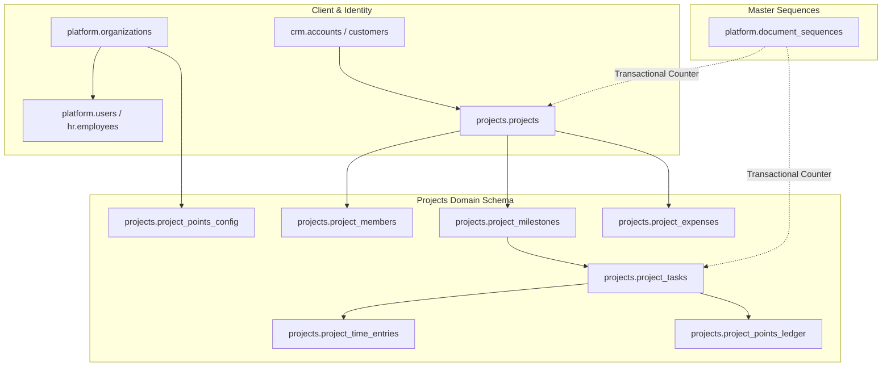
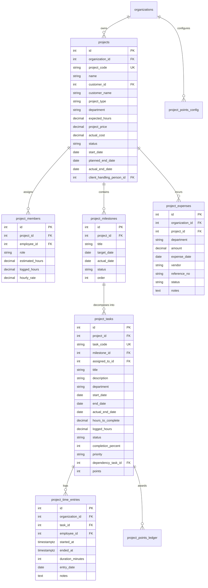

# TexaWave ERP — Projects Module Specification & Production Architecture Mapping

**Document Version:** 1.0.0  
**Status:** Approved Specification  
**Authority:** Reconciles Legacy Blueprint (`project_arch(1).md`) with Production Monorepo Architecture (`Docs/ARCHITECTURE.md`, `Docs/CODING_STANDARDS.md`, `Docs/DESIGN_SYSTEM.md`).  
**Author:** TexaWave Senior Architecture & Full-Stack Engineering Team  
**Date:** October 2026

---

## 1. Executive Summary & Legacy-to-Production Architecture Mapping

### 1.0 Visual References & Attachment Inspection (5 Uploaded Images)

The following reference attachments and workspace artifacts were inspected:

1. `TexaWave_ERP.zip` (located at `C:\Users\skkin\OneDrive\Desktop\my edits in texaware are here\TexaWave_ERP.zip` and extracted in `my edits in texaware are here\TexaWave_ERP\`) — Legacy React 18 / Firebase project source code.
2. `project_arch.md` (located at `C:\Users\skkin\OneDrive\Desktop\project_arch.md`) — Legacy Projects Architecture & Recreation Blueprint.
3. `ARCHITECTURE.md` (located at `Docs/ARCHITECTURE.md`) — Production Monorepo System Architecture & Build Guide.
4. **Five Visual Reference Screenshots** inspected directly in the conversation context:

| Image   | Actual filename                    | Screen or feature shown                               | Relevant implementation requirements                                                                                                                                                                                                                                                                                                                                                                                                                                                    |
| ------- | ---------------------------------- | ----------------------------------------------------- | --------------------------------------------------------------------------------------------------------------------------------------------------------------------------------------------------------------------------------------------------------------------------------------------------------------------------------------------------------------------------------------------------------------------------------------------------------------------------------------- |
| Image 1 | `media_1792645853566_3bf009e9.png` | **Project Tracker Dashboard** (`/projects/dashboard`) | Green banner `#4D9F4B` with "+ New Project", 4 KPI summary cards (Total Projects, Hours Logged, Total Budget, Completed Projects), 5 clickable Health/Deliverable filters (Projects on Track, Delayed Projects, Resource Utilization, Upcoming Milestones, Open Tasks), 4 status pills (Active, On Hold, Completed, Cancelled), and Recent Projects Directory table with code, client, status & health, milestones progress, logged vs expected hours, contract price, and view action. |
| Image 2 | `media_1792645860547_979d9ee2.png` | **All Projects Directory** (`/projects/list`)         | Search input ("Search by project name, code or customer..."), Status filter pills (All Status, Active, On Hold, Completed, Cancelled), Health filter pills (All Projects, On Track, Delayed Milestones, Due in 7 Days). Data table with Code/Project, Customer, Status & Health (`Active`, `On Track` / `Delayed`), Milestones count (`0/2 Done`), Hours Utilization progress bar (`Xh / Yh (%)`), Budget Utilization (`₹spent / ₹budget (%)`), and Actions context menu.               |
| Image 3 | `media_1792645869944_142eda60.png` | **Project Expenses** (`/projects/expenses`)           | Header banner with "+ Add Expense", Summary cards (Total Expenses, Paid Amount, Unpaid Amount). Filter bar with search, status dropdown (All, Paid, Unpaid), vendor dropdown, department dropdown, and date range pickers. Records table showing Client Name, Project Name, Department, Amount (₹), Date, Vendor, Reference, Status (`Paid` / `Unpaid` badges), Notes, and Edit/Delete action buttons.                                                                                  |
| Image 4 | `media_1792645876148_c2819b8b.png` | **Proposal Documents** (`/proposals` / sidebar link)  | Document generation interface with role badge "Admin (Full Access)", "+ Create Proposal", "Manage Templates", and "Settings" buttons. Summary cards (Total Proposals, Follow-ups Due, Under Review, Approved, Sent to Client). Tabs: "All Proposals", "Workflow & Audit History". Table with Proposal # (`TXW-PROP-XXXX`), Project Name, Client, Template Used, Version, Created By, Created Date, Follow-up Due (`Overdue (dd/mm/yyyy)`), Status, and Actions.                         |
| Image 5 | `media_1792645884779_bb228544.png` | **Minutes of Meeting (MoM)** (`/mom` / sidebar link)  | Cross-project meeting minutes register with "CROSS-PROJECT REGISTER" tag, "+ Create MoM", "Manage Templates" buttons. Summary cards (Total Meetings, Finalized Records, Active Drafts). Search and filters by reference/title/project, All Projects, All Statuses, and Date Range. Meeting records table.                                                                                                                                                                               |

### 1.1 Scope and Objective

The **Projects Module** is the operational core for tracking engineering deliverables, client contracts, milestones, granular task breakdown, stopwatch time tracking, resource capacity allocation, financial budget utilization, and employee gamification rewards.

The legacy implementation was built on Firebase Realtime Database (RTDB), Vite, React 18, and client-side listeners with hardcoded green brand tokens (`#4D9F4B`). In accordance with `ARCHITECTURE.md` and `DESIGN_SYSTEM.md`, the production ERP completely supersedes this with:

1. **PostgreSQL Relational Storage:** Multi-tenant PostgreSQL with isolated `projects` schema, foreign key integrity, row locking, and transactional concurrency.
2. **NestJS Modular Backend:** Feature-oriented architecture (`apps/api/src/modules/projects/`) with strict controller → service → repository tiers, `@RequirePermission()`, `@OrgScoped()` tenancy guards, class-validator DTOs, and global audit logging (`platform.audit_logs`).
3. **Next.js App Router UI:** React 19 / Next.js 16 with TanStack Query (`@tanstack/react-query`), TypeScript shared contracts (`@texawave-erp/api-types`), and the ERP-standard blue-to-cyan theme gradient (`#2563EB` → `#06B6D4`).
4. **Master-Data & Document Sequence Integration:** Leverages `platform.document_sequences` for transactional, gap-free, zero-padded code generation (`PRJ-000001`, `TSK-000001`).



---

### 1.2 Legacy-to-Production Architectural Mapping Matrix

| Functional Area           | Legacy Architecture (`project_arch(1).md`)          | Production ERP Target Architecture                                           |
| :------------------------ | :-------------------------------------------------- | :--------------------------------------------------------------------------- |
| **Persistence Engine**    | Firebase Realtime Database (NoSQL trees)            | PostgreSQL 16 via Prisma ORM 6 (`projects` schema)                           |
| **Tenancy Boundary**      | Client-filtered NoSQL queries                       | Tenant-enforced `@OrgScoped()` & `organizationId` foreign keys               |
| **ID / Primary Keys**     | Firebase auto-push IDs (strings)                    | BigInt / Integer auto-increment PKs (`id Int @id @default(autoincrement())`) |
| **Document Numbering**    | Client-side `projects.length + 1` (race conditions) | Database-level row-lock via `platform.document_sequences`                    |
| **Authentication & RBAC** | Firebase Auth + client role checks                  | JWT Bearer, NestJS Guards, `PermissionsGuard`, RBAC catalog                  |
| **Timer Concurrency**     | Client timestamp interval pushed to Firebase        | Backend transactional start/stop with running-timer validation               |
| **Gamification Engine**   | Client-side push to `projects_points_ledger`        | Backend trigger upon task status transition to `completed`                   |
| **Financial Tracking**    | Client math on unvalidated fields                   | Strict `Decimal(14, 2)` calculations in backend services                     |
| **UI Design System**      | Custom CSS `#4D9F4B` green gradient                 | TexaOne Blue-to-Cyan standard (`#2563EB` → `#06B6D4`)                        |

---

### 1.3 Legacy Requirements Coverage Matrix

| Page or workflow             | Legacy Source File          | Legacy behavior to preserve in Production                                                                                                                                                                                                               | Production Implementation Status                                                                                                                                                            |
| ---------------------------- | --------------------------- | ------------------------------------------------------------------------------------------------------------------------------------------------------------------------------------------------------------------------------------------------------- | ------------------------------------------------------------------------------------------------------------------------------------------------------------------------------------------- |
| **Project Dashboard**        | `ProjectsDashboard.tsx`     | KPIs (total projects, active projects, hours logged, total budget, spent, completed), dynamic project health signals (on track vs delayed), upcoming milestones (7-day window), open tasks, clickable status/health filters, recent projects directory. | **Backend Implemented & Verified**: `GET /projects/analytics/dashboard` returns portfolio counts, active projects, logged hours, expected hours, total budget, total spent, health signals. |
| **All Projects**             | `ProjectList.tsx`           | Search by title/code/customer, status filter pills (All, Active, On Hold, Completed, Cancelled), health filters (All, On Track, Delayed, Due in 7 Days), pagination, project summaries with progress bars.                                              | **Backend Implemented & Verified**: `GET /projects` supports `page`, `limit`, `status`, `health`, `department`, `customerId`, `search` query parameters.                                    |
| **Project creation/editing** | `ProjectForm.tsx`           | Project metadata, client linkage, planned dates, handling person/lead, allocated members with hourly rates, expected hours, contract price, and sequential numbering.                                                                                   | **Backend Implemented & Verified**: `POST /projects` and `PATCH /projects/:id` with atomic document sequence generator (`PRJ-XXXXXX`).                                                      |
| **Project details**          | `ProjectDetail.tsx`         | Comprehensive view: Overview, milestones list, task hierarchy, team allocations, project expenses ledger, live budget utilization.                                                                                                                      | **Backend Implemented & Verified**: `GET /projects/:id` returns project with milestones, members, tasks, expenses, and calculated EVM health.                                               |
| **Milestone modal**          | `MilestoneModal.tsx`        | Create/edit milestone title, target date, order, completion status, cascade validation.                                                                                                                                                                 | **Backend Implemented & Verified**: `POST /projects/:id/milestones`, `PATCH /projects/milestones/:id`, `DELETE /projects/milestones/:id`.                                                   |
| **Task modal**               | `TaskModal.tsx`             | Task creation/editing, sequential code (`TSK-XXXXXX`), milestone linkage, assignee, priority (`low`, `medium`, `high`, `urgent`), auto business hours computation (M-F 8h), dependency selection with cycle prevention.                                 | **Backend Implemented & Verified**: `POST /projects/:id/tasks`, `PATCH /projects/tasks/:id`, `GET /projects/tasks/:id` with DFS cycle guard.                                                |
| **Linked-pair selector**     | `LinkedPairSelect.tsx`      | Dynamic selection linking Project $\rightarrow$ Milestone $\rightarrow$ Task ensuring tasks are constrained to project boundary.                                                                                                                        | **Backend Implemented & Verified**: Foreign keys strictly validate `milestone.projectId === project.id` and `task.projectId === project.id`.                                                |
| **My Work**                  | `MyWork.tsx`                | Personal developer backlog, active task queue, live stopwatch timer, manual time entry logs, task completion slider.                                                                                                                                    | **Backend Implemented & Verified**: `GET /projects/tasks/my-work` returns authenticated employee's active work backlog and time history.                                                    |
| **Task timer**               | `TaskTimer.tsx`             | Start, stop, resume stopwatch; elapsed time calculation; prevents duplicate active timers across employee; writes to `project_time_entries`.                                                                                                            | **Backend Implemented & Verified**: `POST /projects/tasks/:id/timer/start`, `POST /projects/tasks/:id/timer/stop`, `GET /projects/tasks/timer/active`.                                      |
| **Completion celebration**   | `CompletionCelebration.tsx` | Triggered when task is marked `completed` (or 100%); awards priority-based points into `project_points_ledger`; idempotent to prevent double-awarding.                                                                                                  | **Backend Implemented & Verified**: `TasksService.updateTask` triggers `awardTaskPoints` only once per completed task.                                                                      |
| **Resource Tracking**        | `ResourceTracking.tsx`      | Team member workload tracking, active in-progress task count, capacity utilization % (160h base), gamification points leaderboard.                                                                                                                      | **Backend Implemented & Verified**: `GET /projects/analytics/resources` and `GET /projects/points/leaderboard`.                                                                             |
| **Project Expenses**         | `ProjectExpenses.tsx`       | Expense CRUD, project linkage, vendor name, reference invoice #, payment status (`paid`, `unpaid`), date filters, total spend aggregation.                                                                                                              | **Backend Implemented & Verified**: `POST /projects/:id/expenses`, `GET /projects/:id/expenses`, `GET /projects/expenses`.                                                                  |
| **Budget Utilization**       | `BudgetUtilization.tsx`     | Contract price, expected hours, logged hours, actual expenses spend, budget variance, earned revenue (EVM).                                                                                                                                             | **Backend Implemented & Verified**: `GET /projects/:id/budget-utilization` calculates EVM earned value and budget variance.                                                                 |
| **Analytics**                | `ProjectAnalytics.tsx`      | Milestone delivery velocity, project health distribution, department spend & velocity, resource workload metrics.                                                                                                                                       | **Backend Implemented & Verified**: `GET /projects/analytics/department-breakdown` and `GET /projects/analytics/dashboard`.                                                                 |
| **Points Master**            | `PointsMaster.tsx`          | Priority points configuration (Low: 5, Med: 10, High: 20, Urgent: 30), custom rules persistence, points audit ledger history.                                                                                                                           | **Backend Implemented & Verified**: `GET /projects/points/config`, `PATCH /projects/points/config`, `GET /projects/points/leaderboard`.                                                     |

---

### 1.4 Scope Verification: Proposal Documents & Minutes of Meeting (MoM)

1. **Analysis of Legacy Source Code (`TexaWave_ERP.zip`):**
   - Inspection of `src/modules/projects/` reveals that neither Proposal Documents nor Minutes of Meeting (MoM) were part of the legacy projects module source files (`ProjectsDashboard.tsx`, `ProjectList.tsx`, `ProjectForm.tsx`, `ProjectDetail.tsx`, `MyWork.tsx`, `ProjectExpenses.tsx`, `ResourceTracking.tsx`, `BudgetUtilization.tsx`, `ProjectAnalytics.tsx`, `PointsMaster.tsx`, `types.ts`, `projectCalculations.ts`).
   - In `src/App.tsx`, the `/projects` routing tree strictly defined the 11 subroutes above.
   - Proposals in the legacy system originated as sales/CRM quotations (`Docs/CRM_QUOTES_LEGACY_PARITY.md`), while MoM represents a cross-functional governance register.
2. **Analysis of Uploaded Screenshots (Images 4 & 5):**
   - In Images 2, 3, 4, and 5, the sidebar contains navigation links for `Proposal Documents` (URL: `/proposals`) and `Minutes of Meeting` (URL: `/mom`).
   - **Architectural Scope Decision:** In accordance with the modular production architecture:
     - The core Projects module scope comprises the 10 functional modules and 11 routes defined in `project_arch(1).md` and `PROJECTS_MODULE_SPEC.md`.
     - In the Next.js UI navigation sidebar, `Proposal Documents` (`/proposals`) and `Minutes of Meeting` (`/mom`) will be represented in the navigation hierarchy as cross-module links. The UI provides dedicated placeholder / stub views adhering to the TexaOne design system, while keeping domain data decoupled from core project tables to prevent duplicate document-management engines or circular CRM dependencies.

---

## 2. Domain Entities & Database Schema (`projects` Schema)

The database schema is housed under the isolated schema `projects`. All tables include standard platform audit attributes (`organization_id`, `created_by`, `updated_by`, `created_at`, `updated_at`, `deleted_at`).

### 2.1 Entity Relationship Diagram



### 2.2 Prisma Schema Definitions

```prisma
// ---------------------------------------------------------------------------
// Projects Module Schema — projects
// ---------------------------------------------------------------------------

enum ProjectStatus {
  active
  on_hold
  completed
  cancelled

  @@schema("projects")
}

enum MilestoneStatus {
  not_started
  in_progress
  hold
  completed

  @@schema("projects")
}

enum TaskStatus {
  not_started
  in_progress
  hold
  completed

  @@schema("projects")
}

enum TaskPriority {
  low
  medium
  high
  urgent

  @@schema("projects")
}

enum ProjectExpenseStatus {
  unpaid
  paid
  cancelled

  @@schema("projects")
}

model Project {
  id                    Int           @id @default(autoincrement())
  organizationId        Int           @map("organization_id")
  projectCode           String        @map("project_code")
  name                  String
  description           String?
  customerId            Int?          @map("customer_id")
  customerName          String?       @map("customer_name")
  projectType           String?       @map("project_type")
  department            String?
  expectedHours         Decimal       @default(0) @map("expected_hours") @db.Decimal(10, 2)
  projectPrice          Decimal       @default(0) @map("project_price") @db.Decimal(14, 2)
  actualCost            Decimal       @default(0) @map("actual_cost") @db.Decimal(14, 2)
  status                ProjectStatus @default(active)
  startDate             DateTime      @map("start_date") @db.Date
  plannedEndDate        DateTime?     @map("planned_end_date") @db.Date
  actualEndDate         DateTime?     @map("actual_end_date") @db.Date
  clientHandlingPersonId Int?         @map("client_handling_person_id")
  customFields          Json          @default("{}") @map("custom_fields")
  createdBy             Int?          @map("created_by")
  updatedBy             Int?          @map("updated_by")
  createdAt             DateTime      @default(now()) @map("created_at") @db.Timestamptz(6)
  updatedAt             DateTime      @updatedAt @map("updated_at") @db.Timestamptz(6)
  deletedAt             DateTime?     @map("deleted_at") @db.Timestamptz(6)

  organization         Organization        @relation(fields: [organizationId], references: [id])
  clientHandlingPerson Employee?           @relation("ProjectClientHandler", fields: [clientHandlingPersonId], references: [id])
  members              ProjectMember[]
  milestones           ProjectMilestone[]
  tasks                ProjectTask[]
  expenses             ProjectExpense[]

  @@unique([organizationId, projectCode])
  @@index([organizationId, status])
  @@index([organizationId, department])
  @@map("projects")
  @@schema("projects")
}

model ProjectMember {
  id             Int       @id @default(autoincrement())
  organizationId Int       @map("organization_id")
  projectId      Int       @map("project_id")
  employeeId     Int       @map("employee_id")
  role           String    @default("Contributor")
  estimatedHours Decimal   @default(0) @map("estimated_hours") @db.Decimal(10, 2)
  loggedHours    Decimal   @default(0) @map("logged_hours") @db.Decimal(10, 2)
  hourlyRate     Decimal   @default(0) @map("hourly_rate") @db.Decimal(10, 2)
  createdAt      DateTime  @default(now()) @map("created_at") @db.Timestamptz(6)
  updatedAt      DateTime  @updatedAt @map("updated_at") @db.Timestamptz(6)

  organization Organization @relation(fields: [organizationId], references: [id])
  project      Project      @relation(fields: [projectId], references: [id], onDelete: Cascade)
  employee     Employee     @relation(fields: [employeeId], references: [id])

  @@unique([projectId, employeeId])
  @@index([organizationId, employeeId])
  @@map("project_members")
  @@schema("projects")
}

model ProjectMilestone {
  id             Int             @id @default(autoincrement())
  organizationId Int             @map("organization_id")
  projectId      Int             @map("project_id")
  title          String
  targetDate     DateTime        @map("target_date") @db.Date
  actualDate     DateTime?       @map("actual_date") @db.Date
  status         MilestoneStatus @default(not_started)
  order          Int             @default(1)
  createdAt      DateTime        @default(now()) @map("created_at") @db.Timestamptz(6)
  updatedAt      DateTime        @updatedAt @map("updated_at") @db.Timestamptz(6)
  deletedAt      DateTime?       @map("deleted_at") @db.Timestamptz(6)

  organization Organization  @relation(fields: [organizationId], references: [id])
  project      Project       @relation(fields: [projectId], references: [id], onDelete: Cascade)
  tasks        ProjectTask[]

  @@index([projectId, order])
  @@map("project_milestones")
  @@schema("projects")
}

model ProjectTask {
  id                 Int          @id @default(autoincrement())
  organizationId     Int          @map("organization_id")
  projectId          Int          @map("project_id")
  taskCode           String       @map("task_code")
  milestoneId        Int?         @map("milestone_id")
  assignedToId       Int?         @map("assigned_to_id")
  title              String
  description        String?
  department         String?
  startDate          DateTime     @map("start_date") @db.Date
  endDate            DateTime     @map("end_date") @db.Date
  actualEndDate      DateTime?    @map("actual_end_date") @db.Date
  hoursToComplete    Decimal      @default(0) @map("hours_to_complete") @db.Decimal(10, 2)
  loggedHours        Decimal      @default(0) @map("logged_hours") @db.Decimal(10, 2)
  status             TaskStatus   @default(not_started)
  completionPercent  Int          @default(0) @map("completion_percent")
  priority           TaskPriority @default(medium)
  dependencyTaskId   Int?         @map("dependency_task_id")
  points             Int          @default(10)
  customFields       Json         @default("{}") @map("custom_fields")
  createdBy          Int?         @map("created_by")
  updatedBy          Int?         @map("updated_by")
  createdAt          DateTime     @default(now()) @map("created_at") @db.Timestamptz(6)
  updatedAt          DateTime     @updatedAt @map("updated_at") @db.Timestamptz(6)
  deletedAt          DateTime?    @map("deleted_at") @db.Timestamptz(6)

  organization   Organization         @relation(fields: [organizationId], references: [id])
  project        Project              @relation(fields: [projectId], references: [id], onDelete: Cascade)
  milestone      ProjectMilestone?    @relation(fields: [milestoneId], references: [id], onDelete: SetNull)
  assignedTo     Employee?            @relation(fields: [assignedToId], references: [id])
  dependencyTask ProjectTask?         @relation("TaskDependencies", fields: [dependencyTaskId], references: [id])
  dependentTasks ProjectTask[]        @relation("TaskDependencies")
  timeEntries    ProjectTimeEntry[]
  pointsLedger   ProjectPointsLedger[]

  @@unique([organizationId, taskCode])
  @@index([projectId, status])
  @@index([organizationId, assignedToId])
  @@map("project_tasks")
  @@schema("projects")
}

model ProjectTimeEntry {
  id              Int       @id @default(autoincrement())
  organizationId  Int       @map("organization_id")
  taskId          Int       @map("task_id")
  employeeId      Int       @map("employee_id")
  startedAt       DateTime  @map("started_at") @db.Timestamptz(6)
  endedAt         DateTime? @map("ended_at") @db.Timestamptz(6)
  durationMinutes Int       @default(0) @map("duration_minutes")
  entryDate       DateTime  @map("entry_date") @db.Date
  notes           String?
  createdAt       DateTime  @default(now()) @map("created_at") @db.Timestamptz(6)

  organization Organization @relation(fields: [organizationId], references: [id])
  task         ProjectTask  @relation(fields: [taskId], references: [id], onDelete: Cascade)
  employee     Employee     @relation(fields: [employeeId], references: [id])

  @@index([organizationId, employeeId, entryDate])
  @@index([taskId])
  @@map("project_time_entries")
  @@schema("projects")
}

model ProjectExpense {
  id             Int                  @id @default(autoincrement())
  organizationId Int                  @map("organization_id")
  projectId      Int                  @map("project_id")
  department     String?
  amount         Decimal              @db.Decimal(14, 2)
  expenseDate    DateTime             @map("expense_date") @db.Date
  vendor         String?
  referenceNo    String?              @map("reference_no")
  status         ProjectExpenseStatus @default(unpaid)
  notes          String?
  createdBy      Int?                 @map("created_by")
  createdAt      DateTime             @default(now()) @map("created_at") @db.Timestamptz(6)
  updatedAt      DateTime             @updatedAt @map("updated_at") @db.Timestamptz(6)

  organization Organization @relation(fields: [organizationId], references: [id])
  project      Project      @relation(fields: [projectId], references: [id], onDelete: Cascade)

  @@index([organizationId, projectId])
  @@map("project_expenses")
  @@schema("projects")
}

model ProjectPointsLedger {
  id             Int      @id @default(autoincrement())
  organizationId Int      @map("organization_id")
  employeeId     Int      @map("employee_id")
  taskId         Int      @map("task_id")
  taskTitle      String   @map("task_title")
  points         Int
  awardedAt      DateTime @default(now()) @map("awarded_at") @db.Timestamptz(6)
  note           String?

  organization Organization @relation(fields: [organizationId], references: [id])
  employee     Employee     @relation(fields: [employeeId], references: [id])
  task         ProjectTask  @relation(fields: [taskId], references: [id], onDelete: Cascade)

  @@index([organizationId, employeeId])
  @@map("project_points_ledger")
  @@schema("projects")
}

model ProjectPointsConfig {
  id             Int      @id @default(autoincrement())
  organizationId Int      @unique @map("organization_id")
  low            Int      @default(5)
  medium         Int      @default(10)
  high           Int      @default(20)
  urgent         Int      @default(30)
  customRules    Json     @default("{}") @map("custom_rules")
  updatedAt      DateTime @updatedAt @map("updated_at") @db.Timestamptz(6)

  organization Organization @relation(fields: [organizationId], references: [id])

  @@map("project_points_config")
  @@schema("projects")
}
```

---

## 3. Mathematical Formulas & Business Rules Engine

All computational logic documented in `project_arch(1).md` is preserved and implemented in shared pure functions (`apps/api/src/modules/projects/calculations/project-calculations.ts` and `@texawave-erp/core`):

### 3.1 Business Days & Hours Calculation

Calculates standard working hours strictly across business weekdays (Monday through Friday), excluding Saturdays and Sundays at 8 working hours per day:

$$\text{BusinessDays}(S, E) = \sum_{d=S}^{E} [d \notin \{\text{Saturday}, \text{Sunday}\}]$$
$$\text{HoursToComplete} = \text{BusinessDays}(S, E) \times 8$$

- Edge cases: If $E < S$, return 0. If $S = E$ and is a weekday, returns 8 hours.

### 3.2 Dynamic Project Health Detection

A project's health is evaluated on the fly based on milestone completion dates:

- **Delayed:** If at least one milestone has $\text{targetDate} < \text{currentDate}$ and $\text{status} \neq \text{'completed'}$ while project status is not completed.
- **Completed:** If project status is `'completed'` or all milestones are `'completed'`.
- **On Track:** If neither delayed nor completed.

### 3.3 Earned Value & Monetary Progress (EVM)

$$\text{AmountEarned} = \text{LoggedHours} \times \left( \frac{\text{ProjectPrice}}{\text{ExpectedHours}} \right) \quad (\text{if ExpectedHours} > 0)$$

### 3.4 Budget Utilization & Variance

$$\text{BudgetUtilizationPercentage} = \text{round}\left( \frac{\text{ActualSpend}}{\text{ProjectPrice}} \times 100 \right) \quad (\text{where ActualSpend} = \sum \text{Expenses})$$
$$\text{Variance} = \text{ProjectPrice} - \text{ActualSpend} \quad (\ge 0 \implies \text{Under Budget / Profitable})$$

### 3.5 Resource Capacity & Utilization

$$\text{MonthlyEmployeeCapacity} = 20 \text{ working days} \times 8 \text{ hours} = 160 \text{ hours}$$
$$\text{ResourceUtilizationPercent} = \min\left(100, \text{round}\left(\frac{\text{ActiveTasksCount}}{\text{ActiveEngineersCount}} \times 100\right)\right)$$

### 3.6 Deadlock-Free Task Dependency Cycle Detection (DFS)

Before assigning `task.dependencyTaskId = candidateDependencyId`, a Depth-First Search traverses the dependency graph to prevent cycles. If the target candidate or any of its ancestors reach the current task ID, a `BusinessRuleViolationException` (`CYCLIC_DEPENDENCY_DETECTED`) is thrown with HTTP 400.

---

## 4. Master Lists & Document Numbering Integration

Per the mandatory constraint:

1. **No Rebuilding of Master Lists:** Projects module consumes master-data from `platform` and `hr` (`organizations`, `users`, `employees`, `teams`, `departments`, `crm.accounts`).
2. **Project Code Generation (`PRJ-000001`):**
   - Doc Type: `"project"`
   - Default Prefix: `"PRJ-"`
   - Default Padding: `6`
   - Implemented via PostgreSQL row-lock on `platform.document_sequences`:
     ```sql
     UPDATE platform.document_sequences
        SET next_number = next_number + 1, updated_at = now()
      WHERE organization_id = $1 AND doc_type = 'project'
      RETURNING prefix, padding, next_number - 1 AS issued;
     ```
3. **Task Code Generation (`TSK-000001`):**
   - Doc Type: `"project_task"`
   - Default Prefix: `"TSK-"`
   - Default Padding: `6`
   - Implemented using the same concurrency-safe atomic sequence issue method.

---

## 5. Security, Authorization & RBAC

All routes require authentication (`JwtAuthGuard`) and are governed by granular permission checks (`@RequirePermission`):

| Permission String         | Description                                    | Default Roles Assigned                          |
| :------------------------ | :--------------------------------------------- | :---------------------------------------------- |
| `projects.project.read`   | View projects, dashboards, milestones, tasks   | Super Admin, HR Manager, Team Lead, Contributor |
| `projects.project.write`  | Create and edit projects, assign members       | Super Admin, Project Manager                    |
| `projects.project.delete` | Soft-delete projects and milestones            | Super Admin                                     |
| `projects.task.write`     | Create, update, assign tasks and milestones    | Super Admin, Project Manager, Team Lead         |
| `projects.timer.write`    | Start and stop stopwatch timers, log work      | All Employees                                   |
| `projects.expenses.read`  | View project expenses and budget variance      | Super Admin, Project Manager, Finance Admin     |
| `projects.expenses.write` | Log and approve project expenses               | Super Admin, Project Manager, Finance Admin     |
| `projects.points.manage`  | Configure points master and gamification rules | Super Admin                                     |

---

## 6. API Endpoint Inventory

The API is exposed under `/api/v1/projects` (or `/projects` in NestJS controller routing):

### 6.1 Projects Core (`/projects`)

- `GET /projects` — Paginated list with filtering by `status`, `department`, `customerId`, `search`.
- `POST /projects` — Create project with auto-generated `PRJ-XXXXXX` code and optional initial team members.
- `GET /projects/:id` — Full project details with milestones, task summaries, team members, and calculated health.
- `PATCH /projects/:id` — Update project metadata, budget, expected hours, dates, or status.
- `DELETE /projects/:id` — Soft-delete project.
- `POST /projects/:id/members` — Add employee as project member with role, estimated hours, and hourly rate.
- `DELETE /projects/:id/members/:employeeId` — Remove member from project.

### 6.2 Milestones (`/projects/:id/milestones`)

- `GET /projects/:id/milestones` — List milestones ordered by sequence.
- `POST /projects/:id/milestones` — Create milestone (`title`, `targetDate`, `order`).
- `PATCH /projects/milestones/:milestoneId` — Update milestone status, date, or title.
- `DELETE /projects/milestones/:milestoneId` — Remove milestone.

### 6.3 Tasks (`/projects/tasks`)

- `GET /projects/:id/tasks` — List tasks for a project.
- `GET /projects/tasks/my-work` — List tasks assigned to the authenticated employee.
- `POST /projects/:id/tasks` — Create task with auto-generated `TSK-XXXXXX`, business hours calculation, and cycle validation.
- `GET /projects/tasks/:taskId` — Task detail with dependency chain and time entries.
- `PATCH /projects/tasks/:taskId` — Update task (`status`, `completionPercent`, `priority`, `assignedToId`). Auto-triggers gamification points when marked completed.
- `DELETE /projects/tasks/:taskId` — Soft-delete task.

### 6.4 Stopwatch & Time Tracking (`/projects/time-entries`)

- `POST /projects/tasks/:taskId/timer/start` — Start stopwatch for current user on task (verifies no other timer is active).
- `POST /projects/tasks/:taskId/timer/stop` — Stop stopwatch, compute duration in minutes, update task and member logged hours.
- `GET /projects/tasks/timer/active` — Return currently running timer for authenticated user, if any.
- `POST /projects/tasks/:taskId/time-entries` — Manual time entry log.
- `GET /projects/tasks/:taskId/time-entries` — List time entries for a task.

### 6.5 Financials & Expenses (`/projects/expenses`)

- `GET /projects/:id/expenses` — List expenses for a specific project.
- `GET /projects/expenses` — Filterable list of all project expenses.
- `POST /projects/:id/expenses` — Add project expense.
- `PATCH /projects/expenses/:expenseId` — Update expense status/notes.
- `GET /projects/:id/budget-utilization` — Real-time budget variance, actual spend, and EVM earned revenue.

### 6.6 Analytics, Dashboard & Gamification (`/projects/analytics`)

- `GET /projects/dashboard/metrics` — Executive KPIs: total active projects, delayed count, hours velocity, budget health.
- `GET /projects/analytics/resources` — Resource capacity tracking (active tasks per employee, monthly capacity % utilization).
- `GET /projects/analytics/department-breakdown` — Projects and hours segmented by department.
- `GET /projects/points/config` — Get gamification points configuration.
- `PATCH /projects/points/config` — Update points assigned to low/medium/high/urgent priorities.
- `GET /projects/points/leaderboard` — Lifetime points awarded to team members with recent ledger transactions.

---

## 7. Frontend User Interface Architecture (`apps/ui`)

The UI adheres strictly to the **TexaOne Blue-to-Cyan** design system:

- **Primary Gradient:** `linear-gradient(135deg, #2563EB 0%, #06B6D4 100%)`
- **Interactive Badges:** Light blue/cyan tint badges for active status, amber for hold/delayed, emerald for completed.

### 7.1 Screen Inventory & Route Mapping

| Route                          | Feature Component   | Functional Features                                                                        |
| :----------------------------- | :------------------ | :----------------------------------------------------------------------------------------- |
| `/projects`                    | Redirect            | Automatically redirects to `/projects/dashboard`                                           |
| `/projects/dashboard`          | `ProjectsDashboard` | KPI metric cards, project health status pills, quick action drawer, recent activity list   |
| `/projects/list`               | `ProjectList`       | Filterable data table (search, department, status, customer), pagination, export           |
| `/projects/new`                | `ProjectForm`       | Multi-section create form with auto-generated code, customer picker, team assignment       |
| `/projects/edit/[id]`          | `ProjectForm`       | Full project edit screen with budget, timeline, and member management                      |
| `/projects/[id]`               | `ProjectDetail`     | Tabbed view: Overview, Milestones & Tasks, Gantt/Timeline, Financials, Team Members        |
| `/projects/expenses`           | `ProjectExpenses`   | Expense register, vendor details, payment status, linked project summary                   |
| `/projects/my-work`            | `MyWork`            | Employee's active tasks, live stopwatch widget, completion celebration modal with confetti |
| `/projects/resources`          | `ResourceTracking`  | Employee capacity grid (160h basis), active task counts, points score badge                |
| `/projects/budget-utilization` | `BudgetUtilization` | Live profit/cost variance, budget utilization bar, EVM earned revenue                      |
| `/projects/analytics`          | `ProjectAnalytics`  | Charts: Department distribution, milestone completion velocity, cost vs budget             |
| `/projects/points-master`      | `PointsMaster`      | Priority points configuration (Low: 5, Med: 10, High: 20, Urgent: 30) and history ledger   |

---

## 8. Verification & Quality Assurance Strategy

1. **Unit & Calculation Tests:**
   - Verify `calculateBusinessHours` across weekend spans, single days, and multi-week spans.
   - Verify `hasCircularDependency` with complex multi-node graphs and self-references.
   - Verify `calculateProjectHealth` with overdue vs on-schedule milestones.
   - Verify financial EVM earned value and budget utilization variance.
2. **Backend API Integration Tests:**
   - Full CRUD lifecycle on projects, milestones, tasks, members, and expenses.
   - Idempotent and concurrency-safe timer start/stop.
   - Automatic points award when task status transitions to `completed`.
   - Document numbering validation (`PRJ-` and `TSK-` sequential generation).
3. **Postman Collection & Verification:**
   - Standalone collection and environment export with automated test assertions.
4. **UI Typecheck & E2E Validation:**
   - Clean TypeScript compile across `@texawave-erp/database`, `apps/api`, and `apps/ui`.
