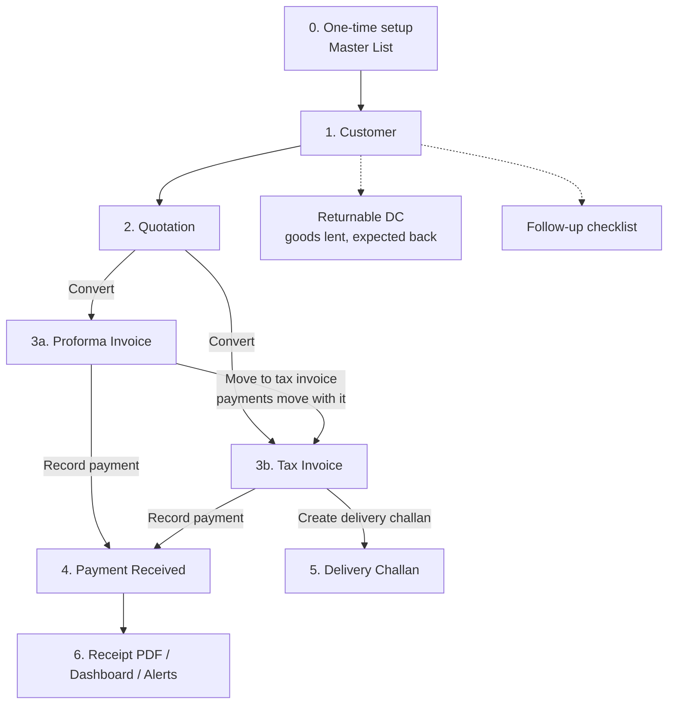
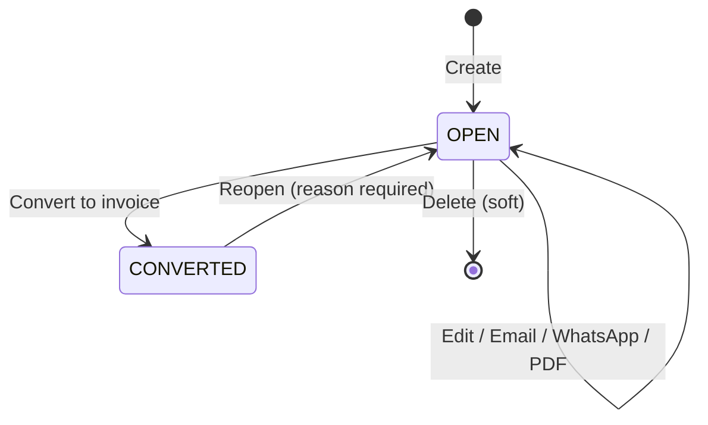
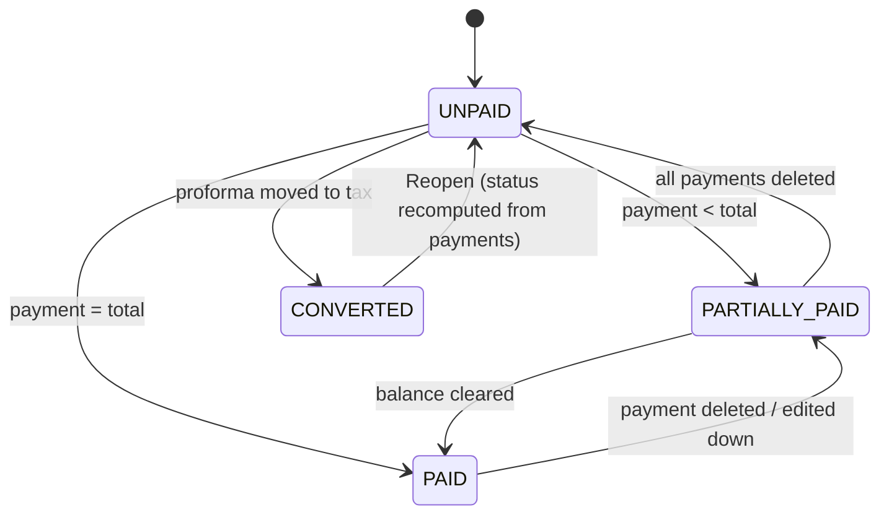
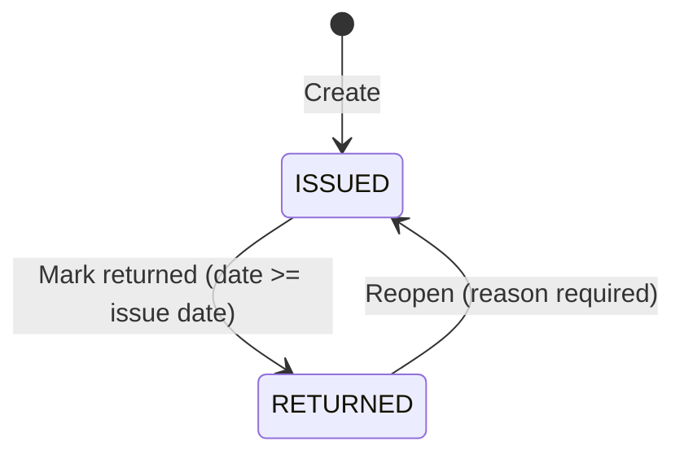

# Sales — End-to-End Workflow

**Scope:** how a sale moves through the Sales module, from setup to cash collected.
**Audience:** sales users, QA, and engineers who need the business flow rather than the route list.
**Source of truth for routes, permissions and error codes:** [`SALES_API.md`](SALES_API.md). If this file and that one disagree, `SALES_API.md` wins — fix this file.
**Master-list setup details:** [`SALES_SETTINGS_FOUNDATION.md`](SALES_SETTINGS_FOUNDATION.md).

---

## 1. The whole flow at a glance

Short form: **Setup → Customer → Quotation → (Proforma) → Tax Invoice → Payments → Delivery Challan**.
Returnable DCs, the checklist and the dashboard sit beside the main chain.

| #   | Stage            | UI route                   | Output                                         | Number format       |
| --- | ---------------- | -------------------------- | ---------------------------------------------- | ------------------- |
| 0   | Master list      | `/sales/master-list`       | Company profile, code formats, document fields | —                   |
| 1   | Customer         | `/sales/customers`         | Customer record                                | `CUS-IN-001`        |
| 2   | Quotation        | `/sales/quotations`        | Priced offer + PDF                             | `TW/QUO/26-27/0001` |
| 3a  | Proforma invoice | `/sales/proforma-invoices` | Advance / pre-bill                             | `TW/PI/26-27/0001`  |
| 3b  | Tax invoice      | `/sales/tax-invoices`      | Legal bill                                     | `TW/IN/26-27/0001`  |
| 4   | Payment received | `/sales/payments`          | Receipt PDF                                    | `TW/PR/26-27/0001`  |
| 5   | Delivery challan | `/sales/delivery-challans` | Goods dispatch note (no prices)                | `TW/DC/26-27/0001`  |
| –   | Returnable DC    | `/sales/returnable-dcs`    | Goods lent, expected back                      | `TW/RDC/26-27/0001` |
| –   | Dashboard        | `/sales/dashboard`         | KPIs, aging, alerts                            | —                   |

Numbers are `<PREFIX>/<FY>/<NNNN>`. The financial year runs April–March; there is one counter per document type per FY.

---

## 2. Stage 0 — One-time setup (Master List)

Open **Master List → Sales Master** (`/sales/master-list`). **Nothing below can be skipped:** no document can be created until the company profile exists.

| Tab                 | Do this                                                                                                                                                                                                          | Permission                                         |
| ------------------- | ---------------------------------------------------------------------------------------------------------------------------------------------------------------------------------------------------------------- | -------------------------------------------------- |
| **Company details** | Seller name, address, GSTIN (sets state; PAN must match), logo (PNG/JPG ≤ 2 MB). Printed on every document.                                                                                                      | `sales.master.write`                               |
| **Numbering**       | Check each code's prefix and width. Optionally set the _last number used_ if migrating from another system (cannot go below a number already issued).                                                            | `sales.master.write`, `sales.running_number.write` |
| **Document fields** | Add the options users pick from on documents: validity, delivery terms, payment terms, HSN codes, bank accounts, company seal, authorized signature, prepared-by, payment modes. Mark one **default** per field. | `sales.master.write`                               |

Notes:

- An option is created **once per field** and is offered on every document type that has the field.
- Each issued document **copies** the values it used, so editing or deleting an option later never changes an old document.
- Seal and signature options take an image upload; the image is kept on documents even after the option is deleted.

---

## 3. Stage 1 — Customer

`/sales/customers` → **New**.

1. Enter company, contact person, email, mobile (`+91` mobile = 10 digits starting 6–9).
2. Enter **GSTIN** — it auto-fills state and PAN. It must be unique among live customers.
3. Add a **billing address** (required by the form) and optionally a shipping address. One default per type.
4. Optionally enter CGST/SGST (same rate, together) or IGST rates — no defaults are applied.
5. Optionally add a bank account. The number is stored encrypted; only a mask is shown. Revealing it needs `sales.customer_bank.reveal` and is audited.
6. Save → code `CUS-<COUNTRY>-<NNN>` is issued and **never changes**.

Rules to remember:

- Only **ACTIVE** customers can get new documents (`CUSTOMER_INACTIVE`).
- A customer with live documents **cannot be deleted**.
- The customer detail page shows a statement of their documents and payments.

---

## 4. Stage 2 — Quotation

`/sales/quotations/new`. The form has a **live A4 preview** on the right, rendered by the server (refreshes ~600 ms after typing stops).

1. Pick the customer. Master-list defaults (validity, delivery terms, bank, seal, signature, prepared by) are pre-filled.
2. Add line items (description, HSN, quantity, price) and optional transport.
3. Save. The server prices it — the browser never recalculates money:
   - line = qty × price; taxable = items + transport;
   - **place of supply** = entered value, else the customer's GST state, else the state of their billing address;
   - same state as your company → **CGST + SGST**; different state → **IGST**;
   - total is rounded to the rupee with a visible `round_off`.
4. A `customer_snapshot` is frozen on the document.

### Quotation lifecycle

Actions on `/sales/quotations/[id]`: **Download PDF, Email, WhatsApp, Edit, Convert to invoice, Delete** — each shown only with its permission.

- **Email** needs SMTP configured (`NOT_CONFIGURED` otherwise). **WhatsApp** returns a `wa.me` share link; there is no Business API provider yet.
- A converted quotation is **locked**. The only way back is **Reopen** with a mandatory reason (1–500 chars). Reopening does **not** delete the invoice already generated from it.

---

## 5. Stage 3 — Invoices (Proforma and Tax)

Both live in one table; the **type is fixed after saving**.

### Three ways to create an invoice

| Path                                                 | When                                    | Result                                                                 |
| ---------------------------------------------------- | --------------------------------------- | ---------------------------------------------------------------------- |
| Direct: `/sales/invoices/new/proforma` or `/new/tax` | No quotation exists                     | Invoice with no source                                                 |
| **Convert quotation** → proforma or tax              | Customer accepted the quote             | Quotation becomes `CONVERTED` (locked)                                 |
| **Move to tax invoice** from a proforma              | Advance was taken, now billing formally | Proforma becomes `CONVERTED`; **its payments move to the tax invoice** |

Conversions run in **one transaction**. Deleting the invoice that was converted _to_ reopens its source.

### Invoice fields beyond the quotation

Invoice date, **due date** (cannot be before the invoice date — `DUE_DATE_BEFORE_INVOICE_DATE`), payment terms (defaults from the master list of that type).

### Invoice status (driven by payments)

- A **tax invoice's status is payment-driven only** — it has no reopen.
- A **proforma** can be reopened after conversion; it returns to `UNPAID` / `PARTIALLY_PAID` / `PAID` based on what it holds (its payments stay on the tax invoice). `NOT_A_PROFORMA` (422) if you try on a tax invoice; `NOT_CONVERTED` (409) if it was never converted.

Actions on `/sales/invoices/[id]`: **Record payment, Move to tax invoice, Create delivery challan, Email, WhatsApp, Edit, Delete**, plus the payments list and the received/balance summary.

---

## 6. Stage 4 — Payments Received

Two entry points: the **Record payment** button on an invoice (invoice pre-selected), or `/sales/payments` → record (pick customer, then one of their open invoices).

1. Choose **payment date**, **amount**, **mode** (a `PAYMENT_MODE` master option, or "Other" typed), optional reference and **due date**.
2. The amount is checked against the balance as you type; the server enforces it under a row lock (`PAYMENT_EXCEEDS_BALANCE`).
3. Save → number `TW/PR/<FY>/<NNNN>` is issued by payment date; the invoice's `amount_received` and status update in the same transaction.

Rules:

- A payment belongs to **one** invoice and **cannot be moved** — delete it and record again.
- Numbers are **never reused** after a delete.
- Payments on a proforma travel with it when it is moved to a tax invoice.
- Needs `sales.invoice_payment.write` (Sales Manager by default; Sales Executive can read only).

### Overdue tracking

A payment/invoice is **overdue** while the invoice is `UNPAID` or `PARTIALLY_PAID` and its due date (payment's `dueDate`, else the invoice's) has passed. The Payments page shows:

- an alert banner (overdue payments, overdue invoices, overdue balance) with **Filter overdue only**;
- an overdue badge and `overdueDays` on each row;
- filters for payment-date range and due-date range.

Actions per payment: **View receipt, Download receipt PDF, Edit, Delete.**

---

## 7. Stage 5 — Delivery Challan

Created from a tax invoice (**Create delivery challan** button) or standalone at `/sales/delivery-challans/new`.

- Items and quantities only — **no prices, no tax**.
- Same live preview, PDF, email and WhatsApp as other documents.
- Carries HSN, bank, seal, signature and prepared-by from the master list.

---

## 8. Side flow — Returnable Delivery Challan

For goods **lent** to a customer and expected back (demo units, tools, samples). Not part of the billing chain.

- Fields: recipient, issue date, **expected return date** (≥ issue date, else `RETURN_DATE_BEFORE_ISSUE_DATE`), purpose, taken by, goods (description, quantity), seal, signature, prepared by, terms.
- A pending RDC past its expected return date shows an **overdue** badge (`overdueDays`).
- A **returned** RDC cannot be edited or returned again (`RDC_RETURNED`).

---

## 9. Side flow — Checklist and Dashboard

- **Checklist** (`/sales/action-items`, shown on the dashboard): add follow-ups, mark **complete**, **reopen**, delete.
- **Dashboard** (`/sales/dashboard`, `sales.dashboard.read`): KPIs, needs-attention alerts, revenue vs collections, pipeline, receivables aging, top clients, recent activity. Figures are live from customers, quotations, invoices and payments.

---

## 10. Typical scenarios

### A. Quote → advance → final bill → delivery

1. Create customer → create quotation → email it.
2. Customer accepts → **Convert** quotation to **proforma**.
3. Customer pays an advance → **Record payment** on the proforma (`PARTIALLY_PAID`).
4. Work done → **Move to tax invoice** (payments move across; proforma locks).
5. Customer pays the balance → invoice `PAID`.
6. **Create delivery challan** from the tax invoice.

### B. Quote → straight to tax invoice

Create customer → quotation → **Convert** to **tax invoice** → record payments as they arrive.

### C. Walk-in sale, no quotation

**New tax invoice** directly → record payment → (optional) delivery challan.

### D. Wrong conversion

- Quotation converted by mistake → **Reopen** with a reason (the generated invoice stays; delete it separately if unwanted — deleting it also reopens the source).
- Proforma moved by mistake → **Reopen** the proforma (tax invoice stays).

### E. Payment mistake

Wrong amount/date/mode → **Edit payment**. Wrong invoice → **Delete payment** and record it on the right invoice.

### F. Equipment loan

Create **Returnable DC** → customer returns goods → **Mark returned** (with date).

---

## 11. Who can do what

| Capability                                                 | Sales Manager |         Sales Executive         |
| ---------------------------------------------------------- | :-----------: | :-----------------------------: |
| Dashboard, customers (read/write), checklist               |       ✓       |                ✓                |
| Create/edit/send quotations, invoices, DCs, returnable DCs |       ✓       |                ✓                |
| Convert quotation / move proforma to tax                   |       ✓       | ✓ (needs `sales.invoice.write`) |
| Read payments received                                     |       ✓       |                ✓                |
| **Record / edit / delete payments**                        |       ✓       |                —                |
| **Delete** any document or customer                        |       ✓       |                —                |
| Reveal customer bank account (audited)                     |       ✓       |                —                |
| Master list write, running numbers                         |       ✓       |                —                |

Full permission codes: [`SALES_API.md`](SALES_API.md) §2.

---

## 12. Cross-cutting rules (apply at every stage)

| Rule            | Detail                                                                           |
| --------------- | -------------------------------------------------------------------------------- |
| **Soft delete** | Deleted documents keep their numbers; numbers are not reused.                    |
| **Money**       | `Decimal` end to end; the UI shows server strings, never recomputes.             |
| **Audit**       | Every write is one transaction with its audit row; reopen reasons are stored.    |
| **Snapshots**   | Customer and master-list values are frozen on each document.                     |
| **Org scoped**  | Sales is `@OrgScoped()` + exact `@RequirePermission()`, not team-scoped.         |
| **Preview**     | `POST /preview` returns `{ number, html, totals }`, stores and reserves nothing. |
| **PDF**         | Rendered server-side with logo, seal and signature.                              |

---

## 13. Common errors

| Code                                | Meaning                                       | Fix                                        |
| ----------------------------------- | --------------------------------------------- | ------------------------------------------ |
| `CUSTOMER_INACTIVE`                 | Customer is not ACTIVE                        | Reactivate the customer                    |
| `PLACE_OF_SUPPLY_REQUIRED`          | No GST state or billing address               | Add an address or enter place of supply    |
| `INVALID_MASTER_ITEM`               | Seal/signature/mode option is the wrong field | Pick a valid option                        |
| `PAYMENT_MODE_REQUIRED`             | Neither mode option nor typed mode            | Choose a mode                              |
| `PAYMENT_EXCEEDS_BALANCE`           | Payment > invoice balance                     | Reduce amount                              |
| `DUE_DATE_BEFORE_INVOICE_DATE`      | Due date earlier than invoice date            | Fix the date                               |
| `NOT_CONVERTED` / `NOT_A_PROFORMA`  | Invalid reopen target                         | Reopen only converted quotations/proformas |
| `RUNNING_NUMBER_IN_USE`             | Counter set below an issued number            | Use a higher number                        |
| `RDC_RETURNED` / `RDC_NOT_RETURNED` | Wrong RDC state for the action                | Reopen or mark returned first              |
| `NOT_CONFIGURED`                    | SMTP not set up                               | Configure mail, or use WhatsApp link / PDF |

---

## 14. Not built yet

Customer contacts, leads, sales orders, credit notes, a WhatsApp Business provider. Sales Orders and Credit Notes will slot between quotation and invoice, and after invoice, respectively; update this file when they land.
